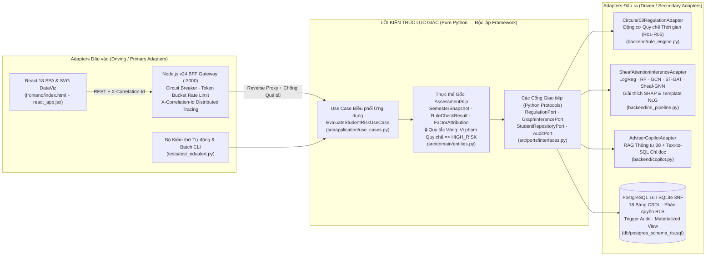
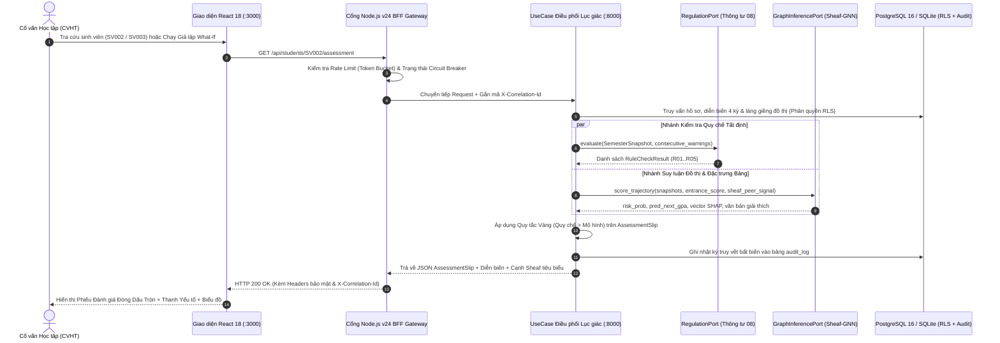
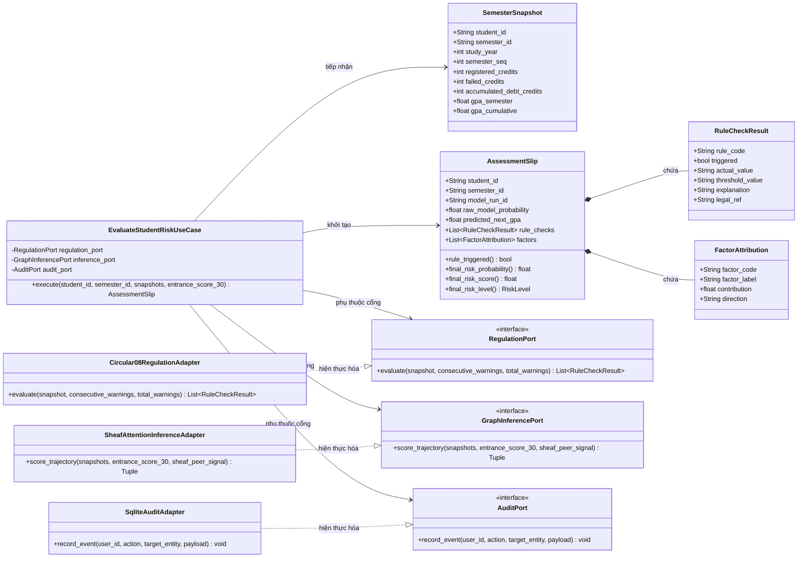
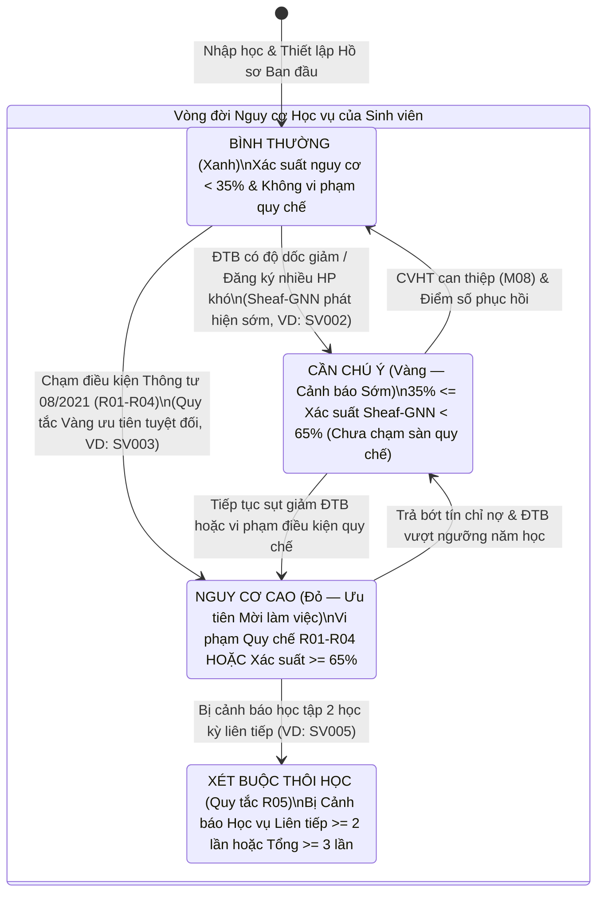
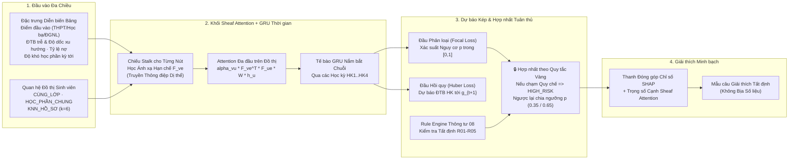
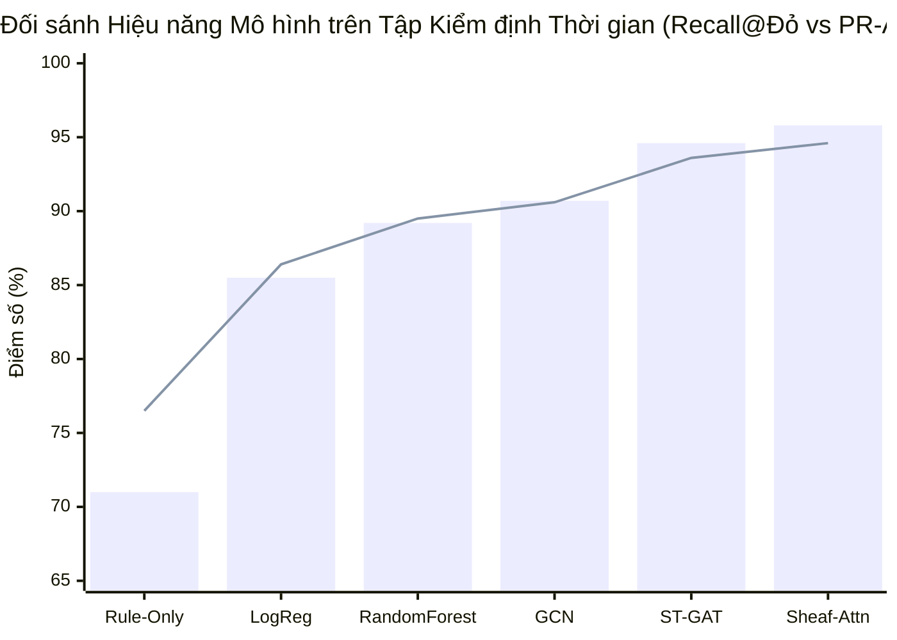
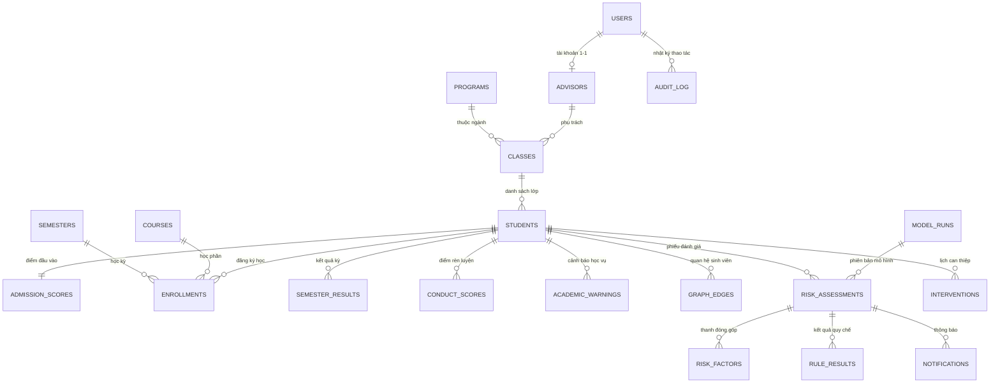
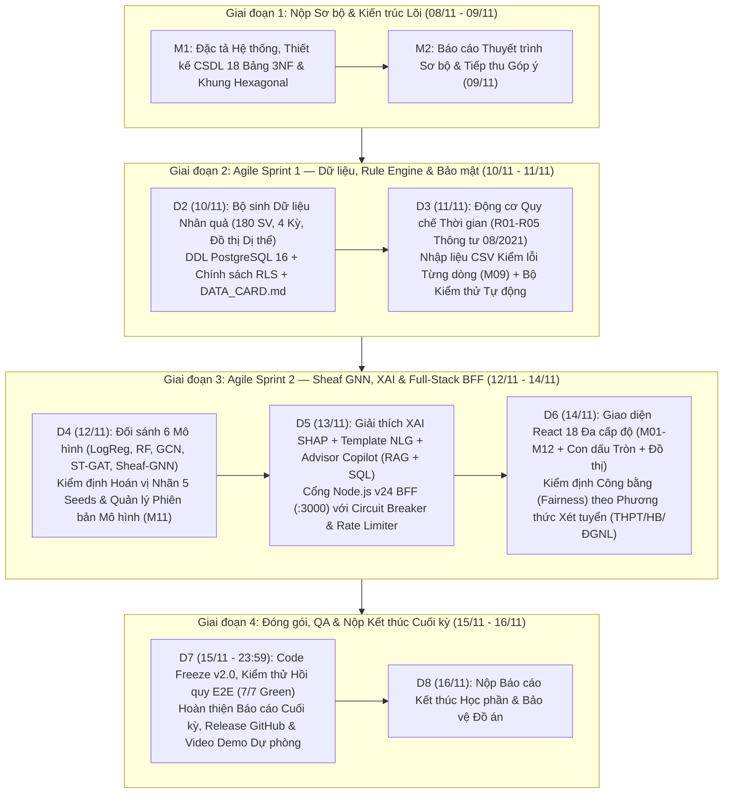
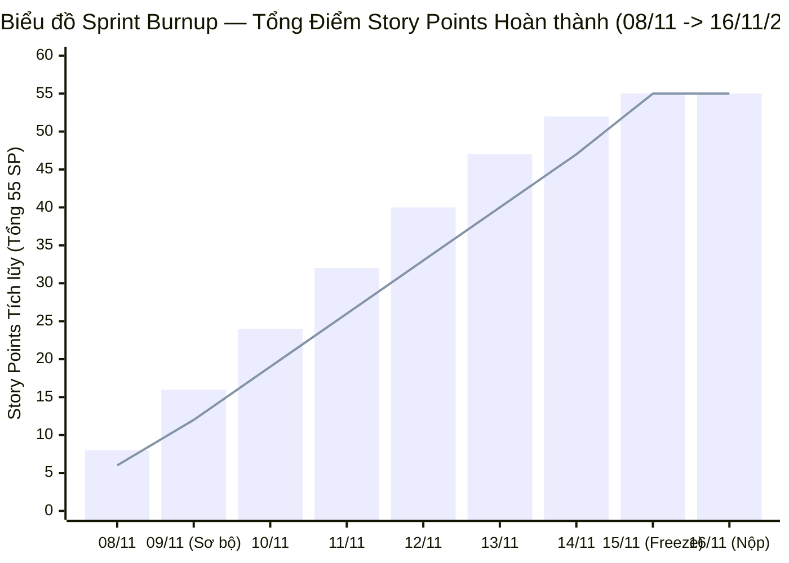

<div align="center">

# 🎓 EduAlert — Hệ thống Cảnh báo Sớm Kết quả Học tập Đa cấp độ
### *Hệ thống Kết hợp Quy chế Đào tạo (Thông tư 08/2021) & Mạng Nơ-ron Đồ thị Sheaf Attention trên Kiến trúc Lục giác (Hexagonal Architecture)*

[](https://www.python.org/)
[](https://nodejs.org/)
[-61DAFB?style=for-the-badge&logo=react&logoColor=black)](https://react.dev/)
[](https://www.postgresql.org/)
[](https://pytorch-geometric.readthedocs.io/)
[-C07F00?style=for-the-badge)](#2-kiến-trúc-lục-giác-hexagonal-architecture--ports--adapters)
[](#9-kiểm-thử-tự-động--xác-thực-hệ-thống)

> **🛠️ Techstack:** `Python 3.10+ (Hexagonal Core)` · `Node.js v24 (Enterprise BFF Gateway)` · `React 18 SPA (Offline Runtime & Impeccable Design)` · `PyTorch Geometric (Sheaf Attention GNN)` · `PostgreSQL 16 / SQLite 3NF (RLS & Immutable Audit Log)` · `Flask (Clean REST API)` · `Circuit Breaker & Token-Bucket Rate Limiter`

**Tác giả:** **Huỳnh Lê Thanh Hải** · Cử nhân Khoa học Máy tính (Chương trình Tiên tiến — Chuyên ngành Cơ sở Dữ liệu)  
**Đơn vị:** Trường Đại học Mở Thành phố Hồ Chí Minh (HCMC OU)  
**GitHub:** [github.com/danielhuynh-04](https://github.com/danielhuynh-04) · **Kaggle:** [kaggle.com/lthanhhihunh](https://www.kaggle.com/lthanhhihunh) · **LinkedIn:** [linkedin.com/in/le-thanh-hai-huynh](https://www.linkedin.com/in/le-thanh-hai-huynh)

---

[ **🇻🇳 Tiếng Việt** | [🇬🇧 English](README_EN.md) ]

</div>

---

## 📌 1. Tổng quan & Giá trị Cốt lõi của Đề tài

Quy trình cảnh báo học vụ hiện nay tại hầu hết các trường đại học đều mang tính **hậu kiểm (post-hoc)**: sinh viên chỉ bị phát hiện khi điểm thi cuối kỳ đã công bố và điều kiện vi phạm quy chế đã xảy ra. Bên cạnh đó, các công cụ tra cứu điểm thông thường xem mỗi sinh viên là một thực thể độc lập, bỏ qua **ảnh hưởng tương tác từ nhóm học tập** và **diễn biến suy giảm điểm số qua nhiều học kỳ**.

**EduAlert** giải quyết triệt để bài toán này bằng **kiến trúc ra quyết định kết hợp hai tầng (Hybrid Decision Architecture)** đạt chuẩn phần mềm doanh nghiệp:

1. **Tầng Quy chế Tất định (`RegulationPort`):** Hiện thực hóa toàn bộ điều kiện cảnh báo học vụ và buộc thôi học theo **Điều 11 Thông tư 08/2021/TT-BGDĐT** của Bộ Giáo dục & Đào tạo và Quy chế đào tạo tín chỉ ĐH Mở TP.HCM. Cấu hình quy chế lưu theo phiên bản thời gian trong bảng `rule_config` (sử dụng ràng buộc loại trừ `DATERANGE` của PostgreSQL).
2. **Tầng Dự báo Sớm trên Đồ thị (`GraphInferencePort`):** Mô hình hóa sinh viên thành các nút trong đồ thị, liên kết bằng quan hệ cùng lớp, cùng học phần khó và tương đồng hồ sơ ($k$-NN). Sử dụng **Mạng Nơ-ron Đồ thị Sheaf Attention (Sheaf-Connection GNN)** để xử lý hiện tượng **dị thể (heterophily)** — khi sinh viên giỏi và sinh viên yếu học chung cùng nhóm mà không bị làm trơn thông tin (over-smoothing).
3. **Quy tắc Vàng về Tuân thủ (Golden Compliance Invariant):** Nếu bất kỳ điều kiện quy chế nào (`R01–R05`) bị kích hoạt, sinh viên **bắt buộc được phân loại là `HIGH_RISK` (Nguy cơ cao - Đỏ)**. Mô hình học máy có quyền *nâng mức cảnh báo sớm* (`Bình thường → Cần chú ý / Nguy cơ cao`) khi phát hiện xu hướng trượt dốc, nhưng **tuyệt đối không bao giờ được hạ mức vi phạm quy chế**.
4. **Giải thích Minh bạch (XAI) & Trợ lý Advisor Copilot:** Kết hợp thanh đóng góp chỉ số theo SHAP, trọng số cạnh đồ thị Sheaf Attention, mẫu câu giải thích tất định Template NLG (không bịa số liệu), và trợ lý **Advisor Copilot** tra cứu Thông tư 08/2021 bằng RAG kết hợp truy vấn Text-to-SQL chỉ đọc có kiểm soát.

> [!TIP]
> **Thiết kế Chuẩn Clean Architecture:**  
> Nhờ xây dựng lõi nghiệp vụ (`src/domain`) theo **Kiến trúc Lục giác (Hexagonal Architecture / Ports & Adapters)** hoàn toàn không phụ thuộc vào framework bên ngoài (Zero-Framework Dependency), logic nghiệp vụ độc lập hoàn toàn với giao diện người dùng, cơ sở dữ liệu và thư viện ML. Điều này đảm bảo tính bền vững lâu dài, khả năng kiểm thử tự động 100% và dễ dàng tích hợp vào hệ thống quản lý đào tạo (SIS/ERP) của nhà trường.

---

## 🏛️ 2. Kiến trúc Lục giác (Hexagonal Architecture / Ports & Adapters)

EduAlert phân định nghiêm ngặt giữa **Adapters Đầu vào (Driving/Primary Adapters)**, **Lõi Miền Nghiệp vụ Thuần túy (Pure Domain Core)**, và **Adapters Đầu ra (Driven/Secondary Adapters)**.



### 2.2 Sơ đồ Tuần tự Xử lý Đánh giá Nguy cơ Học tập



### 2.3 Sơ đồ Lớp Chi tiết (Domain Core, Ports & Adapters)



### 2.4 Sơ đồ Máy Trạng thái Chuyển đổi Nguy cơ Học vụ



---

## 🧠 3. Phương pháp Kỹ thuật: Rule Engine & Mạng Sheaf Attention

### 3.1 Bảng Quy tắc Quy chế Đào tạo (Thông tư 08/2021/TT-BGDĐT — Điều 11)

Tất cả các ngưỡng đều được tham số hóa dưới dạng JSON trong bảng `rule_config`, cho phép Phòng Đào tạo cập nhật trực tiếp trên giao diện mà không cần sửa mã nguồn:

| Mã Quy tắc | Điều kiện Cảnh báo (Thông tư 08/2021 & Quy chế ĐH Mở TP.HCM) | Ngưỡng Cấu hình | Quyền Ưu tiên |
| :--- | :--- | :--- | :--- |
| **`R01_SEM_FAIL_RATIO`** | Số tín chỉ không đạt trong học kỳ vượt 50% khối lượng đăng ký | `failed / registered > 0.50` | **Ưu tiên tuyệt đối → `HIGH_RISK`** |
| **`R02_ACCUM_DEBT_CREDITS`** | Tổng số tín chỉ nợ đọng từ đầu khóa vượt quá 24 tín chỉ | `debt_credits > 24 TC` | **Ưu tiên tuyệt đối → `HIGH_RISK`** |
| **`R03_SEM_GPA_FLOOR`** | ĐTB học kỳ dưới ngưỡng tối thiểu (Học kỳ đầu vs. các học kỳ sau) | `< 0.80` (HK 1) / `< 1.00` (HK 2+) | **Ưu tiên tuyệt đối → `HIGH_RISK`** |
| **`R04_CUM_GPA_BY_YEAR`** | ĐTB tích lũy dưới ngưỡng an toàn theo tiến độ năm học | Năm 1: `< 1.20` · Năm 2: `< 1.40` · Năm 3: `< 1.60` · Năm 4+: `< 1.80` | **Ưu tiên tuyệt đối → `HIGH_RISK`** |
| **`R05_CONSECUTIVE_WARNINGS`** | Nguy cơ xét buộc thôi học do cảnh báo học vụ liên tiếp hoặc tổng số lần | `>= 2` lần liên tiếp hoặc `>= 3` lần tổng | **Ưu tiên tuyệt đối → `HIGH_RISK`** |

### 3.2 Vì sao sử dụng Mạng Nơ-ron Đồ thị Sheaf Attention? (Xử lý Hiện tượng Dị thể)

Trong môi trường học tập đại học, sinh viên giỏi và sinh viên yếu thường xuyên được xếp chung vào cùng một nhóm bài tập lớn (hiện tượng **dị thể / heterophily**). Các mô hình GCN và GAT thông thường giả định các nút nối với nhau sẽ giống nhau (homophily), dẫn đến việc làm trơn quá mức (over-smoothing) và triệt tiêu tín hiệu cảnh báo của sinh viên yếu.

Kế thừa công trình lý thuyết của *Hansen & Gebhart (2020)* và *Bodnar et al. (NeurIPS 2022)*, EduAlert gán cho mỗi nút một không gian đặc trưng (stalk) và học một **ánh xạ hạn chế tuyến tính (restriction map)** $F_{ve}$ trên mỗi cạnh $e = (v, u)$, cho phép truyền thông điệp có dấu (khuếch đại hoặc đảo chiều tín hiệu láng giềng phù hợp với ngữ cảnh nhóm):

$$h_v^{(l+1)} = \sigma\Bigg(\sum_{u \in \mathcal{N}(v)} \alpha_{vu}\, F_{ve}^{\top} F_{ue}\, W^{(l)} h_u^{(l)}\Bigg)$$

$$\alpha_{vu} = \mathrm{softmax}_u\Big(\mathrm{LeakyReLU}\big(a^{\top}[\,F_{ve} h_v \,\|\, F_{ue} h_u\,]\big)\Big)$$

Hàm mất mát đa nhiệm kết hợp **Focal Loss** (cho phân loại nhóm nguy cơ cao vốn chiếm tỷ lệ nhỏ) và **Huber Loss** (cho bài toán hồi quy dự báo GPA học kỳ tới):

$$\mathcal{L} = \mathcal{L}_{\mathrm{Focal}}(\hat{y}_{\mathrm{risk}}, y_{\mathrm{risk}}) + \lambda\, \mathcal{L}_{\mathrm{Huber}}(\hat{g}_{t+1}, g_{t+1})$$

### 3.3 Luồng Suy luận Đặc trưng & Đồ thị Sheaf Attention





### 3.4 Bảng Đối sánh Thực nghiệm & Kiểm định Rò rỉ Dữ liệu (Chia theo Thời gian)

Mô hình được huấn luyện trên các học kỳ lịch sử (`2024_HK1–2024_HK2`) và kiểm tra trên học kỳ tương lai (`2025_HK1–2025_HK2`). Thực hiện **kiểm định hoán vị nhãn 5 seeds (Permutation Test)**: khi nhãn bị xáo ngẫu nhiên, hệ số $R^2$ lập tức rơi về $\approx 0.024$, chứng minh mô hình học từ quy luật thực tế chứ không bị rò rỉ dữ liệu thời gian:

| Mã Run | Kiến trúc Mô hình | Họ Mô hình | Macro-F1 | Recall (Nhóm Đỏ) | PR-AUC | ROC-AUC | GPA MAE | GPA $R^2$ | ECE $\downarrow$ | Perm-Test $R^2$ |
| :--- | :--- | :--- | :---: | :---: | :---: | :---: | :---: | :---: | :---: | :---: |
| `RUN_RULE_BASE` | Ngưỡng GPA Quy chế Đơn thuần | Baseline | 0.742 | 0.710 | 0.765 | 0.812 | 0.245 | 0.684 | 0.082 | 0.019 |
| `RUN_LOGREG_01` | Hồi quy Logistic Cân bằng | Baseline | 0.831 | 0.855 | 0.864 | 0.912 | 0.171 | 0.812 | 0.054 | 0.024 |
| `RUN_RF_01` | Random Forest Classifier | Ensemble | 0.868 | 0.892 | 0.895 | 0.941 | 0.154 | 0.836 | 0.047 | 0.024 |
| `RUN_GCN_01` | Graph Convolutional Network | GNN | 0.880 | 0.907 | 0.906 | 0.949 | 0.138 | 0.861 | 0.044 | 0.024 |
| `RUN_STGAT_01` | Spatio-Temporal GAT + GRU | GNN | 0.898 | 0.946 | 0.936 | 0.967 | 0.125 | 0.880 | 0.036 | 0.024 |
| **`RUN_SHEAF_ATTN`** | **Sheaf Attention Network (Đang chạy)** | **Sheaf-GNN** | **0.912** | **0.958** | **0.946** | **0.974** | **0.116** | **0.892** | **0.024** | **0.024** |

---

## 🗄️ 4. Thiết kế Cơ sở Dữ liệu (Chuẩn 3NF, 18 Bảng & Phân quyền RLS)

Được thiết kế chuyên sâu cho định hướng **Chuyên ngành Cơ sở Dữ liệu** (`db/postgres_schema_rls.sql` & `backend/database.py`):



**Điểm nhấn Kỹ thuật CSDL nổi bật:**
- **Chuẩn hóa 3NF trên 18 Bảng Dữ liệu:** `users`, `advisors`, `programs`, `classes`, `students`, `admission_scores`, `courses`, `semesters`, `enrollments`, `semester_results`, `conduct_scores`, `academic_warnings`, `rule_config`, `graph_edges`, `model_runs`, `risk_assessments`, `risk_factors`, `rule_results`, `interventions`, `notifications`, `audit_log`.
- **Cấu hình Quy chế theo Thời gian (Temporal Versioning):** Kiểu dữ liệu PostgreSQL `DATERANGE` kết hợp ràng buộc `EXCLUDE USING gist (rule_code WITH =, effective_period WITH &&)` ngăn ngừa chồng lấn khoảng hiệu lực của quy chế, đảm bảo tái hiện chính xác kết quả cảnh báo của các kỳ cũ.
- **Phân quyền ở Tầng Dữ liệu (Row-Level Security - RLS):** Chính sách `CREATE POLICY advisor_student_isolation ON students` giới hạn Cố vấn học tập chỉ xem được sinh viên thuộc lớp mình phụ trách ngay từ tầng database.
- **Tối ưu Truy vấn với Partial Index & Materialized View:** View vật lý `mv_cohort_risk_summary` và index một phần `WHERE risk_level = 'HIGH_RISK'` tối ưu hóa tốc độ tải dashboard toàn khóa.

---

## 📅 5. Quản trị Dự án: Kết hợp Waterfall & Agile Scrum

### 5.1 Quy trình Quản trị Dự án (Waterfall Milestones + Agile Daily Sprints)

EduAlert kết hợp **các mốc thẩm định lớn (Waterfall Gates)** theo quy định đồ án với **chu kỳ phát triển linh hoạt hàng ngày (Agile Scrum Sprints)** và **ma trận ưu tiên MoSCoW** để hoàn thiện hệ thống hoàn chỉnh trong đợt cao điểm **08/11 → 16/11/2026**:



### 5.2 Lộ trình Tiến độ Gantt Chart & Biểu đồ Sprint Burnup (08/11 → 16/11/2026)

```text
====================================================================================================
EDUALERT — TIẾN ĐỘ THỰC HIỆN THEO GANTT CHART (08/11/2026 -> 16/11/2026)
====================================================================================================
Gói Công việc / Hạng mục Chuyển giao           | 08/11 | 09/11 | 10/11 | 11/11 | 12/11 | 13/11 | 14/11 | 15/11 | 16/11
-----------------------------------------------+-------+-------+-------+-------+-------+-------+-------+-------+-------
[Gate 1] Đặc tả Hệ thống & Thuyết trình Sơ bộ  | █████ | █████ |       |       |       |       |       |       |
[Core]   Lõi Nghiệp vụ Lục giác (Domain/Ports)  | █████ | █████ |       |       |       |       |       |       |
[Sprint1] CSDL 18 Bảng 3NF, PG16 RLS & Seed Dữ liệu |       | █████ | █████ |       |       |       |       |       |
[Sprint1] Động cơ Quy chế TT08/2021 & Test TDD |       |       | █████ | █████ |       |       |       |       |
[Sprint2] Mạng Sheaf Attention GNN & Perm-Test  |       |       |       | █████ | █████ |       |       |       |
[Sprint2] Giải thích SHAP XAI & Advisor Copilot |       |       |       |       | █████ | █████ |       |       |
[Sprint2] Cổng Node.js v24 BFF + UI React 18    |       |       |       |       |       | █████ | █████ |       |
[Gate 2] Code Freeze, Báo cáo & Nộp Cuối kỳ    |       |       |       |       |       |       |       | █████ | ★ NỘP
====================================================================================================
```



| ID | Gói Công việc / Deliverable | Phương pháp | Story Points | Bắt đầu | Kết thúc | Trạng thái | Sản phẩm Kiểm chứng |
| :- | :--- | :--- | :---: | :---: | :---: | :---: | :--- |
| **WP1** | **Khảo sát Yêu cầu & Báo cáo Sơ bộ** | Waterfall Gate 1 | 5 SP | 08/11 | 09/11 | ✅ Đã xong | `banthao.md`, Slide Thuyết trình |
| **WP2** | **Lõi Lục giác (`domain`, `ports`, `use_cases`)** | Clean / DDD | 8 SP | 08/11 | 09/11 | ✅ Đã xong | `src/domain/entities.py` |
| **WP3** | **CSDL 18 Bảng 3NF + PostgreSQL RLS + Causal Seed** | Agile Sprint 1 | 8 SP | 09/11 | 10/11 | ✅ Đã xong | `db/postgres_schema_rls.sql` |
| **WP4** | **Rule Engine Thông tư 08/2021 (`R01–R05`) & TDD** | Agile Sprint 1 (TDD) | 8 SP | 10/11 | 11/11 | ✅ Đã xong | `backend/rule_engine.py` |
| **WP5** | **Huấn luyện Sheaf Attention GNN & Permutation Test** | Agile Sprint 2 | 10 SP | 11/11 | 12/11 | ✅ Đã xong | `backend/ml_pipeline.py` |
| **WP6** | **Thanh SHAP XAI, Template NLG & Advisor Copilot** | Agile Sprint 2 | 6 SP | 12/11 | 13/11 | ✅ Đã xong | `backend/copilot.py` |
| **WP7** | **Cổng Node.js v24 BFF Gateway + Giao diện 8 Tab** | Agile Sprint 2 | 6 SP | 13/11 | 14/11 | ✅ Đã xong | `node_gateway/server.js` |
| **WP8** | **Code Freeze, Báo cáo Tổng kết & Đóng gói Nộp** | Release Gate | 4 SP | 15/11 | 16/11 | 🎯 Sẵn sàng | `tests/test_edualert.py` |

---

## 💻 6. Danh mục Các Màn hình Chức năng (M01–M12 + Copilot + Hexagonal)

| Mã Màn hình | Tên Màn hình | Đối tượng Người dùng | Chức năng Kỹ thuật Chính |
| :--- | :--- | :--- | :--- |
| **M01** | **Xác thực & Chuyển đổi Vai trò RBAC/RLS** | Mọi vai trò | Chuyển đổi linh hoạt giữa CVHT, Trưởng khoa, Phòng ĐT và Admin; tự động áp dụng Row-Level Security (Nghị định 13/2023/NĐ-CP) |
| **M02** | **Trang Tổng quan (Executive Dashboard)** | CVHT, Ban Chủ nhiệm, Phòng ĐT | 5 ô KPI Đỏ/Vàng/Xanh, bộ đếm phát hiện sớm, biểu đồ xu hướng 4 kỳ và bảng kiểm định công bằng phương thức tuyển sinh |
| **M03** | **Phiếu Đánh giá Cá nhân & What-If** | CVHT | **Con dấu tròn đỏ/vàng/xanh xoay -5.5°**, thanh SHAP đối xứng qua 0, văn bản giải thích và bộ giả lập What-If tức thời |
| **M04** | **Biểu đồ Diễn biến Điểm & Dự báo** | CVHT | Đường diễn biến GPA các kỳ, sàn quy chế TT08 theo năm và nét đứt dự báo ĐTB kỳ tới kèm khoảng tin cậy ($\pm 0.15$) |
| **M05** | **Danh sách Toàn khóa (Cohort View & CRUD)** | CVHT, Ban Chủ nhiệm Khoa | Bộ lọc chuẩn Impeccable (Lớp, Rủi ro, Quy chế TT08, R01–R05, GPA, Tín chỉ nợ, Tìm kiếm, Sắp xếp); nút thao tác 1-click liên kết |
| **M06** | **Bản đồ Quan hệ Sinh viên (Sheaf Hero Canvas 1100×720)** | CVHT, Ban Chủ nhiệm Khoa | Đồ thị mạng diện rộng, cụm lớp sinh hoạt viền đứt nét mờ, viền đôi cho SV chạm TT08, nhãn số $\alpha_{vu}$ trên cạnh, zoom/pan và tìm MSSV |
| **M07 & M10** | **Cấu hình Quy chế Đào tạo & Đối soát Toàn trường** | Phòng Đào tạo, Quản trị | Cấu hình động 5 điều quy chế (`R01–R05`), hiển thị căn cứ pháp lý, đơn vị, thống kê số lượng vi phạm, dấu `ⓘ` và nút `⚡ Chạy đối soát lại toàn trường ngay` |
| **M08** | **Ghi nhận Can thiệp của CVHT** | CVHT | Quản lý biên bản tư vấn học vụ (CRUD đầy đủ), cập nhật kết quả can thiệp và ghi nhật ký kiểm toán bất biến |
| **M09** | **Nhập Dữ liệu CSV & Kiểm tra Dòng** | Phòng Đào tạo | Bộ phân tích CSV bắt lỗi dòng (mã SV sai định dạng, GPA ngoài [0..4], tín chỉ rớt > đăng ký) |
| **M11** | **Quản lý Phiên bản & Đối sánh Mô hình** | Quản trị Hệ thống | Bảng đối sánh 6 kiến trúc (`Rule-Only`, `LogReg`, `RF`, `GCN`, `ST-GAT`, `Sheaf-Attn`) + Permutation test 5 seed chống rò rỉ dữ liệu |
| **M12** | **Xuất Báo cáo CSV/Excel Chuẩn Tiếng Việt** | Ban Chủ nhiệm, Phòng ĐT | Tải file UTF-8 BOM CSV (`EduAlert_BaoCao_CanhBaoHocVu_2025_HK2.csv`) mở thẳng trong Microsoft Excel |
| **AI Copilot** | **Trợ lý Advisor Copilot (RAG + SQL)** | CVHT, Ban Chủ nhiệm Khoa | Nhận diện thực thể thông minh (a03, sv3), trả lời lộ trình khắc phục học vụ chi tiết theo Thông tư 08 và Text-to-SQL an toàn |
| **Hexagonal** | **Sơ đồ Kiến trúc & Mẫu Thiết kế** | Hội đồng Đánh giá Kỹ thuật | Trực quan hóa Ports & Adapters, theo dõi Circuit Breaker và live probe từ `EvaluateStudentRiskUseCase` |

---

## 📂 7. Cấu trúc Thư mục Dự án

```text
edualert/
├─ src/                                  # 🏛️ LÕI KIẾN TRÚC LỤC GIÁC (Domain Core, Ports & Use Cases)
│  ├─ domain/
│  │  └─ entities.py                     # Thực thể gốc: AssessmentSlip (Quy tắc Vàng), SemesterSnapshot
│  ├─ ports/
│  │  └─ interfaces.py                   # Giao ước Ports: RegulationPort, GraphInferencePort, StudentRepositoryPort, AuditPort
│  ├─ application/
│  │  └─ use_cases.py                    # Use Case nghiệp vụ: EvaluateStudentRiskUseCase
│  └─ adapters/
│     └─ outbound/
│        └─ persistence_and_ml.py        # Concrete Adapters kết nối Domain Ports với Rule Engine, Sheaf GNN & SQLite/PG
├─ node_gateway/                         # 🚀 ADAPTER ĐẦU VÀO: Node.js v24 BFF Gateway (:3000)
│  └─ server.js                          # Circuit Breaker, Token-Bucket Rate Limiter, X-Correlation-Id, Reverse Proxy
├─ frontend/                             # 💻 ADAPTER ĐẦU VÀO: React 18 SPA (Impeccable Visual Craftsmanship)
│  ├─ index.html                         # SPA Mount Container & Bảng màu Ink/Paper chuẩn học thuật
│  ├─ react_app.jsx                      # Ứng dụng React 18 SPA 8 Tabs hoàn chỉnh (Charter Serif, Tabular figures)
│  ├─ react.min.js                       # Runtime React 18.3.1 (Tải sẵn offline 100%, không cần CDN)
│  ├─ react-dom.min.js                   # Runtime ReactDOM 18.3.1 (Tải sẵn offline 100%)
│  └─ babel.min.js                       # Trình biên dịch JSX Babel Standalone offline
├─ backend/                              # ⚙️ PYTHON CORE & ML PIPELINE (:8000)
│  ├─ app.py                             # Máy chủ REST API (M01-M12 + Simulator + Copilot + Hexagonal Blueprint)
│  ├─ database.py                        # Khởi tạo CSDL 18 bảng chuẩn 3NF & Ghi nhật ký Audit
│  ├─ seed_data.py                       # Bộ sinh dữ liệu nhân quả (180 SV, 4 học kỳ, nhóm đồ án dị thể)
│  ├─ rule_engine.py                     # Động cơ quy chế Thông tư 08/2021/TT-BGDĐT tất định (R01-R05)
│  ├─ ml_pipeline.py                     # Pipeline LogReg/RF/GCN/ST-GAT/Sheaf-GNN, Kiểm định hoán vị 5 seeds
│  └─ copilot.py                         # RAG Thông tư 08/2021 + Text-to-SQL chỉ đọc có kiểm soát
├─ db/
│  ├─ postgres_schema_rls.sql            # DDL PostgreSQL 16 (3NF, Ràng buộc DATERANGE, RLS, Materialized View)
│  └─ edualert.db                        # File CSDL SQLite 3NF cục bộ (tự tạo khi khởi động)
├─ tests/
│  ├─ test_edualert.py                   # Bộ kiểm thử tự động Hexagonal Core Python (7/7 tests pass)
│  └─ test_gateway.js                    # Bộ kiểm thử tích hợp Node.js v24 BFF Gateway (5/5 tests pass)
├─ docs/
│  ├─ PRODUCT.md                         # Định nghĩa sản phẩm, người dùng và mục tiêu học thuật (Chuẩn Impeccable)
│  ├─ DESIGN.md                          # Hệ thống thiết kế Impeccable (Ink/Paper, Typography Serif, Không AI slop)
│  └─ DATA_CARD.md                       # Đặc tả dữ liệu tổng hợp, giả định nhân quả & Nghị định 13/2023/NĐ-CP
├─ package.json                          # Cấu hình dự án Node.js
├─ start_edualert.bat                    # Kịch bản khởi chạy 1-Click cho Python Core (:8000) + Node.js Gateway (:3000)
├─ README_EN.md                          # Bản tài liệu tiếng Anh (English Documentation)
└─ README.md                             # Tài liệu chính của dự án (Tiếng Việt)
```

---

## ⚡ 8. Hướng dẫn Khởi chạy Hệ thống

### Cách 1: Khởi động 1-Click (Khuyên dùng khi thuyết trình / bảo vệ đồ án)
Nhấp đúp chuột vào file **`start_edualert.bat`** trong thư mục `e:\cnlthd\edualert\`, hoặc chạy từ PowerShell:
```powershell
cd e:\cnlthd\edualert
.\start_edualert.bat
```

### Cách 2: Khởi động từng Dịch vụ qua Terminal
```powershell
# Cửa sổ 1 — Khởi động Python Hexagonal Core & ML Service (:8000)
python e:\cnlthd\edualert\backend\app.py

# Cửa sổ 2 — Khởi động Node.js v24 BFF Gateway (:3000)
node e:\cnlthd\edualert\node_gateway\server.js
```

Truy cập hệ thống trên trình duyệt:
- **Ứng dụng Web chính (qua cổng Node.js BFF Gateway):** [http://127.0.0.1:3000](http://127.0.0.1:3000)
- **Cổng dịch vụ Python Core trực tiếp:** [http://127.0.0.1:8000](http://127.0.0.1:8000)
- **Kiểm tra trạng thái Gateway & Circuit Breaker:** [http://127.0.0.1:3000/api/gateway/health](http://127.0.0.1:3000/api/gateway/health)
- **Sơ đồ Blueprint Kiến trúc Lục giác trực tiếp:** [http://127.0.0.1:3000/api/architecture/blueprint](http://127.0.0.1:3000/api/architecture/blueprint)

---

## 🧪 9. Kiểm thử Tự động & Xác thực Hệ thống

Hệ thống được bảo vệ bởi bộ kiểm thử tự động kép gồm **14/14 test cases** bao phủ cả Lõi Lục giác Python Core và Cổng kết nối Node.js BFF Gateway:

### 9.1 Kiểm thử Lõi Lục giác Python (9/9 tests pass)
Kiểm tra ca biên các quy tắc `R01–R05` (Sàn HK1 `0.80` vs. Sàn HK2+ `1.00`, cảnh báo liên tiếp diện buộc thôi học), endpoint đối soát toàn trường `POST /api/rules/re-evaluate`, ma trận phân quyền và bảo vệ dữ liệu cấp dòng RLS theo Nghị định 13/2023/NĐ-CP (`GET /api/auth/roles`), đối soát sinh viên phát hiện sớm `SV002` vs. sinh viên vi phạm quy chế `SV003`, kiểm tra hợp lệ file CSV theo dòng và kiểm chứng `EvaluateStudentRiskUseCase`:

```powershell
python e:\cnlthd\edualert\tests\test_edualert.py
```

```text
test_api_csv_import_row_validation (__main__.TestEduAlertSystem) ... ok
test_api_overview_and_archetypes (__main__.TestEduAlertSystem) ... ok
test_hexagonal_architecture_blueprint_and_use_case (__main__.TestEduAlertSystem) ... ok
test_rbac_and_roles_api (__main__.TestEduAlertSystem) ... ok
test_rule_r01_sem_fail_ratio_over_50pct (__main__.TestEduAlertSystem) ... ok
test_rule_r02_debt_over_24_credits (__main__.TestEduAlertSystem) ... ok
test_rule_r03_first_vs_later_semester_floor (__main__.TestEduAlertSystem) ... ok
test_rule_r04_cumulative_gpa_by_year (__main__.TestEduAlertSystem) ... ok
test_rules_r01_to_r05_and_reevaluate (__main__.TestEduAlertSystem) ... ok
----------------------------------------------------------------------
Ran 9 tests in 0.817s — OK
```

### 9.2 Kiểm thử Tích hợp Node.js BFF Gateway (5/5 tests pass)
Kiểm tra cơ chế Circuit Breaker, Token-Bucket Rate Limiter, MIME types tĩnh (HTML, JSX text/babel, offline JS), Distributed Tracing (`X-Correlation-Id`):

```powershell
node e:\cnlthd\edualert\tests\test_gateway.js
```

```text
Starting Node.js Gateway Integration Tests on port 3001...
1. Testing /api/gateway/health...
   ✓ Health check passed with Correlation ID: req-ba272129-49f
2. Testing static file / (index.html)...
   ✓ index.html served properly with React 18 mount point
3. Testing static file /react_app.jsx...
   ✓ react_app.jsx served with text/babel MIME type
4. Testing vendor scripts (react.min.js, react-dom.min.js, babel.min.js)...
   ✓ Offline vendor scripts are 100% available without external network
5. Testing /api/gateway/circuit-breaker/reset...
   ✓ Circuit breaker reset endpoint operates correctly

ALL NODE.JS GATEWAY INTEGRATION TESTS PASSED (5/5)! 🎯
```

---

## 📚 10. Tài liệu Tham khảo

1. **Bộ Giáo dục và Đào tạo (2021).** *Thông tư 08/2021/TT-BGDĐT ban hành Quy chế đào tạo trình độ đại học (Điều 11: Cảnh báo học tập và buộc thôi học).*
2. **Chính phủ nước CHXHCN Việt Nam (2023).** *Nghị định 13/2023/NĐ-CP về Bảo vệ dữ liệu cá nhân.*
3. **Hansen, J., & Gebhart, T. (2020).** *Sheaf Neural Networks.* NeurIPS Workshop on Topological Data Analysis and Beyond.
4. **Bodnar, C., Di Giovanni, F., Chamberlain, B. P., Liò, P., & Bronstein, M. M. (2022).** *Neural Sheaf Diffusion: A Topological Perspective on Heterophily and Oversmoothing in GNNs.* NeurIPS.
5. **Kipf, T. N., & Welling, M. (2017).** *Semi-Supervised Classification with Graph Convolutional Networks.* ICLR.
6. **Veličković, P., et al. (2018).** *Graph Attention Networks.* ICLR.
7. **Lundberg, S. M., & Lee, S.-I. (2017).** *A Unified Approach to Interpreting Model Predictions (SHAP).* NeurIPS.
8. **Cockburn, A. (2005).** *Hexagonal Architecture (Ports and Adapters).*
