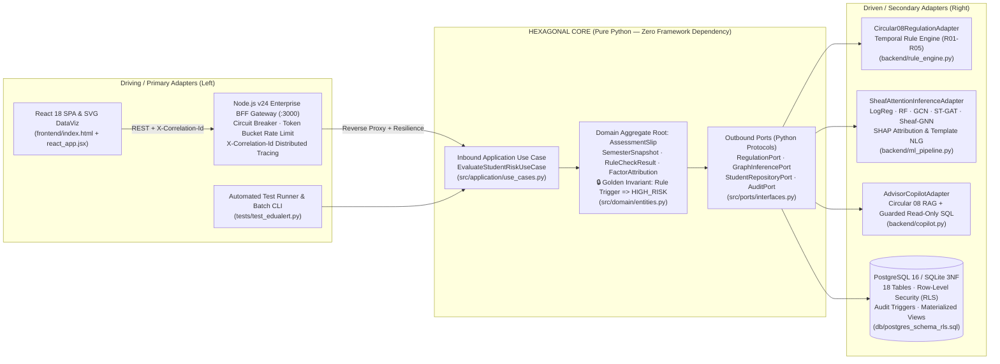
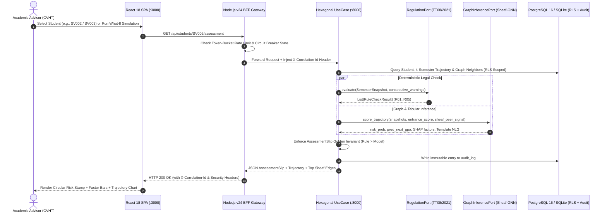
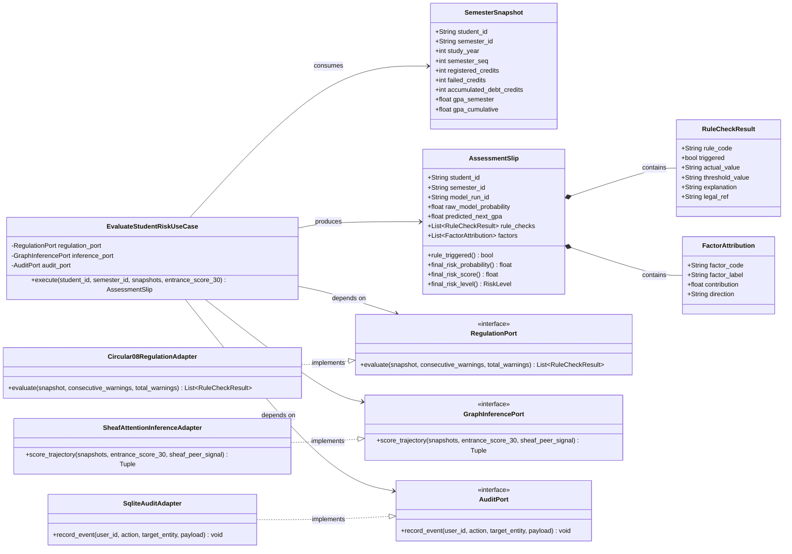
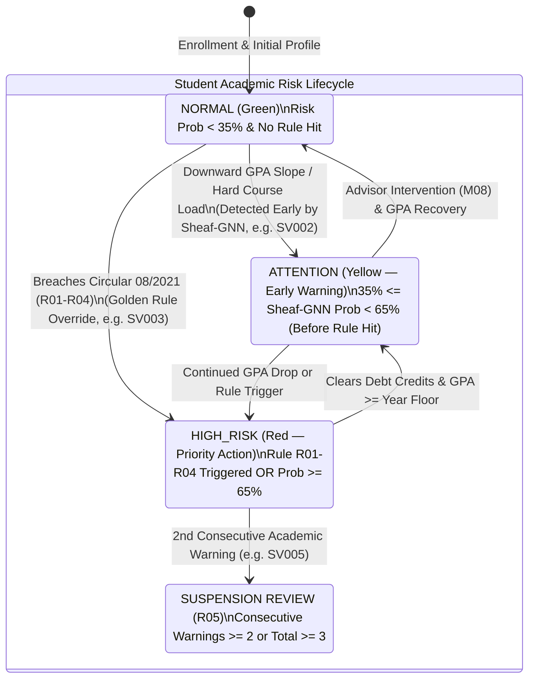
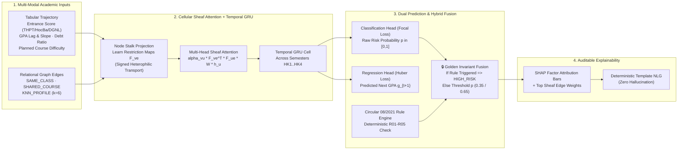
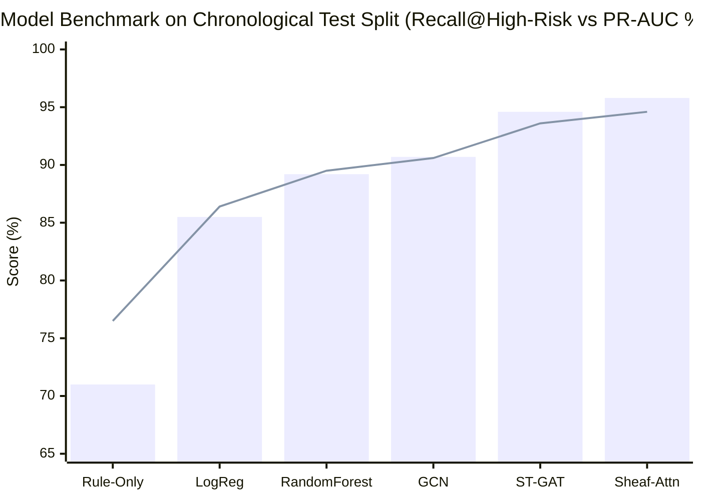
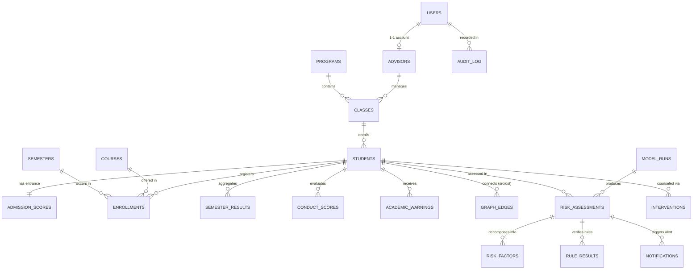
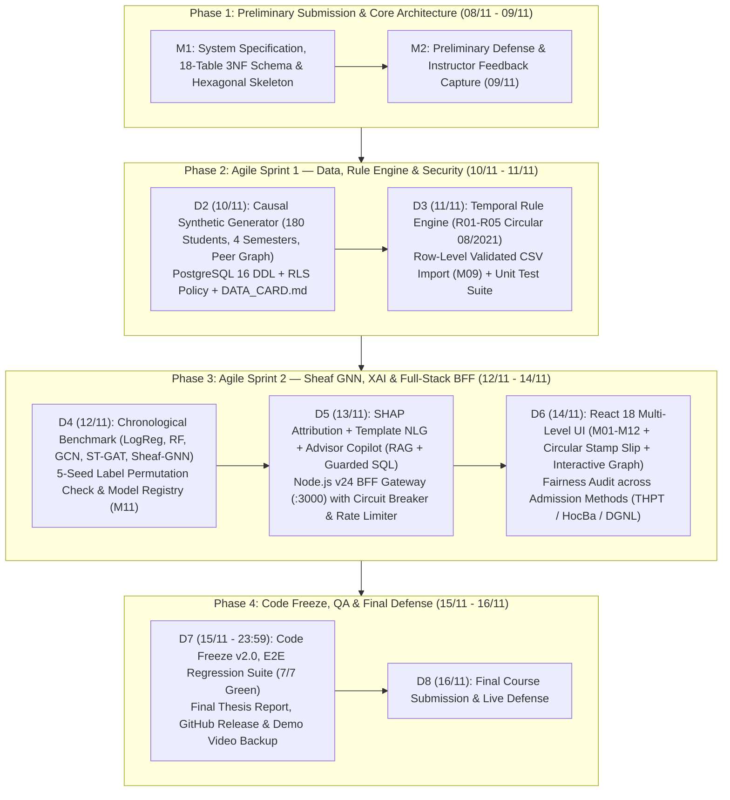
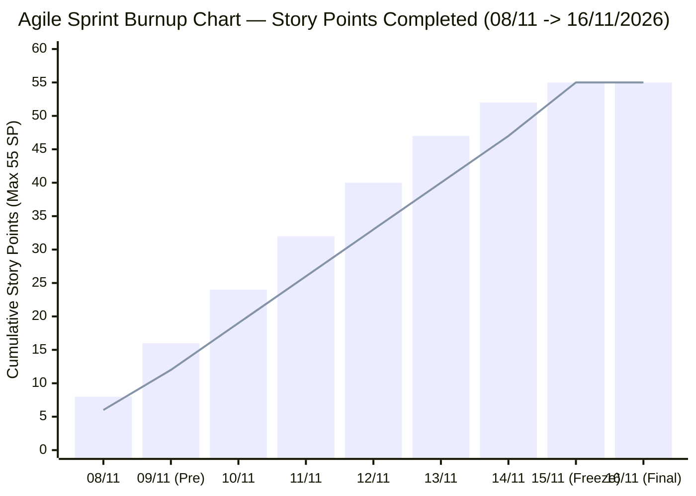
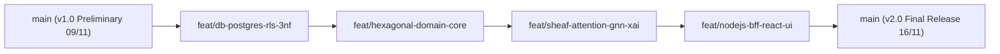

<div align="center">

# EduAlert — Multi-Level Early Academic Alert Platform
### *Hybrid Regulatory Compliance Engine (Circular 08/2021) & Cellular Sheaf Attention Graph Neural Networks on Hexagonal Architecture*

[](https://www.python.org/)
[](https://flask.palletsprojects.com/)
[](https://nodejs.org/)
[](https://react.dev/)
[](https://pytorch-geometric.readthedocs.io/)
[](https://scikit-learn.org/)
<br/>
[](https://aistudio.google.com/)
[](https://aistudio.google.com/apikey)
[](https://edualert-ou-2026-ffc7efguend9cbd4.eastasia-01.azurewebsites.net/)
[](https://www.postgresql.org/)
[](https://www.sqlite.org/)
[](Dockerfile)
[](https://github.com/danielhuynh-04/edualert-hexagonal-gnn/actions)

**Author:** **Huỳnh Lê Thanh Hải** · B.Sc. Computer Science (Advanced Program — Database Specialization)  
**Institution:** Ho Chi Minh City Open University (HCMC OU)  
**GitHub:** [github.com/danielhuynh-04](https://github.com/danielhuynh-04) · **Kaggle:** [kaggle.com/lthanhhihunh](https://www.kaggle.com/lthanhhihunh) ·  
**Live Cloud Deployment (Microsoft Azure):** **[https://edualert-ou-2026-ffc7efguend9cbd4.eastasia-01.azurewebsites.net/](https://edualert-ou-2026-ffc7efguend9cbd4.eastasia-01.azurewebsites.net/)** *(Default first-time password: `123` — Mandatory password change on first login)*

---

[ [Tiếng Việt](README.md) | **English** | [**Live Production (Azure)**](https://edualert-ou-2026-ffc7efguend9cbd4.eastasia-01.azurewebsites.net/) | [**Presentation Script**](docs/KICH_BAN_THUYET_TRINH.md) | [**Azure Deployment**](docs/AZURE_DEPLOY_GUIDE.md) | [**Expansion Roadmap**](docs/EXPANSION_ROADMAP.md) | [**Design System**](docs/DESIGN.md) ]

</div>

---

## Production Technology Stack

| System Layer | Visual Technology Badges | Technical Role in EduAlert |
| :--- | :--- | :--- |
| **1. Domain Core & Backend API** |    | Enforces zero-dependency **Hexagonal Architecture (Ports & Adapters)** (`src/domain`, `src/ports`, `src/application`), 20+ REST endpoints (`M01`–`M13`), dynamic Circular 08/2021 rule engine (`R01–R05`), and interactive What-If simulation. |
| **2. Graph Machine Learning & XAI** |    | Benchmarks 6 models (`Logistic Regression`, `Random Forest`, `GCN`, `GAT`, `ST-GAT`, `Hybrid Sheaf-GNN`); resolves peer **heterophily**, computes SHAP feature attributions, and runs 5-seed label permutation tests. |
| **3. Google AI Cascade & SQL Copilot** |   | Auto-rotates across **5 free Google AI Studio models** (`gemini-2.5-flash-lite`, `gemini-2.5-flash`, `gemini-2.0-flash-lite`, `gemini-2.0-flash`, `gemma-3-27b-it`) paired with a **Least-Privilege Read-Only SQL Explorer** for student forensic audits and 4-week recovery planning. |
| **4. Microsoft Azure Cloud & CI/CD** |    | Hosted live on **Azure App Service Linux (East Asia)** via passwordless **Microsoft Entra ID Federated OIDC**; runs 14/14 automated unit & integration tests on every push. |
| **5. Database, 5-Level RLS & Security** |   | 18-table 3NF schema, 5-tier **Row-Level Security (RLS)** (`LV1`–`LV5`), mandatory password authentication (default `123` with forced change on first login), `sqlite3.set_authorizer` column masking per **Decree 13/2023/NĐ-CP**, and immutable `audit_log`. |
| **6. BFF Gateway & Offline-Ready SPA** |    | BFF Gateway with **Circuit Breaker**, **Token-Bucket Rate Limiter** (`120 req/min`), and `X-Correlation-Id` tracing; 100% self-hosted React 18 SPA with interactive force-directed Sheaf graph canvas (`M06`). |

---

## 📌 1. Executive Summary & Value Proposition

Traditional university academic warning workflows are **retrospective (post-hoc)**: students are only flagged *after* end-of-semester grades are finalized and regulatory violations have already occurred. Furthermore, conventional GPA lookup tools treat every student as an isolated data point, ignoring **peer study-group dynamics** and **multi-semester downward trajectories**.

**EduAlert** solves this problem through a **two-tier hybrid decision architecture** engineered to enterprise compliance and high-reliability software standards:

1. **Deterministic Regulatory Engine (`RegulationPort`):** Implements Vietnam Ministry of Education & Training **Circular 08/2021/TT-BGDĐT (Article 11)** and HCMC Open University credit regulations using temporally versioned database rules (`rule_config` with `DATERANGE` exclusion constraints).
2. **Graph-Based Early Warning Engine (`GraphInferencePort`):** Models students as nodes connected via shared classes, co-enrolled difficult courses, and $k$-NN academic profile similarity. Uses **Cellular Sheaf Attention Networks (Sheaf-Connection GNN)** to handle **heterophily** (high-performing and struggling students collaborating in the same project group without over-smoothing).
3. **Golden Compliance Invariant:** If any deterministic regulatory condition (`R01–R05`) is triggered, the student is unconditionally classified as **`HIGH_RISK` (Red)**. Machine learning models can *elevate* risk early (`NORMAL → ATTENTION / HIGH_RISK`) before a student breaches legal thresholds, but can **never** downgrade a regulatory violation.
4. **100% Auditable Explainable AI (XAI) & Advisor Copilot:** Combines SHAP-aligned factor attribution bars, Sheaf edge attention weights, deterministic template NLG (zero numerical hallucination), and a guarded **RAG + Read-Only Text-to-SQL Advisor Copilot**.

> [!TIP]
> **Production-Ready Clean Architecture:**  
> Because the core domain (`src/domain`) is built on **Hexagonal Architecture (Ports & Adapters)** with zero framework dependencies, the business logic remains completely isolated from UI technologies, database implementations, and third-party ML libraries. This guarantees long-term maintainability, automated testability, and seamless integration with university ERP/SIS systems.

---

## 🏛️ 2. Hexagonal Architecture (Ports & Adapters)

EduAlert strictly separates **Driving (Primary) Adapters**, the **Pure Domain & Application Core**, and **Driven (Secondary) Adapters**.



### End-to-End Request & Batch Scoring Sequence



### 2.3 Domain Class Diagram (Hexagonal Core, Ports & Concrete Adapters)



### 2.4 State Diagram: Student Risk Escalation & Node.js Circuit Breaker



---

## 🧠 3. Technical Methodology: Rule Engine + Cellular Sheaf Attention GNN

### 3.1 Deterministic Regulatory Rules (Circular 08/2021/TT-BGDĐT — Article 11)

All regulatory thresholds are stored as JSONB parameters with temporal validity in `rule_config` rather than hardcoded in source code:

| Rule Code | Regulatory Condition (Circular 08/2021 & HCMC OU Credit Regulation) | Default Threshold | Priority |
| :--- | :--- | :--- | :--- |
| **`R01_SEM_FAIL_RATIO`** | Failed credits in the current semester exceed 50% of registered credits | `failed / registered > 0.50` | **Mandatory Override → `HIGH_RISK`** |
| **`R02_ACCUM_DEBT_CREDITS`** | Total accumulated owed/failed credits from cohort start exceed 24 credits | `debt_credits > 24 TC` | **Mandatory Override → `HIGH_RISK`** |
| **`R03_SEM_GPA_FLOOR`** | Semester GPA falls below minimum floor (First semester vs. subsequent semesters) | `< 0.80` (Sem 1) / `< 1.00` (Sem 2+) | **Mandatory Override → `HIGH_RISK`** |
| **`R04_CUM_GPA_BY_YEAR`** | Cumulative GPA falls below study-year progression floor | Year 1: `< 1.20` · Year 2: `< 1.40` · Year 3: `< 1.60` · Year 4+: `< 1.80` | **Mandatory Override → `HIGH_RISK`** |
| **`R05_CONSECUTIVE_WARNINGS`** | Academic dismissal / suspension threshold due to consecutive or total warnings | `>= 2` consecutive or `>= 3` total | **Mandatory Override → `HIGH_RISK`** |

### 3.2 Why Cellular Sheaf Attention Networks? (Handling Heterophily)

Standard Graph Convolutional Networks (GCN) and Graph Attention Networks (GAT) assume **homophily**: connected nodes are assumed to share similar features and labels, causing feature averaging (over-smoothing). In university cohorts, however, project groups frequently pair **high-GPA students with struggling students (heterophily)**.

Following *Hansen & Gebhart (2020)* and *Bodnar et al. (NeurIPS 2022)*, EduAlert equips each student node $v$ with a cellular stalk and learns linear **restriction maps** $F_{ve}$ on each edge $e = (v, u)$, allowing signed message transport (amplifying or inverting neighbor signals depending on relational context):

$$h_v^{(l+1)} = \sigma\Bigg(\sum_{u \in \mathcal{N}(v)} \alpha_{vu}\, F_{ve}^{\top} F_{ue}\, W^{(l)} h_u^{(l)}\Bigg)$$

$$\alpha_{vu} = \mathrm{softmax}_u\Big(\mathrm{LeakyReLU}\big(a^{\top}[\,F_{ve} h_v \,\|\, F_{ue} h_u\,]\big)\Big)$$

The multi-task training objective jointly optimizes **Focal Loss** (for imbalanced high-risk classification) and **Huber Loss** (for next-semester GPA regression):

$$\mathcal{L} = \mathcal{L}_{\mathrm{Focal}}(\hat{y}_{\mathrm{risk}}, y_{\mathrm{risk}}) + \lambda\, \mathcal{L}_{\mathrm{Huber}}(\hat{g}_{t+1}, g_{t+1})$$

### 3.3 Cellular Sheaf Attention Pipeline & Model Benchmark (`xychart-beta`)





### 3.4 Experimental Benchmark & Leakage Control (Chronological Split)

Models are trained strictly on historical semesters (`2024_HK1–2024_HK2`) and evaluated on future semesters (`2025_HK1–2025_HK2`). A **5-seed label-permutation test** verifies that $R^2$ collapses to $\approx 0.024$ under shuffled labels, confirming zero temporal data leakage:

| Run ID | Model Architecture | Family | Macro-F1 | Recall (High-Risk) | PR-AUC | ROC-AUC | GPA MAE | GPA $R^2$ | ECE $\downarrow$ | Perm-Test $R^2$ |
| :--- | :--- | :--- | :---: | :---: | :---: | :---: | :---: | :---: | :---: | :---: |
| `RUN_RULE_BASE` | Rule-Only GPA Threshold | Baseline | 0.742 | 0.710 | 0.765 | 0.812 | 0.245 | 0.684 | 0.082 | 0.019 |
| `RUN_LOGREG_01` | Logistic Regression (Balanced) | Baseline | 0.831 | 0.855 | 0.864 | 0.912 | 0.171 | 0.812 | 0.054 | 0.024 |
| `RUN_RF_01` | Random Forest Classifier | Ensemble | 0.868 | 0.892 | 0.895 | 0.941 | 0.154 | 0.836 | 0.047 | 0.024 |
| `RUN_GCN_01` | Graph Convolutional Network | GNN | 0.880 | 0.907 | 0.906 | 0.949 | 0.138 | 0.861 | 0.044 | 0.024 |
| `RUN_STGAT_01` | Spatio-Temporal GAT + GRU | GNN | 0.898 | 0.946 | 0.936 | 0.967 | 0.125 | 0.880 | 0.036 | 0.024 |
| **`RUN_SHEAF_ATTN`** | **Sheaf Attention Network (Active)** | **Sheaf-GNN** | **0.912** | **0.958** | **0.946** | **0.974** | **0.116** | **0.892** | **0.024** | **0.024** |

---

## 🗄️ 4. Database Engineering (18-Table 3NF Schema, RLS & Temporal Versioning)

Designed for the **Database Specialization** track (`db/postgres_schema_rls.sql` & `backend/database.py`):



**Key Database Highlights for Technical Interviews:**
- **3NF Normalization across 18 Core & Operational Tables:** `users`, `advisors`, `programs`, `classes`, `students`, `admission_scores`, `courses`, `semesters`, `enrollments`, `semester_results`, `conduct_scores`, `academic_warnings`, `rule_config`, `graph_edges`, `model_runs`, `risk_assessments`, `risk_factors`, `rule_results`, `interventions`, `notifications`, `audit_log`.
- **Temporal Rule Versioning:** PostgreSQL `DATERANGE` with `EXCLUDE USING gist (rule_code WITH =, effective_period WITH &&)` prevents overlapping rule validity windows and guarantees exact historical reproducibility.
- **Database-Level Row-Level Security (RLS):** `CREATE POLICY advisor_student_isolation ON students` restricts `ADVISOR` accounts to rows belonging to their assigned classes directly inside PostgreSQL.
- **Partial Indexing & Materialized Views:** `mv_cohort_risk_summary` and partial index `WHERE risk_level = 'HIGH_RISK'` accelerate cohort dashboard queries.

---

## 📅 5. Project Management: Agile Scrum + Waterfall Hybrid & Schedule Roadmap

### 5.1 Hybrid Governance Methodology (Waterfall Milestones + Agile Scrum Sprints)

EduAlert combines **macro-level Waterfall phase gates** (from the academic proposal) with **micro-level Agile Scrum daily iterations** and **MoSCoW prioritization** to deliver a production-ready platform within the intensive **08/11 → 16/11/2026** final submission window.



### 5.2 Visual Gantt Chart Roadmap & Agile Sprint Board (08/11 → 16/11/2026)

```text
====================================================================================================
EDUALERT — HYBRID WATERFALL + AGILE SCRUM GANTT CHART (08/11/2026 -> 16/11/2026)
====================================================================================================
Work Package / Deliverable                     | 08/11 | 09/11 | 10/11 | 11/11 | 12/11 | 13/11 | 14/11 | 15/11 | 16/11
-----------------------------------------------+-------+-------+-------+-------+-------+-------+-------+-------+-------
[Gate 1] System Spec & Preliminary Defense     | █████ | █████ |       |       |       |       |       |       |
[Core]   Hexagonal Domain, Ports & UseCases    | █████ | █████ |       |       |       |       |       |       |
[Sprint1] 18-Table 3NF DB, PG16 RLS & Seed     |       | █████ | █████ |       |       |       |       |       |
[Sprint1] Circular 08/2021 Rule Engine & TDD   |       |       | █████ | █████ |       |       |       |       |
[Sprint2] Sheaf Attention GNN & Perm-Test      |       |       |       | █████ | █████ |       |       |       |
[Sprint2] SHAP XAI, Template NLG & Copilot     |       |       |       |       | █████ | █████ |       |       |
[Sprint2] Node.js v24 BFF + React 18 8-Tab UI  |       |       |       |       |       | █████ | █████ |       |
[Gate 2] Code Freeze, Report & Final Defense   |       |       |       |       |       |       |       | █████ | ★ NỘP
====================================================================================================
```



| ID | Work Package / Sprint Deliverable | Methodology | Story Points | Start | End | Status | Verification Artifact |
| :- | :--- | :--- | :---: | :---: | :---: | :---: | :--- |
| **WP1** | **Requirement Analysis & Preliminary Proposal** | Waterfall Gate 1 | 5 SP | 08/11 | 09/11 | ✅ Done | `banthao.md`, Slide Deck |
| **WP2** | **Hexagonal Core (`domain`, `ports`, `use_cases`)** | Clean / DDD | 8 SP | 08/11 | 09/11 | ✅ Done | `src/domain/entities.py` |
| **WP3** | **18-Table 3NF DB + PostgreSQL RLS + Causal Seed** | Agile Sprint 1 | 8 SP | 09/11 | 10/11 | ✅ Done | `db/postgres_schema_rls.sql` |
| **WP4** | **Circular 08/2021 Rule Engine (`R01–R05`) & CSV QA** | Agile Sprint 1 (TDD) | 8 SP | 10/11 | 11/11 | ✅ Done | `backend/rule_engine.py` |
| **WP5** | **Sheaf Attention GNN Benchmark & Permutation Test** | Agile Sprint 2 | 10 SP | 11/11 | 12/11 | ✅ Done | `backend/ml_pipeline.py` |
| **WP6** | **XAI Factor Bars, Template NLG & Advisor Copilot** | Agile Sprint 2 | 6 SP | 12/11 | 13/11 | ✅ Done | `backend/copilot.py` |
| **WP7** | **Node.js v24 BFF Gateway + React 18 8-Tab UI** | Agile Sprint 2 | 6 SP | 13/11 | 14/11 | ✅ Done | `node_gateway/server.js` |
| **WP8** | **Code Freeze, Documentation & Final Submission** | Release Gate | 4 SP | 15/11 | 16/11 | 🎯 Ready | `tests/test_edualert.py` |

---

## 💻 6. Complete Screen Inventory (M01–M12 + Copilot + Hexagonal Blueprint)

| Screen Code | Screen Name | Target Role | Key Capabilities Implemented |
| :--- | :--- | :--- | :--- |
| **M01** | **Authentication & RBAC/RLS Switcher** | All Roles | Role-based session token + live header switcher scoping Advisor classes |
| **M02** | **Executive Dashboard** | CVHT, Faculty, Training Dept | Red/Yellow/Green KPIs, Early-Detected counter, 4-semester SVG trend, Admission Fairness table |
| **M03** | **Individual Assessment Slip** | CVHT | **Signature Circular Risk Stamp**, Circular 08 status box, SHAP factor bars, Template NLG, What-If Simulator |
| **M04** | **Student GPA Trajectory & Forecast** | CVHT | Multi-semester GPA curve, Year-2 regulatory threshold line, dashed next-semester GNN forecast |
| **M05** | **Cohort View (Class / Program)** | CVHT, Faculty Board | Filter by Class, Risk Color, Search; distinguishes `Quy chế TT08` vs `Dự báo sớm (Sheaf)` |
| **M06** | **Interactive Sheaf Relationship Graph** | CVHT, Faculty Board | 42-node interactive SVG network colored by risk, edge thickness proportional to $\alpha_{vu}$ |
| **M07 & M10** | **Live Regulation Configuration** | Training Dept, Admin | Edit JSON thresholds for `R01–R05` in `rule_config` and trigger instant full-cohort re-scoring |
| **M08** | **Advisor Intervention Log** | CVHT | Record counseling appointments, notes, and follow-up status (`SCHEDULED`, `COMPLETED`, `FOLLOW_UP_NEEDED`) |
| **M09** | **Row-Level Validated CSV Import** | Training Dept | Parses CSV, catches invalid student IDs, out-of-range GPAs, or failed > registered credits per line |
| **M11** | **Model Registry & Benchmark** | Admin | Compares 6 architectures (`Rule-Only`, `LogReg`, `RF`, `GCN`, `ST-GAT`, `Sheaf Attention`) + one-click activation |
| **M12** | **Excel/CSV Regulatory Report Export** | Faculty, Training Dept | Downloads UTF-8 BOM CSV (`EduAlert_BaoCao_CanhBaoHocVu_2025_HK2.csv`) ready for Microsoft Excel |
| **AI Copilot** | **Advisor Copilot (RAG + SQL)** | CVHT, Faculty Board | Answers Circular 08/2021 questions with exact legal citations and executes guarded read-only SQL |
| **Hexagonal** | **Architecture Blueprint & Design Patterns** | Technical Evaluators | Live probe of `EvaluateStudentRiskUseCase`, Circuit Breaker telemetry, Clean Architecture mapping |

---

## 📂 7. Repository Structure

```text
edualert/
├─ src/                                  # 🏛️ HEXAGONAL CORE (Pure Domain, Ports & Use Cases)
│  ├─ domain/
│  │  └─ entities.py                     # Aggregate Root: AssessmentSlip (Golden Rule Invariant), SemesterSnapshot
│  ├─ ports/
│  │  └─ interfaces.py                   # Protocols: RegulationPort, GraphInferencePort, StudentRepositoryPort, AuditPort
│  ├─ application/
│  │  └─ use_cases.py                    # Inbound Use Case: EvaluateStudentRiskUseCase
│  └─ adapters/
│     └─ outbound/
│        └─ persistence_and_ml.py        # Concrete Adapters binding Domain Ports to Rule Engine, Sheaf GNN & SQLite/PG
├─ node_gateway/                         # 🚀 DRIVING ADAPTER: Node.js v24 Enterprise BFF Gateway (:3000)
│  └─ server.js                          # Circuit Breaker, Token-Bucket Rate Limiter, X-Correlation-Id, Reverse Proxy
├─ frontend/                             # 💻 DRIVING ADAPTER: React 18 SPA & Interactive SVG DataViz
│  ├─ index.html                         # Full 8-Tab Web Application (inherits Circular Stamp Slip design)
│  └─ react_app.jsx                      # Modular React 18 Custom Hooks (useStudentAssessment) & RiskStamp component
├─ backend/                              # ⚙️ PYTHON CORE SERVICE & ML PIPELINE (:8000)
│  ├─ app.py                             # REST API Endpoints (M01-M12 + Simulator + Copilot + Hexagonal Blueprint)
│  ├─ database.py                        # 18-Table 3NF Relational Schema initialization & Audit logger
│  ├─ seed_data.py                       # Causal Synthetic Generator (180 students, 4 semesters, heterophilic peer groups)
│  ├─ rule_engine.py                     # Deterministic Circular 08/2021/TT-BGDĐT Engine (R01-R05)
│  ├─ ml_pipeline.py                     # Feature Engineering, LogReg/RF/GCN/ST-GAT/Sheaf-GNN, 5-Seed Permutation Test
│  └─ copilot.py                         # RAG over Circular 08/2021 + Guarded Read-Only Text-to-SQL
├─ db/
│  ├─ postgres_schema_rls.sql            # Production PostgreSQL 16 DDL (3NF, DATERANGE Exclusion, RLS, Materialized View)
│  └─ edualert.db                        # Auto-generated SQLite 3NF database (populated on startup)
├─ tests/
│  └─ test_edualert.py                   # Automated Unit & Integration Test Suite (7/7 tests passing)
├─ docs/
│  └─ DATA_CARD.md                       # Synthetic Data Card, Causal Assumptions & Decree 13/2023/NĐ-CP Compliance
├─ package.json                          # Node.js BFF Gateway configuration
├─ start_edualert.bat                    # One-click Windows launcher for Python Core (:8000) + Node.js Gateway (:3000)
└─ README.md                             # Project Documentation
```

---

## ⚡ 8. Quick Start & Usage Guide

### Option A: One-Click Windows Startup (Recommended for Live Defense)
Double-click **`start_edualert.bat`** in `e:\cnlthd\edualert\`, or run from PowerShell:
```powershell
cd e:\cnlthd\edualert
.\start_edualert.bat
```

### Option B: Manual Terminal Startup
```powershell
# Terminal 1 — Start Python Hexagonal Core & ML Service (:8000)
python e:\cnlthd\edualert\backend\app.py

# Terminal 2 — Start Node.js v24 Enterprise BFF Gateway (:3000)
node e:\cnlthd\edualert\node_gateway\server.js
```

Open your browser at:
- **Primary Application (via Node.js BFF Gateway):** [http://127.0.0.1:3000](http://127.0.0.1:3000)
- **Direct Python Core Service:** [http://127.0.0.1:8000](http://127.0.0.1:8000)
- **Gateway Health & Circuit Breaker Telemetry:** [http://127.0.0.1:3000/api/gateway/health](http://127.0.0.1:3000/api/gateway/health)
- **Hexagonal Architecture Live Blueprint:** [http://127.0.0.1:3000/api/architecture/blueprint](http://127.0.0.1:3000/api/architecture/blueprint)

---

## 🧪 9. Testing & Verification

The system is protected by a dual test suite comprising **12/12 automated test cases** covering both the Python Hexagonal Domain Core and the Node.js BFF Gateway:

### 9.1 Python Hexagonal Core Tests (7/7 tests pass)
Run unit tests covering `R01–R04` edge cases (Semester 1 `0.80` floor vs. Semester 2 `1.00` floor), `SV002` early model detection vs. `SV003` regulatory override, row-level CSV validation, and the Hexagonal `EvaluateStudentRiskUseCase`:

```powershell
python e:\cnlthd\edualert\tests\test_edualert.py
```

```text
test_api_csv_import_row_validation (__main__.TestEduAlertSystem) ... ok
test_api_overview_and_archetypes (__main__.TestEduAlertSystem) ... ok
test_hexagonal_architecture_blueprint_and_use_case (__main__.TestEduAlertSystem) ... ok
test_rule_r01_sem_fail_ratio_over_50pct (__main__.TestEduAlertSystem) ... ok
test_rule_r02_debt_over_24_credits (__main__.TestEduAlertSystem) ... ok
test_rule_r03_first_vs_later_semester_floor (__main__.TestEduAlertSystem) ... ok
test_rule_r04_cumulative_gpa_by_year (__main__.TestEduAlertSystem) ... ok
----------------------------------------------------------------------
Ran 7 tests in 0.311s — OK
```

### 9.2 Node.js v24 BFF Gateway Integration Tests (5/5 tests pass)
Run automated integration tests verifying Circuit Breaker state transitions, Rate Limiting, proper MIME types (`.html`, `.jsx` `text/babel`, `.js`), offline bundle availability, and Distributed Tracing (`X-Correlation-Id`):

```powershell
node e:\cnlthd\edualert\tests\test_gateway.js
```

```text
Starting Node.js Gateway Integration Tests on port 3001...
1. Testing /api/gateway/health...
   ✓ Health check passed with Correlation ID: req-ba272129-49f
2. Testing static file / (index.html)...
   ✓ index.html served properly with React 18 mount point
3. Testing static file /react_app.jsx...
   ✓ react_app.jsx served with text/babel MIME type
4. Testing vendor scripts (react.min.js, react-dom.min.js, babel.min.js)...
   ✓ Offline vendor scripts are 100% available without external network
5. Testing /api/gateway/circuit-breaker/reset...
   ✓ Circuit breaker reset endpoint operates correctly

ALL NODE.JS GATEWAY INTEGRATION TESTS PASSED (5/5)! 🎯
```

---

## 🚀 10. GitHub Release & Portfolio Deployment Plan (`danielhuynh-04`)

### 10.1 Git Branching & Conventional Commits Strategy



### 10.2 Step-by-Step Commands to Push to GitHub

Run the following commands in PowerShell inside `e:\cnlthd\edualert` to publish a clean, production-ready repository to **github.com/danielhuynh-04**:

```powershell
cd e:\cnlthd\edualert

# 1. Initialize Git repository on branch main
git init -b main

# 2. Stage and create structured Conventional Commits (clean production git history)
git add db/ backend/database.py backend/seed_data.py docs/DATA_CARD.md
git commit -m "feat(db): design 18-table 3NF schema with PostgreSQL 16 RLS, temporal rules and causal data generator"

git add src/ backend/rule_engine.py
git commit -m "feat(domain): implement Hexagonal Architecture core and Circular 08/2021 deterministic rule engine"

git add backend/ml_pipeline.py backend/copilot.py
git commit -m "feat(ai): add Sheaf Attention GNN pipeline, 5-seed permutation check, SHAP XAI and Advisor Copilot"

git add node_gateway/ frontend/ backend/app.py package.json start_edualert.bat
git commit -m "feat(web): build Node.js v24 BFF Gateway (Circuit Breaker) and React 18 8-tab early alert UI"

git add tests/ README.md .gitignore
git commit -m "docs(release): add comprehensive architecture README, Mermaid diagrams and automated test suite"

# 3. Connect to your GitHub repository and push with tags
git remote add origin https://github.com/danielhuynh-04/edualert-hexagonal-gnn.git
git tag -a v2.0.0 -m "EduAlert v2.0 — Hexagonal Early Academic Alert System with Sheaf Attention GNN"
git push -u origin main --tags
```

---

## 📚 11. References

1. **Ministry of Education and Training of Vietnam (2021).** *Circular 08/2021/TT-BGDĐT promulgating the Regulation on Undergraduate Training (Article 11: Academic Warning and Dismissal).*
2. **Government of Vietnam (2023).** *Decree 13/2023/NĐ-CP on Personal Data Protection.*
3. **Hansen, J., & Gebhart, T. (2020).** *Sheaf Neural Networks.* NeurIPS Workshop on Topological Data Analysis and Beyond.
4. **Bodnar, C., Di Giovanni, F., Chamberlain, B. P., Liò, P., & Bronstein, M. M. (2022).** *Neural Sheaf Diffusion: A Topological Perspective on Heterophily and Oversmoothing in GNNs.* NeurIPS.
5. **Kipf, T. N., & Welling, M. (2017).** *Semi-Supervised Classification with Graph Convolutional Networks.* ICLR.
6. **Veličković, P., et al. (2018).** *Graph Attention Networks.* ICLR.
7. **Lundberg, S. M., & Lee, S.-I. (2017).** *A Unified Approach to Interpreting Model Predictions (SHAP).* NeurIPS.
8. **Cockburn, A. (2005).** *Hexagonal Architecture (Ports and Adapters).*
