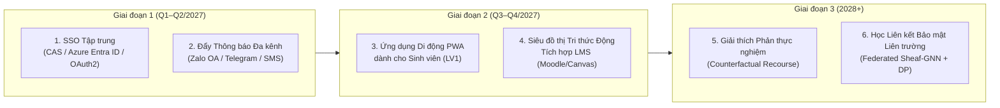

# 🚀 Các Hướng Mở Rộng Đề Xuất Chiến Lược (Strategic Expansion Roadmap)

Tài liệu này trình bày **6 hướng mở rộng trọng tâm** nhằm nâng cấp hệ thống **EduAlert** từ mô hình thử nghiệm quy mô khoa/trường (180 sinh viên) lên nền tảng cảnh báo học vụ thông minh cấp Đại học Số (Digital University) và liên trường đại học.

---

## 1. Tích hợp Xác thực Tập trung Đại học (Enterprise SSO, Microsoft Entra ID, CAS, OAuth 2.0 / OIDC)

- **Hiện trạng trong đồ án:** Đã xây dựng cổng đăng nhập phân quyền **5 cấp độ (LV1 Sinh viên → LV5 Quản trị Hệ thống)** kèm kiểm soát truy cập cấp dòng (**Row-Level Security — RLS**) và ghi vết kiểm toán (`audit_log`).
- **Hướng mở rộng:**
  - Tích hợp trực tiếp với hệ thống **Single Sign-On (SSO)** của Trường Đại học Mở TP.HCM qua giao thức **OAuth 2.0 / OpenID Connect (OIDC)** và **Microsoft Entra ID (Azure AD)** (tận dụng hệ sinh thái email `@ou.edu.vn` và `@student.ou.edu.vn`).
  - Xác thực hai yếu tố (**2FA/MFA**) bắt buộc đối với cấp **LV4 (Phòng Đào tạo)** khi thay đổi tham số quy chế Thông tư 08 và cấp **LV5 (Quản trị viên)**.
  - Tự động đồng bộ danh sách lớp chủ nhiệm của Cố vấn học tập (LV2) từ phần mềm quản lý đào tạo Edusoft/SIS theo thời gian thực.

---

## 2. Hệ thống Đẩy Thông báo Đa kênh Thời gian thực (Multi-Channel Real-Time Notification Engine)

- **Hiện trạng trong đồ án:** Bảng `notifications` và luồng tạo biên bản can thiệp học vụ M08.
- **Hướng mở rộng:** Xây dựng hàng đợi sự kiện bất đồng bộ (**Transactional Outbox + RabbitMQ / Azure Service Bus**) kết nối 4 kênh liên lạc thực tế:
  1. **Zalo Official Account (Zalo ZNS)**: Gửi thông báo cảnh báo sớm trực tiếp đến Zalo của sinh viên và phụ huynh (tỉ lệ đọc >90% tại Việt Nam).
  2. **Telegram / Microsoft Teams Bot**: Gửi cảnh báo tức thời cho Cố vấn học tập (LV2) ngay khi mô hình Sheaf GNN phát hiện một cụm sinh viên trong lớp có dấu hiệu tụt điểm dây chuyền.
  3. **Email Học vụ tự động (Azure Communication Services / SMTP)**: Đính kèm phiếu đánh giá học vụ M03 định dạng PDF có chữ ký số.
  4. **SMS Brandname**: Dùng cho trường hợp khẩn cấp khi sinh viên chạm ngưỡng cảnh báo lần 2 (nguy cơ buộc thôi học theo Khoản 2 Điều 11 TT08).

---

## 3. Ứng dụng Di động PWA cá nhân hóa cho Sinh viên (Student Self-Service Mobile PWA)

- **Hiện trạng trong đồ án:** Cấp **LV1 (Sinh viên)** đã được tách biệt giao diện riêng (chỉ xem phiếu cá nhân M03, bộ giả lập What-If M04 và Trợ lý AI cá nhân, khóa toàn bộ dữ liệu bạn cùng lớp).
- **Hướng mở rộng:**
  - Đóng gói giao diện LV1 thành **Progressive Web App (PWA)** có thể cài đặt trực tiếp lên màn hình chính iOS/Android, hỗ trợ Web Push Notification và xem học bạ offline.
  - **Trợ lý Lộ trình Đăng ký Môn học (Course Enrollment Recommender)**: Khi sinh viên chuẩn bị đăng ký học phần đầu kỳ, hệ thống tự động cảnh báo nếu tổ hợp môn dự kiến có quá nhiều học phần tỷ lệ trượt lịch sử cao (>25%) và gợi ý tổ hợp môn cân bằng để tối ưu ĐTB tích lũy.
  - **Đặt lịch hẹn tư vấn 1-1 với CVHT**: Sinh viên chủ động chọn khung giờ gặp Cố vấn học tập ngay trên ứng dụng.

---

## 4. Tích hợp Siêu đồ thị Tri thức Động với Hệ thống LMS (Dynamic LMS Knowledge Hypergraph)

- **Hiện trạng trong đồ án:** Đồ thị dị thể sinh viên – học phần (Sheaf Attention Network) cập nhật theo từng học kỳ.
- **Hướng mở rộng:**
  - Kết nối trực tiếp với nhật ký hoạt động của hệ thống **LMS (Moodle / Canvas)** qua chuẩn **xAPI / Caliper Analytics**: tần suất đăng nhập, thời lượng xem bài giảng video, số bài tập nộp trễ, điểm kiểm tra giữa kỳ.
  - Nâng cấp từ đồ thị cặp (pairwise graph) lên **Dynamic Sheaf Hypergraph Neural Network**: mỗi lớp học phần, nhóm đồ án và chủ đề thảo luận là một **siêu cạnh (hyperedge)** biến thiên theo tuần học.
  - **Kết quả kỳ vọng:** Phát hiện sinh viên có nguy cơ bỏ cuộc **ngay từ tuần thứ 4–6 của học kỳ** (trước kỳ thi giữa kỳ), thay vì chỉ dự báo dựa trên điểm tổng kết cuối kỳ.

---

## 5. Giải thích Phản thực nghiệm & Khuyến nghị Tối ưu (Counterfactual Recourse Optimization)

- **Hiện trạng trong đồ án:** Giải thích cục bộ bằng giá trị đóng góp đặc trưng **SHAP** và bộ giả lập **What-If M04** (người dùng tự kéo thanh trượt để thử kịch bản).
- **Hướng mở rộng:**
  - Giải bài toán tối ưu ngược (**Counterfactual Recourse**):
    $$\min_{\Delta x} \; \text{Cost}(\Delta x) \quad \text{s.t.} \quad f_{\text{Hybrid}}(x + \Delta x) = \text{NORMAL}, \quad x + \Delta x \in \mathcal{F}_{\text{feasible}}$$
  - Thay vì để sinh viên tự thử mò trên thanh trượt What-If, hệ thống tự động tính toán **tập hành động tốn ít công sức nhất** nhưng đảm bảo đưa sinh viên thoát khỏi vùng nguy cơ:
    *Ví dụ: "Để thoát mức CẢNH BÁO ở HK tới, SV002 chỉ cần cải thiện môn Cấu trúc dữ liệu từ D lên B (3 tín chỉ) và giảm khối lượng đăng ký mới từ 18 xuống 14 tín chỉ."*

---

## 6. Học Liên kết Bảo vệ Quyền riêng tư Liên trường (Cross-University Federated Sheaf-GNN & Differential Privacy)

- **Hiện trạng trong đồ án:** Huấn luyện tập trung trên dữ liệu ẩn danh SHA-256 của một trường, tuân thủ **Nghị định 13/2023/NĐ-CP**.
- **Hướng mở rộng:**
  - Các trường đại học tại Việt Nam đều áp dụng chung khung **Thông tư 08/2021/TT-BGDĐT**, nhưng không thể chia sẻ cơ sở dữ liệu điểm thô của sinh viên cho nhau vì ràng buộc pháp lý về dữ liệu cá nhân.
  - Triển khai **Federated Learning (FedAvg / FedProx)** kết hợp **Differential Privacy ($\epsilon, \delta$-DP)** cho mô hình Sheaf GNN: mỗi trường đại học huấn luyện mô hình trên dữ liệu nội bộ của mình và chỉ gửi các vector cập nhật trọng số đã nhiễu hóa về máy chủ điều phối chung.
  - Giúp các khoa mới thành lập hoặc các trường quy mô nhỏ thừa hưởng được tri thức dự báo chính xác từ các trường lớn mà **không một bản ghi sinh viên nào rời khỏi máy chủ của trường sở tại**.
