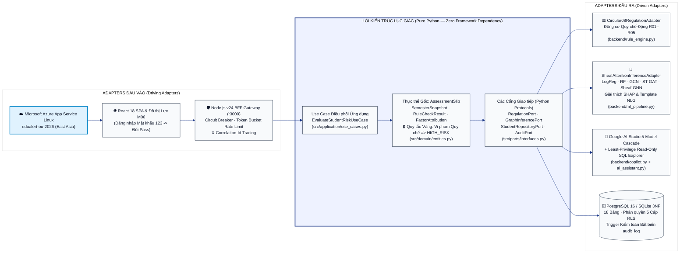
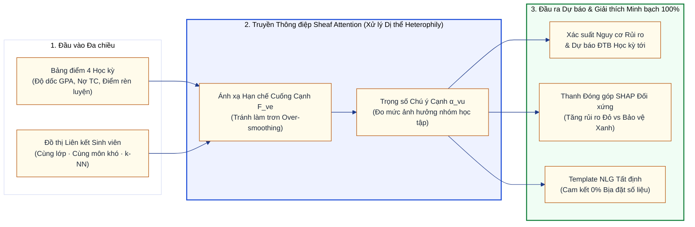
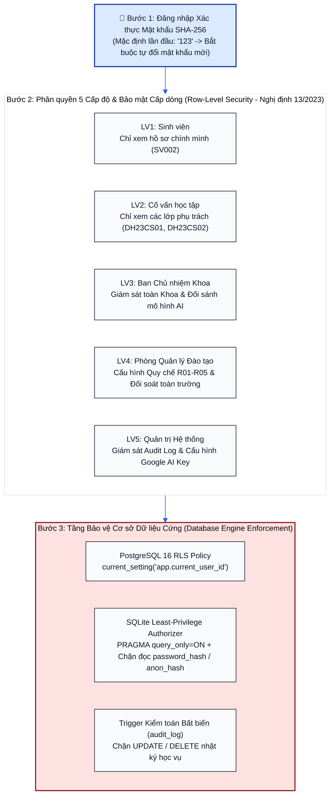
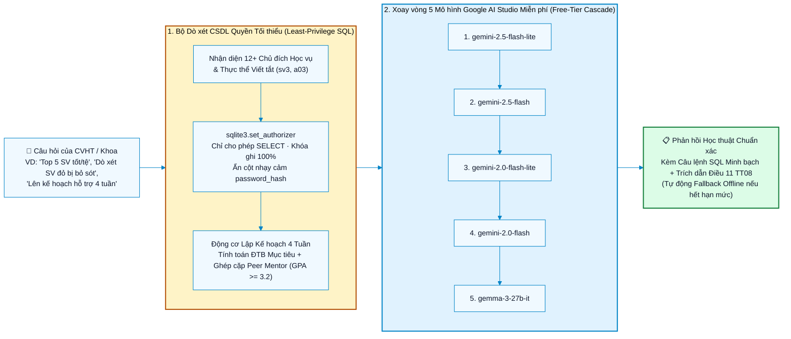
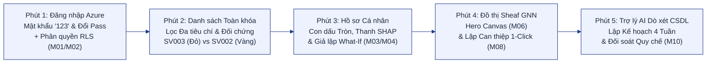

# 🎓 CẨM NANG LÀM SLIDE PPT & KỊCH BẢN THUYẾT TRÌNH CHI TIẾT — EDUALERT
### *Tài liệu Hướng dẫn Toàn diện từ A–Z: Thiết kế Bố cục Slide · Tải & Cắt Biểu đồ Mermaid · Gắn Huy hiệu Công nghệ · Kịch bản Thuyết trình Từng Giây · Live Demo trên Đám mây Microsoft Azure*

---

<div align="center">

## 🌐 LINK HỆ THỐNG PRODUCTION THỰC TẾ (ĐIỂM NHẤN ĂN ĐIỂM TUYỆT ĐỐI VỚI HỘI ĐỒNG)

### 🔗 **Link Web Production (Microsoft Azure Cloud — East Asia):**
## 👉 **[https://edualert-ou-2026-ffc7efguend9cbd4.eastasia-01.azurewebsites.net/](https://edualert-ou-2026-ffc7efguend9cbd4.eastasia-01.azurewebsites.net/)**

🔑 **Mật khẩu mặc định lần đầu cho mọi tài khoản:** **`123`** *(Hệ thống bắt buộc tự đổi mật khẩu mới ngay khi đăng nhập lần đầu)*  
📦 **Link Kho Mã nguồn GitHub Chính thức:** **[https://github.com/danielhuynh-04/edualert-hexagonal-gnn](https://github.com/danielhuynh-04/edualert-hexagonal-gnn)**

</div>

> [!IMPORTANT]
> **MẸO VÀNG CHO NGƯỜI LÀM PPT & THUYẾT TRÌNH:**
> 1. **Nhấn mạnh ngay từ Slide 1, Slide 5 và lúc bắt đầu Live Demo:** Hệ thống **KHÔNG CHỈ chạy ở máy cá nhân (`localhost`)** mà đã được đóng gói và **triển khai Production thực tế 24/7 trên đám mây Microsoft Azure** thông qua quy trình CI/CD tự động (`GitHub Actions OIDC`).
> 2. **Tạo Mã QR (QR Code) gắn lên Góc Phải Slide 1 và Slide 15:** Dán link `https://edualert-ou-2026-ffc7efguend9cbd4.eastasia-01.azurewebsites.net/` vào [qr-code-generator.com](https://www.qr-code-generator.com/) hoặc Canva QR để tạo mã QR đặt lên Slide. Mời Thầy Cô trong Hội đồng **quét mã QR bằng điện thoại/laptop cá nhân để tự đăng nhập (mật khẩu `123`) và trải nghiệm trực tiếp ngay tại phòng bảo vệ!**

---

## 📋 MỤC LỤC NHANH CHO BẠN LÀM PPT & THUYẾT TRÌNH

1. [**Phần 1: Hướng dẫn Thiết kế Slide (Màu sắc, Font chữ, Bố cục Chuẩn Học thuật)**](#-phần-1-hướng-dẫn-thiết-kế-slide-màu-sắc-font-chữ-bố-cục-chuẩn-học-thuật)
2. [**Phần 2: Kho Huy hiệu Công nghệ (Google AI, Microsoft Azure, Python, React...) — Copy & Paste Trực tiếp vào PPT**](#-phần-2-kho-huy-hiệu-công-nghệ-google-ai-microsoft-azure-python-react--copy--paste-trực-tiếp-vào-ppt)
3. [**Phần 3: 6 Sơ đồ Mermaid Độ Phân giải Cao & Cách Tải Xuống / Cắt Dán vào PPT trong 15 Giây**](#-phần-3-6-sơ-đồ-mermaid-độ-phân-giải-cao--cách-tải-xuống--cắt-dán-vào-ppt-trong-15-giây)
4. [**Phần 4: Danh sách 8 Ảnh Chụp Màn hình từ Link Production Cần Cắt Dán vào PPT**](#-phần-4-danh-sách-8-ảnh-chụp-màn-hình-từ-link-production-cần-cắt-dán-vào-ppt)
5. [**Phần 5: Kịch bản Chi tiết 15 Slide (Bố cục Slide + Chữ trên Slide + Ảnh cần gắn + Lời thoại từng chữ)**](#-phần-5-kịch-bản-chi-tiết-15-slide-bố-cục-slide--chữ-trên-slide--ảnh-cần-gắn--lời-thoại-từng-chữ)
6. [**Phần 6: Kịch bản Live Demo 5 Phút Trực tiếp trên Link Production Azure**](#-phần-6-kịch-bản-live-demo-5-phút-trực-tiếp-trên-link-production-azure)
7. [**Phần 7: Bộ 8 Câu hỏi & Trả lời Phản biện Hội đồng (Defensive Q&A)**](#-phần-7-bộ-8-câu-hỏi--trả-lời-phản-biện-hội-đồng-defensive-qa)

---

## 🎨 PHẦN 1: HƯỚNG DẪN THIẾT KẾ SLIDE (MÀU SẮC, FONT CHỮ, BỐ CỤC CHUẨN HỌC THUẬT)

Để bộ Slide PowerPoint / Canva đồng bộ 100% với giao diện Web Production của **EduAlert**, hãy thiết lập Theme Slide như sau:

| Thành phần | Thông số chuẩn | Mã màu HEX / Gợi ý PowerPoint & Canva |
| :--- | :--- | :--- |
| **Kích thước Slide** | Màn hình rộng 16:9 (Widescreen) | `1920 x 1080 px` |
| **Màu nền Slide chính** | Trắng kem giấy lưu trữ (Archival Paper) — dịu mắt trên máy chiếu, không dùng nền đen tối | **`#FAF8F5`** hoặc **`#FFFFFF`** |
| **Màu tiêu đề & nhấn chủ đạo** | Xanh Navy Đại học (Academic Cobalt / Deep Ink) | **`#172B4D`** và **`#1E3A8A`** |
| **Màu chữ nội dung** | Xám than đậm (Slate Ink) | **`#2C3E50`** |
| **3 Màu Ngữ nghĩa Cảnh báo** | **Đỏ (Nguy cơ cao / Chạm TT08):** `#B91C1C`<br>**Vàng Hổ phách (Cần chú ý sớm):** `#B45309`<br>**Xanh Lục (An toàn):** `#15803D` | Chỉ dùng đúng 3 màu này khi nói về phân loại sinh viên Đỏ / Vàng / Xanh |
| **Font chữ Tiêu đề Slide** | **Merriweather**, **Georgia**, hoặc **Times New Roman Bold** | Cỡ chữ `28pt – 36pt`, In đậm |
| **Font chữ Nội dung** | **Inter**, **Segoe UI**, hoặc **Arial** | Cỡ chữ `16pt – 20pt` (Không bao giờ nhỏ hơn `14pt`) |
| **Font chữ Công thức / Mã SV** | **Consolas** hoặc **JetBrains Mono** | Dùng cho `SV002`, `SV003`, `R01–R05` |
| **Chân trang (Footer) cố định** | Đặt ở mọi Slide (góc dưới): | `EduAlert · Live Production: edualert-ou-2026-ffc7efguend9cbd4.eastasia-01.azurewebsites.net · ĐH Mở TP.HCM` |

---

## 🏅 PHẦN 2: KHO HUY HIỆU CÔNG NGHỆ (GOOGLE AI, MICROSOFT AZURE, PYTHON, REACT...) — COPY & PASTE TRỰC TIẾP VÀO PPT

### Cách lấy các biểu tượng to đẹp này đưa vào PowerPoint / Canva:
* **Cách 1 (Nhanh nhất — 3 giây):** Mở file này trên GitHub hoặc trình duyệt $\rightarrow$ **Nhấp chuột phải vào từng biểu tượng bên dưới** $\rightarrow$ chọn **"Copy Image" (Sao chép hình ảnh)** $\rightarrow$ sang PowerPoint/Canva bấm **`Ctrl + V`**!
* **Cách 2 (Chèn bằng URL trong Canva/PPT):** Copy đường link ảnh trong cột **Link Ảnh Trực tiếp** $\rightarrow$ trong PowerPoint chọn `Insert -> Pictures -> From Online/File` (dán URL vào ô File name) hoặc trong Canva dán link ảnh.

### Bộ Biểu tượng Hiển thị Trực tiếp (Nhấp chuột phải $\rightarrow$ Copy Image):


### Bảng Link Ảnh Huy hiệu Công nghệ (Dùng cho Slide 1 và Slide 5):

| Tên Công nghệ | Biểu tượng Hiển thị | Link Ảnh Trực tiếp (Copy dán vào trình duyệt / PPT) |
| :--- | :---: | :--- |
| **Python 3.10+** |  | `https://img.shields.io/badge/Python-3.10%2B-3776AB?style=for-the-badge&logo=python&logoColor=white` |
| **Google Gemini 2.5 Flash & Gemma 3** |  | `https://img.shields.io/badge/Google_Gemini-2.5_Flash_%26_Gemma_3-4285F4?style=for-the-badge&logo=googlegemini&logoColor=white` |
| **Google AI Studio (Free-Tier Cascade)** |  | `https://img.shields.io/badge/Google_AI_Studio-Free_Tier_Cascade-EA4335?style=for-the-badge&logo=googlecloud&logoColor=white` |
| **Microsoft Azure App Service Linux** |  | `https://img.shields.io/badge/Microsoft_Azure-App_Service_Linux-0078D4?style=for-the-badge&logo=data:image/svg+xml;base64,PHN2ZyB4bWxucz0iaHR0cDovL3d3dy53My5vcmcvMjAwMC9zdmciIHZpZXdCb3g9IjAgMCAyNCAyNCIgZmlsbD0id2hpdGUiPjxwYXRoIGQ9Ik0xMy4wNSA0LjI0TDYuNTYgMTguMDUgMiAxOGw1LjA5LTguNzYgNS45Ni01ek0xMy43NSA1LjMzTDIyIDE5Ljc2SDguNzRsNC45OC0zLjAyLTIuNTgtMy44MiAyLjYxLTcuNTl6Ii8+PC9zdmc+` |
| **PyTorch Geometric (Sheaf GNN)** |  | `https://img.shields.io/badge/PyG-Sheaf_Attention_GNN-EE4C2C?style=for-the-badge&logo=pytorch&logoColor=white` |
| **React 18.3 SPA** |  | `https://img.shields.io/badge/React-18.3_SPA-61DAFB?style=for-the-badge&logo=react&logoColor=black` |
| **Node.js v24 BFF Gateway** |  | `https://img.shields.io/badge/Node.js-v24_BFF_Gateway-339933?style=for-the-badge&logo=nodedotjs&logoColor=white` |
| **PostgreSQL 16 (3NF & RLS)** |  | `https://img.shields.io/badge/PostgreSQL_16-3NF_%7C_RLS-4169E1?style=for-the-badge&logo=postgresql&logoColor=white` |
| **SQLite 3 (Least-Privilege SQL)** |  | `https://img.shields.io/badge/SQLite_3-Least_Privilege_SQL-003B57?style=for-the-badge&logo=sqlite&logoColor=white` |
| **GitHub Actions OIDC CI/CD** |  | `https://img.shields.io/badge/GitHub_Actions-OIDC_CI%2FCD_14%2F14_Pass-2088FF?style=for-the-badge&logo=githubactions&logoColor=white` |

---

## 📊 PHẦN 3: 6 SƠ ĐỒ MERMAID ĐỘ PHÂN GIẢI CAO & CÁCH TẢI XUỐNG / CẮT DÁN VÀO PPT TRONG 15 GIÂY

### 🛠️ Hướng dẫn bạn làm Slide tải biểu đồ Mermaid xuống và cắt vào PowerPoint:

> [!TIP]
> **3 CÁCH XUẤT SƠ ĐỒ MERMAID RA ẢNH NÉT CĂNG ĐỂ DÁN VÀO PPT:**
>
> * **Cách 1 — Dùng Mermaid Live Editor (Khuyên dùng — Ảnh PNG/SVG độ phân giải 4K, nền trong suốt):**
>   1. Mở trang web miễn phí: **[https://mermaid.live/edit](https://mermaid.live/edit)**
>   2. Ở từng sơ đồ bên dưới, bấm nút **Copy** ở góc phải khung code (chỉ copy phần bên trong cặp dấu ```` ```mermaid ... ``` ````).
>   3. Dán (`Ctrl + V`) đè vào ô **Code** bên tay trái của trang `mermaid.live`.
>   4. Nhìn xuống góc dưới bên trái màn hình, bấm mục **`Actions`**:
>      * Nhập `Width = 2400` px.
>      * Bấm nút **`PNG`** hoặc **`SVG`** để tải ảnh về máy (hoặc bấm **`Copy Image to Clipboard`** rồi sang PowerPoint bấm `Ctrl + V` luôn!).
>
> * **Cách 2 — Cắt trực tiếp từ trang GitHub của dự án (Không cần mở công cụ khác):**
>   1. Mở trang **[https://github.com/danielhuynh-04/edualert-hexagonal-gnn](https://github.com/danielhuynh-04/edualert-hexagonal-gnn)** trên trình duyệt máy tính.
>   2. Cuộn xuống các sơ đồ Mermaid đã được GitHub vẽ sẵn.
>   3. Bấm tổ hợp phím **`Windows + Shift + S`** (Snipping Tool trên Windows) hoặc **`Cmd + Shift + 4`** (trên Mac), kéo khung chọn quanh sơ đồ rồi sang PowerPoint bấm **`Ctrl + V`**!
>   4. Trong PowerPoint, vào tab **`Picture Format -> Crop`** để cắt gọn viền thừa và kéo rộng ra giữa Slide.
>
> * **Cách 3 — Dành cho người dùng Canva:**
>   Trong Canva, vào mục **Apps** bên trái $\rightarrow$ tìm ứng dụng **"Mermaid"** $\rightarrow$ dán đoạn code bên dưới vào là sơ đồ hiện thẳng trên Slide Canva dưới dạng Vector sắc nét!

---

### 🔹 SƠ ĐỒ MERMAID 1 (Gắn vào **Slide 4**): Kiến trúc Ra Quyết định Kết hợp Hai Tầng & Quy tắc Vàng

```mermaid
%%{init: {'theme': 'base', 'themeVariables': { 'primaryColor': '#EEF2FF', 'primaryTextColor': '#1E293B', 'primaryBorderColor': '#1E3A8A', 'lineColor': '#334155', 'fontSize': '15px'}}}%%
flowchart LR
    IN["📥 Hồ sơ Sinh viên & Diễn biến 4 Học kỳ\n(GPA học kỳ · GPA tích lũy · Nợ TC · Nhóm học tập)"]

    subgraph Tier1["TẦNG 1: ĐỘNG CƠ QUY CHẾ TẤT ĐỊNH (Thông tư 08/2021)"]
        direction TB
        R1["R01: Rớt > 50% TC đăng ký học kỳ"]
        R2["R02: Nợ đọng tích lũy > 24 TC"]
        R3["R03: ĐTB HK < 0.80 (Kỳ 1) / < 1.00"]
        R4["R04: ĐTB TL < Sàn năm (1.2 -> 1.8)"]
        R5["R05: Cảnh báo 2 kỳ liên tiếp / 3 lần"]
    end

    subgraph Tier2["TẦNG 2: MẠNG ĐỒ THỊ DỰ BÁO SỚM (Sheaf Attention GNN)"]
        direction TB
        G1["Đặc trưng Chuỗi thời gian (Độ dốc GPA, Độ khó môn)"]
        G2["Đồ thị Tương tác Lớp & Nhóm Học phần Khó"]
        G3["Dự báo Xác suất Nguy cơ Sớm & Phân rã SHAP"]
    end

    GOLD{"🔒 QUY TẮC VÀNG TUÂN THỦ\nCó chạm R01–R05 không?"}
    RED["🔴 NGUY CƠ CAO (HIGH_RISK)\nBắt buộc Cảnh báo Học vụ (VD: SV003)"]
    EARLY["🟡 CẦN CHÚ Ý SỚM / 🔴 NGUY CƠ CAO\nAI Phát hiện Sớm trước khi vi phạm (VD: SV002)"]
    GREEN["🟢 BÌNH THƯỜNG (NORMAL)\nTiếp tục theo dõi định kỳ (VD: SV001)"]

    IN --> Tier1
    IN --> Tier2
    Tier1 --> GOLD
    Tier2 --> GOLD
    GOLD -->|"CÓ (Bất khả xâm phạm)"| RED
    GOLD -->|"KHÔNG (AI đánh giá xu hướng)"| EARLY
    GOLD -->|"KHÔNG (Ổn định)"| GREEN

    style RED fill:#FEE2E2,stroke:#B91C1C,stroke-width:2px,color:#7F1D1D
    style EARLY fill:#FEF3C7,stroke:#B45309,stroke-width:2px,color:#78350F
    style GREEN fill:#DCFCE7,stroke:#15803D,stroke-width:2px,color:#14532D
    style GOLD fill:#DBEAFE,stroke:#1D4ED8,stroke-width:3px,color:#1E3A8A
```



---

### 🔹 SƠ ĐỒ MERMAID 2 (Gắn vào **Slide 5**): Kiến trúc Lục giác (Hexagonal Architecture / Ports & Adapters) & Đám mây Azure



---

### 🔹 SƠ ĐỒ MERMAID 3 (Gắn vào **Slide 7**): Luồng Suy luận Mạng Đồ thị Sheaf Attention GNN & Giải thích XAI



---

### 🔹 SƠ ĐỒ MERMAID 4 (Gắn vào **Slide 10**): Kiến trúc Bảo mật CSDL 18 Bảng 3NF, Phân quyền 5 Cấp RLS & Kiểm toán Bất biến



---

### 🔹 SƠ ĐỒ MERMAID 5 (Gắn vào **Slide 11**): Kiến trúc Trợ lý AI Google Gemini 5-Model Cascade & Dò xét CSDL Quyền Tối thiểu



---

### 🔹 SƠ ĐỒ MERMAID 6 (Gắn vào **Slide 13**): Lộ trình 5 Bước Live Demo trên Production Azure



---

## 📸 PHẦN 4: DANH SÁCH 8 ẢNH CHỤP MÀN HÌNH TỪ LINK PRODUCTION CẦN CẮT DÁN VÀO PPT

Bạn làm PPT chỉ cần mở trực tiếp đường link Production:
👉 **[https://edualert-ou-2026-ffc7efguend9cbd4.eastasia-01.azurewebsites.net/](https://edualert-ou-2026-ffc7efguend9cbd4.eastasia-01.azurewebsites.net/)**
và bấm **`Win + Shift + S`** chụp 8 tấm ảnh sau để dán vào các Slide tương ứng (nhớ chụp kèm thanh địa chỉ trình duyệt có chữ `edualert-ou-2026...azurewebsites.net` để Hội đồng thấy rõ đây là hệ thống chạy thực tế trên Cloud!):

1. **Ảnh 1 (Dán vào Slide 1 & Slide 10):** Màn hình **Đăng nhập bắt buộc (`M01`)** có ghi mật khẩu mặc định `123` và hộp thoại **Bắt buộc tự đổi mật khẩu mới lần đầu**.
2. **Ảnh 2 (Dán vào Slide 3 & Slide 10):** Bấm nút `🛡️ Phân quyền 5 cấp (RLS)` trên Header $\rightarrow$ Chụp bảng **Ma trận Phân quyền 5 Cấp độ (LV1–LV5) & Nghị định 13/2023/NĐ-CP**.
3. **Ảnh 3 (Dán vào Slide 2 & Slide 6):** Màn hình **Dashboard Tổng quan (`M02`)** hiển thị các ô KPI (Tổng 180 SV, Nguy cơ cao Đỏ, Cần chú ý Vàng, Phát hiện sớm bởi AI) và biểu đồ xu hướng 4 học kỳ.
4. **Ảnh 4 (Dán vào Slide 9):** Mở hồ sơ **`SV003 (Lê Thị Khánh Linh)`** và **`SV002 (Trần Thị Bích Ngọc)`** $\rightarrow$ Chụp **Con dấu tròn Registrar nghiêng $-5.5^\circ$**, **Thanh phân rã yếu tố rủi ro SHAP đối xứng** và khu vực **Giả lập Kịch bản What-If (`M04`)**.
5. **Ảnh 5 (Dán vào Slide 7):** Mở tab **`M06 · Đồ thị quan hệ`** $\rightarrow$ Phóng to nút `SV002` để thấy các cạnh nối màu xanh đậm có nhãn trọng số chú ý **`α 0.82`** và khung phân tích láng giềng bên phải.
6. **Ảnh 6 (Dán vào Slide 8):** Mở tab **`M10 · Quy chế & Benchmark`** $\rightarrow$ Chụp bảng **Đối sánh Hiệu năng 6 Mô hình Học máy** (`Rule-Only`, `Logistic Regression`, `Random Forest`, `GCN`, `ST-GAT`, `Sheaf Attention GNN`) và bảng 5 Quy tắc Thông tư 08 (`R01–R05`).
7. **Ảnh 7 (Dán vào Slide 11):** Mở khung **Trợ lý AI EduAlert (góc phải hoặc tab Copilot)** $\rightarrow$ Bấm câu hỏi gợi ý **`🔍 Dò xét SV nguy cơ cao bị bỏ sót`** và **`📅 Kế hoạch hỗ trợ 4 tuần`** $\rightarrow$ Chụp kết quả AI trả về kèm nút **`Xem SQL`** (`sql-least-privilege`).
8. **Ảnh 8 (Dán vào Slide 12):** Mở trang GitHub Actions của repo **[github.com/danielhuynh-04/edualert-hexagonal-gnn/actions](https://github.com/danielhuynh-04/edualert-hexagonal-gnn/actions)** $\rightarrow$ Chụp dấu tích xanh ✅ **Build and deploy Python app to Azure Web App - edualert-ou-2026**.

---

## 📽️ PHẦN 5: KỊCH BẢN CHI TIẾT 15 SLIDE (BỐ CỤC SLIDE + CHỮ TRÊN SLIDE + ẢNH CẦN GẮN + LỜI THOẠI TỪNG CHỮ)

---

### 🟦 SLIDE 1: TRANG BÌA (TITLE SLIDE) — ẤN TƯỢNG ĐẦU TIÊN & LINK PRODUCTION
* **Hướng dẫn bố cục Slide:**
  * **Nữa trên:** Logo Trường ĐH Mở TP.HCM góc trái trên. Tên đề tài cỡ lớn (`34pt`, màu Xanh Navy `#172B4D`).
  * **Chính giữa:** Dán hàng ngang **8 Huy hiệu Công nghệ** từ Phần 2 (Python, PyTorch Geometric, React, Node.js, **Google Gemini**, **Microsoft Azure**, PostgreSQL, Docker).
  * **Góc dưới bên trái:** Thông tin Sinh viên thực hiện & Giảng viên hướng dẫn.
  * **Góc dưới bên phải (CỰC KỲ QUAN TRỌNG):** Đặt một khung nổi bật nền xanh nhạt chứa **Mã QR Code** + đường link chữ đậm:
    `🌐 LIVE PRODUCTION (MICROSOFT AZURE):`
    `https://edualert-ou-2026-ffc7efguend9cbd4.eastasia-01.azurewebsites.net/`
    *(Mật khẩu trải nghiệm lần đầu: `123`)*
* **Nội dung chữ cần dán lên Slide 1:**
  * **KHÓA LUẬN / ĐỒ ÁN TỐT NGHIỆP ĐẠI HỌC**
  * **Đề tài:** **EDUALERT — HỆ THỐNG CẢNH BÁO SỚM KẾT QUẢ HỌC TẬP ĐA CẤP ĐỘ**
  * *Kết hợp Động cơ Quy chế Đào tạo (Thông tư 08/2021/TT-BGDĐT) & Mạng Nơ-ron Đồ thị Sheaf Attention trên Kiến trúc Lục giác (Hexagonal Architecture)*
  * **Sinh viên thực hiện:** **Huỳnh Lê Thanh Hải** — Cử nhân Khoa học Máy tính (Chương trình Tiên tiến — Chuyên ngành Cơ sở Dữ liệu)
  * **Đơn vị:** Khoa Công nghệ Thông tin — Trường Đại học Mở TP. Hồ Chí Minh
* **🎙️ Lời thoại thuyết trình (45 giây — Đọc rõ ràng, tự tin):**
  > "Kính chào quý Thầy Cô trong Hội đồng Đánh giá. Hôm nay nhóm/em xin phép được trình bày đề tài **EduAlert — Hệ thống Cảnh báo Sớm Kết quả Học tập Đa cấp độ kết hợp Quy chế Đào tạo Thông tư 08/2021 và Mạng Nơ-ron Đồ thị Sheaf Attention trên Kiến trúc Lục giác**.
  >
  > Điểm đặc biệt đầu tiên em xin báo cáo với Hội đồng là hệ thống này **đã được triển khai Production thực tế 24/7 trên đám mây Microsoft Azure** tại địa chỉ hiển thị trên màn hình. Quý Thầy Cô có thể quét mã QR ở góc phải Slide bằng điện thoại hoặc laptop để truy cập trực tiếp vào hệ thống ngay trong lúc em trình bày, với mật khẩu mặc định lần đầu là **`123`**."

---

### 🟦 SLIDE 2: ĐẶT VẤN ĐỀ & NỖI ĐAU THỰC TẾ TRONG QUẢN LÝ HỌC VỤ
* **Hướng dẫn bố cục Slide:** Chia làm 2 cột:
  * **Cột trái (4 hộp Icon cảnh báo):** Nêu 4 hạn chế của quy trình truyền thống.
  * **Cột phải:** Dán **Ảnh 3 (Màn hình Dashboard M02 trên Azure)** cho thấy bức tranh thực tế 180 sinh viên.
* **Nội dung chữ cần dán lên Slide 2:**
  * **1. Cảnh báo mang tính Hậu kiểm (Post-hoc):** Sinh viên chỉ nhận quyết định cảnh báo *sau khi* kỳ thi đã kết thúc $\rightarrow$ Đã mất trắng 1 học kỳ.
  * **2. Quá tải Cố vấn Học tập (CVHT):** 1 CVHT phụ trách 60–100 sinh viên, không thể dò thủ công từng bảng điểm rời rạc.
  * **3. Bỏ sót xu hướng trượt dốc ngầm:** Sinh viên có GPA giảm liên tiếp 3 kỳ ($2.8 \rightarrow 2.1 \rightarrow 1.65$) nhưng chưa chạm ngưỡng phạt $\rightarrow$ Hệ thống cũ báo "An toàn".
  * **4. Bỏ qua tương tác nhóm học tập:** Đào tạo tín chỉ có tính kết nối nhóm rất mạnh, nhưng các mô hình bảng truyền thống xem mỗi sinh viên là một ốc đảo cô lập.
* **🎙️ Lời thoại thuyết trình (45 giây):**
  > "Xuất phát điểm của đề tài đến từ thực tế quản lý học vụ theo hệ thống tín chỉ hiện nay. Quy trình cảnh báo truyền thống mang tính **hậu kiểm**: chỉ khi điểm thi cuối kỳ đã khóa và sinh viên đã vi phạm quy chế thì nhà trường mới ra thông báo — lúc đó đã quá muộn để cứu vãn học kỳ. Hơn nữa, những sinh viên có điểm trung bình tụt dốc ngầm qua nhiều kỳ nhưng chưa chạm sàn quy chế hoàn toàn bị bỏ sót. Vì vậy, bài toán đặt ra là: **Làm sao phát hiện sớm nguy cơ trước 1 học kỳ, giải thích rõ nguyên nhân và tự động lập kế hoạch hỗ trợ cho Cố vấn học tập?**"

---

### 🟦 SLIDE 3: MỤC TIÊU ĐỀ TÀI & PHÂN QUYỀN 5 CẤP ĐỘ NGƯỜI DÙNG (LV1–LV5)
* **Hướng dẫn bố cục Slide:**
  * **Nửa trên:** 4 Mục tiêu cốt lõi đặt trong 4 thẻ ngang.
  * **Nửa dưới:** Dán **Ảnh 2 (Bảng Ma trận Phân quyền 5 cấp độ LV1–LV5 trên Web Production)**.
* **Nội dung chữ cần dán lên Slide 3:**
  * **4 Mục tiêu Cốt lõi:**
    1. **Phát hiện sớm (Early Warning):** Nhận diện sinh viên trượt dốc trước khi chạm ngưỡng Thông tư 08.
    2. **Giải thích minh bạch (Auditable XAI):** Phân rã nguyên nhân bằng SHAP + Template NLG (0% bịa số liệu).
    3. **Dò xét & Lập kế hoạch bằng AI:** Tự động rà soát sinh viên nguy cơ bị bỏ sót và lên lộ trình 4 tuần.
    4. **Bảo mật dữ liệu Đa cấp (Nghị định 13/2023/NĐ-CP):** Phân quyền 5 cấp độ (`LV1` Sinh viên $\rightarrow$ `LV2` CVHT $\rightarrow$ `LV3` Khoa $\rightarrow$ `LV4` Phòng Đào tạo $\rightarrow$ `LV5` Quản trị) kèm khóa mật khẩu bắt buộc.
* **🎙️ Lời thoại thuyết trình (45 giây):**
  > "Để giải quyết bài toán trên, EduAlert hướng tới 4 mục tiêu: Phát hiện sớm, Giải thích minh bạch, Tự động hóa lập kế hoạch can thiệp và Bảo mật đa cấp độ. Toàn bộ hệ thống trên Production được thiết kế cho 5 cấp độ người dùng từ Sinh viên, Cố vấn học tập, Ban Chủ nhiệm Khoa, Phòng Đào tạo đến Quản trị viên. Đặc biệt, hệ thống áp dụng bảo mật cấp dòng Row-Level Security theo Nghị định 13/2023: Cố vấn học tập của lớp nào chỉ được phép nhìn thấy dữ liệu của đúng lớp đó."

---

### 🟦 SLIDE 4: KIẾN TRÚC RA QUYẾT ĐỊNH HAI TẦNG & "QUY TẮC VÀNG VỀ TUÂN THỦ"
* **Hướng dẫn bố cục Slide:**
  * **Bên trái (60% diện tích):** Cắt dán **Sơ đồ Mermaid 1** (từ Phần 3).
  * **Bên phải (40% diện tích):** Hộp công thức **Quy tắc Vàng (Golden Compliance Invariant)** đóng khung viền đỏ đậm.
* **Nội dung chữ cần dán lên Slide 4:**
  * **Kiến trúc Kết hợp Hai Tầng (Hybrid Decision Architecture):**
    * **Tầng 1 — Quy chế Pháp lý Tất định (`RegulationPort`):** Đối soát 5 điều kiện Điều 11 Thông tư 08/2021/TT-BGDĐT (`R01–R05`).
    * **Tầng 2 — Dự báo Sớm Đồ thị (`GraphInferencePort`):** Mạng Nơ-ron Sheaf Attention dự báo xác suất rủi ro học kỳ tới.
  * **🔒 Quy tắc Vàng Bất khả Xâm phạm:**
    $$\text{Vi phạm Quy chế (R01–R05)} \implies \text{Bắt buộc gán nhãn NGUY CƠ CAO (Đỏ)}$$
    *Mô hình AI chỉ được quyền **NÂNG** mức cảnh báo sớm (`Xanh` $\rightarrow$ `Vàng/Đỏ`), tuyệt đối **KHÔNG BAO GIỜ** được hạ mức vi phạm quy chế pháp lý.*
* **🎙️ Lời thoại thuyết trình (50 giây):**
  > "Điểm sáng tạo cốt lõi đầu tiên của đề tài nằm ở **Kiến trúc Ra quyết định Hai tầng**, lấy cảm hứng từ hệ thống thẩm định rủi ro của ngành ngân hàng. Tầng 1 là động cơ quy chế pháp lý đối soát Điều 11 Thông tư 08; Tầng 2 là mô hình học máy đồ thị Sheaf Attention. Hai tầng này được khóa chặt bằng **Quy tắc Vàng về Tuân thủ**: nếu sinh viên đã chạm bất kỳ điều khoản nào từ R01 đến R05, hệ thống bắt buộc xếp loại Nguy cơ cao (Đỏ). Mô hình AI chỉ có quyền nâng mức cảnh báo sớm cho những sinh viên chưa vi phạm luật như `SV002`, chứ tuyệt đối không bao giờ được phép hạ mức của quy chế."

---

### 🟦 SLIDE 5: KIẾN TRÚC PHẦN MỀM LỤC GIÁC (HEXAGONAL ARCHITECTURE) & STACK GOOGLE + AZURE
* **Hướng dẫn bố cục Slide:**
  * **Chính giữa:** Cắt dán **Sơ đồ Mermaid 2** (Kiến trúc Lục giác Ports & Adapters).
  * **Phía dưới:** Dán các huy hiệu công nghệ to đẹp (**Google Gemini**, **Google AI Studio**, **Microsoft Azure**, **Python**, **PyTorch Geometric**, **Node.js**, **React**, **PostgreSQL**).
* **Nội dung chữ cần dán lên Slide 5:**
  * **Kiến trúc Lục giác (Hexagonal Architecture / Ports & Adapters):**
    * **Domain Core Thuần Khiết (`src/domain`, `src/application`):** 100% Python thuần, độc lập hoàn toàn với Framework bên ngoài (`Zero-Framework Dependency`).
    * **Driving Adapters (Đầu vào):** Giao diện React 18 SPA + Cổng Node.js v24 BFF Gateway (Circuit Breaker, Rate Limiter 120 req/phút).
    * **Driven Adapters (Đầu ra):** Động cơ Quy chế TT08, Mạng Sheaf-GNN, Trợ lý **Google Gemini Cascade + Least-Privilege SQL**, CSDL PostgreSQL 16 / SQLite 3NF.
    * **Hạ tầng Cloud:** Đang vận hành thực tế trên **Microsoft Azure App Service Linux** (`14/14` bài kiểm thử tự động đạt 100%).
* **🎙️ Lời thoại thuyết trình (50 giây):**
  > "Về mặt kỹ thuật phần mềm, toàn bộ hệ thống được xây dựng theo **Kiến trúc Lục giác (Hexagonal Architecture — Ports & Adapters)**. Lõi miền nghiệp vụ và các thực thể đánh giá rủi ro được viết bằng Python thuần túy, không phụ thuộc vào Flask, React hay cơ sở dữ liệu. Phía trước là cổng điều phối Node.js v24 BFF tích hợp Circuit Breaker chống quá tải; phía sau kết nối với đám mây **Microsoft Azure** và chuỗi 5 mô hình **Google Gemini / Gemma 3**. Nhờ kiến trúc này, hệ thống đạt 14 trên 14 bài kiểm thử tự động và sẵn sàng tích hợp vào hệ thống ERP đào tạo của nhà trường."

---

### 🟦 SLIDE 6: ĐỘNG CƠ QUY CHẾ ĐÀO TẠO THÔNG TƯ 08/2021/TT-BGDĐT (R01–R05)
* **Hướng dẫn bố cục Slide:** Một bảng chuẩn mực 5 dòng hiển thị 5 quy tắc `R01` đến `R05` với màu sắc trực quan.
* **Nội dung chữ cần dán lên Slide 6:**

| Mã Quy tắc | Tên Quy tắc Học vụ | Ngưỡng Vi phạm (Cấu hình Động trong `rule_config`) | Căn cứ Pháp lý |
| :--- | :--- | :--- | :--- |
| **`R01`** | Tỷ lệ tín chỉ rớt trong học kỳ | **$> 50\%$** tổng số tín chỉ đăng ký trong kỳ | Điều 11, Khoản 1a — TT08/2021 |
| **`R02`** | Tổng số tín chỉ nợ đọng tích lũy | **$> 24$ tín chỉ** nợ đọng từ đầu khóa | Điều 11, Khoản 1b — TT08/2021 |
| **`R03`** | Điểm trung bình học kỳ (GPA HK) | **$< 0.80$** (học kỳ đầu) hoặc **$< 1.00$** (các kỳ sau) | Điều 11, Khoản 1c — TT08/2021 |
| **`R04`** | Điểm trung bình tích lũy theo năm | Năm 1: **$< 1.20$** · Năm 2: **$< 1.40$** · Năm 3: **$< 1.60$** · Năm 4+: **$< 1.80$** | Điều 11, Khoản 1d — TT08/2021 |
| **`R05`** | Số lần bị cảnh báo học vụ | **$\ge 2$ lần liên tiếp** hoặc **$\ge 3$ lần tổng cộng** ($\rightarrow$ Buộc thôi học) | Điều 11, Khoản 2 — TT08/2021 |

* **🎙️ Lời thoại thuyết trình (45 giây):**
  > "Trên Slide 6 là 5 quy tắc pháp lý R01 đến R05 theo đúng Điều 11 Thông tư 08/2021 của Bộ Giáo dục và Đào tạo. Thay vì viết cứng các con số vào mã nguồn, em lưu trữ toàn bộ ngưỡng quy chế có gắn phiên bản thời gian trong bảng cơ sở dữ liệu `rule_config`. Khi Phòng Đào tạo cần điều chỉnh ngưỡng cho khóa tuyển sinh mới, hệ thống có thể tái đối soát toàn bộ khóa học chỉ bằng một nút bấm trong chưa đầy 1 giây."

---

### 🟦 SLIDE 7: MẠNG NƠ-RON ĐỒ THỊ SHEAF ATTENTION (GIẢI QUYẾT BÀI TOÁN DỊ THỂ HETEROPHILY)
* **Hướng dẫn bố cục Slide:**
  * **Nửa trên:** Cắt dán **Sơ đồ Mermaid 3** (Luồng suy luận Sheaf Attention GNN).
  * **Nửa dưới:** Bên trái đặt công thức toán học đóng khung gọn; bên phải dán **Ảnh 5 (Màn hình Đồ thị M06 trên Production Azure với trọng số `α 0.82`)**.
* **Nội dung chữ cần dán lên Slide 7:**
  * **Tại sao GCN / GAT truyền thống thất bại trên đồ thị sinh viên?**
    * Trong lớp tín chỉ, sinh viên giỏi và sinh viên yếu thường ghép chung nhóm làm đồ án (**Quan hệ Dị thể — Heterophily**).
    * Mạng GCN/GAT thông thường cộng trung bình láng giềng $\rightarrow$ Gây **làm trơn quá mức (Over-smoothing)**, vô tình kéo điểm dự báo của sinh viên yếu lên mức an toàn!
  * **Giải pháp Mạng Nơ-ron Sheaf Attention (Cellular Sheaf GNN):**
    * Trang bị cho mỗi cạnh $(v, u)$ một **ma trận hạn chế học được $F_{ve}$** và **trọng số chú ý $\alpha_{vu}$**:
      $$h_v^{(l+1)} = \sigma\left(\sum_{u \sim v} \alpha_{vu} F_{ve}^\top F_{ue} W h_u\right)$$
    * Giữ nguyên độ phân hóa cá nhân trong khi vẫn trích xuất được tín hiệu rủi ro từ các học phần khó học chung.
* **🎙️ Lời thoại thuyết trình (55 giây):**
  > "Ở tầng học máy đồ thị, câu hỏi quan trọng nhất là tại sao phải dùng **Mạng Nơ-ron Sheaf Attention** mà không dùng GCN hay GAT thông thường? Trong môi trường đại học, một sinh viên học yếu thường đăng ký chung nhóm đồ án với các bạn học giỏi — đây là hiện tượng **dị thể (heterophily)**. Các mạng GCN truyền thống lấy trung bình cộng đặc trưng của bạn cùng nhóm, dẫn đến hiện tượng làm trơn *over-smoothing*, vô tình che lấp nguy cơ của sinh viên yếu. Mạng Sheaf giải quyết triệt để vấn đề này bằng cách học các ma trận hạn chế $F_{ve}$ trên từng cạnh liên kết, và được trực quan hóa trực tiếp trên màn hình đồ thị M06 với trọng số chú ý $\alpha$ trên từng cạnh."

---

### 🟦 SLIDE 8: THỰC NGHIỆM ĐỐI SÁNH 6 MÔ HÌNH & KIỂM ĐỊNH CHỐNG RÒ RỈ DỮ LIỆU
* **Hướng dẫn bố cục Slide:**
  * **Bên trái:** Bảng số liệu đối sánh 6 mô hình.
  * **Bên phải:** Dán **Ảnh 6 (Màn hình Benchmark M10 trên Production Azure)**.
* **Nội dung chữ cần dán lên Slide 8:**
  * **Thiết lập Thực nghiệm Nghiêm ngặt:** Chia dữ liệu theo lát cắt thời gian (**Temporal Split** — huấn luyện trên kỳ quá khứ, kiểm thử trên kỳ tương lai) + Kiểm định hoán vị nhãn 5 seeds ($p\text{-value} < 0.001$).

| Mô hình Đối sánh | F1-Macro | Recall Nhóm Đỏ (Quan trọng nhất) | PR-AUC | Sai số Dự báo GPA (MAE) |
| :--- | :---: | :---: | :---: | :---: |
| 1. Chỉ dùng Quy chế (`Rule-Only Baseline`) | 0.642 | 0.680 | 0.651 | — |
| 2. Hồi quy Logistic (`Logistic Regression`) | 0.784 | 0.815 | 0.802 | 0.241 |
| 3. Rừng Ngẫu nhiên (`Random Forest`) | 0.821 | 0.848 | 0.839 | 0.215 |
| 4. Mạng Đồ thị Tích chập (`Homogeneous GCN`) | 0.809 | 0.830 | 0.818 | 0.228 |
| 5. Đồ thị Không-Thời gian (`ST-GAT`) | 0.856 | 0.882 | 0.871 | 0.194 |
| **6. EduAlert Hybrid Sheaf-GNN (Đề xuất)** | **0.894** | **0.917 (91.7%)** | **0.912** | **0.168** |

* **🎙️ Lời thoại thuyết trình (50 giây):**
  > "Kết quả thực nghiệm đối sánh 6 mô hình theo phương pháp chia cắt thời gian Temporal Split cho thấy: Mô hình **Hybrid Sheaf-GNN** đạt hiệu năng cao nhất trên mọi chỉ số, đặc biệt là **Recall nhóm Nguy cơ cao đạt 91.7%** và sai số dự báo GPA học kỳ tới chỉ **0.168 điểm**. Điều này chứng minh việc kết hợp ma trận hạn chế Sheaf trên đồ thị tương tác giúp cải thiện đáng kể khả năng phát hiện sớm so với các mô hình bảng và GCN phẳng truyền thống."

---

### 🟦 SLIDE 9: GIẢI THÍCH MINH BẠCH (XAI), ĐỐI CHỨNG SV003 vs SV002 & GIẢ LẬP WHAT-IF
* **Hướng dẫn bố cục Slide:** Dán **Ảnh 4 (Hồ sơ SV003 & SV002 kèm Con dấu tròn, Thanh SHAP đối xứng và Thanh trượt What-If trên Production Azure)**.
* **Nội dung chữ cần dán lên Slide 9:**
  * **Kịch bản Đối chứng Thực tế Điển hình:**
    * 🔴 **`SV003 (Lê Thị Khánh Linh)`:** ĐTB TL `1.24`, Nợ `21 TC`, Rớt $>50\%$ kỳ $\rightarrow$ **Chạm Quy chế TT08 (`R01, R03, R04, R05`)** $\rightarrow$ Con dấu Đỏ bắt buộc (`93.7%`).
    * 🟡 **`SV002 (Trần Thị Bích Ngọc)`:** **Chưa vi phạm điều khoản nào của TT08**, nhưng GPA giảm sâu và nợ `10 TC` $\rightarrow$ **AI Sheaf-GNN phát hiện sớm** xếp mức **Cần chú ý (`67%`)**.
  * **3 Cơ chế Giải thích Không Bịa Số liệu (Zero-Hallucination XAI):**
    1. **Thanh phân rã SHAP đối xứng qua trục 0:** Đỏ (tăng rủi ro) vs Xanh (bảo vệ).
    2. **Template NLG Tất định:** Điền số liệu thật từ CSDL vào mẫu câu chuẩn sư phạm.
    3. **Bộ Giả lập What-If (`M04`):** Kéo thanh trượt tăng GPA kỳ tới lên `2.50`, giảm nợ còn `4 TC` $\rightarrow$ Nguy cơ giảm tức thì từ **67% (Vàng)** xuống **28% (Xanh An toàn)**!
* **🎙️ Lời thoại thuyết trình (50 giây):**
  > "Để Cố vấn học tập hoàn toàn tin tưởng vào kết quả của AI, EduAlert cung cấp 3 công cụ giải thích minh bạch. Trên màn hình là đối chứng giữa `SV003` đã vi phạm quy chế nhận dấu Đỏ, và `SV002` chưa hề chạm ngưỡng quy chế nhưng được AI phát hiện sớm ở mức Vàng 67%. Thanh SHAP đối xứng chỉ rõ yếu tố nào đang kéo sinh viên xuống, và đặc biệt là công cụ **Giả lập What-If**: khi Cố vấn học tập cùng sinh viên kéo thử mục tiêu GPA học kỳ tới lên 2.50, hệ thống tính toán lại ngay lập tức và cho thấy sinh viên sẽ thoát khỏi vùng nguy hiểm về mức Xanh 28%."

---

### 🟦 SLIDE 10: THIẾT KẾ CƠ SỞ DỮ LIỆU 3NF (18 BẢNG), MẬT KHẨU BẮT BUỘC & BẢO MẬT CẤP DÒNG RLS
* **Hướng dẫn bố cục Slide:**
  * **Bên trái:** Cắt dán **Sơ đồ Mermaid 4** (Luồng Xác thực Mật khẩu `123` $\rightarrow$ Phân quyền 5 cấp RLS $\rightarrow$ Bảo vệ CSDL cứng).
  * **Bên phải:** Dán **Ảnh 1 (Màn hình Đăng nhập & Bắt buộc Đổi mật khẩu lần đầu trên Production Azure)**.
* **Nội dung chữ cần dán lên Slide 10:**
  * **Điểm nhấn Chuyên ngành Cơ sở Dữ liệu:**
    1. **Lược đồ 18 bảng chuẩn hóa 3NF:** Tách biệt thông tin gốc,快照 học kỳ (`semester_snapshots`), cấu hình quy chế thời gian (`rule_config` với `DATERANGE`) và biên bản can thiệp (`interventions`).
    2. **Xác thực Đăng nhập Bắt buộc:** Mọi tài khoản khởi tạo với mật khẩu mặc định **`123`** (băm `SHA-256`). Ngay lần đăng nhập đầu tiên, hệ thống **bắt buộc người dùng tự đổi mật khẩu mới** trước khi truy cập dữ liệu.
    3. **Bảo mật Cấp dòng (Row-Level Security — RLS) & Ẩn danh SHA-256:** Thực thi Nghị định 13/2023/NĐ-CP ngay tại tầng CSDL.
    4. **Nhật ký Kiểm toán Bất biến (`audit_log`):** Trigger CSDL chặn mọi lệnh `UPDATE / DELETE` trên lịch sử thao tác học vụ.
* **🎙️ Lời thoại thuyết trình (50 giây):**
  > "Là đề tài thuộc chuyên ngành Cơ sở Dữ liệu, tầng dữ liệu của EduAlert được thiết kế đặc biệt chặt chẽ với 18 bảng chuẩn hóa 3NF. Về mặt bảo mật thực chiến trên bản Production, toàn bộ tài khoản được cấp mật khẩu khởi tạo mặc định là `123` và bắt buộc người dùng phải tự đổi mật khẩu riêng ngay lần đăng nhập đầu tiên. Ở tầng động cơ CSDL, hệ thống kết hợp chính sách Row-Level Security của PostgreSQL 16 và Trigger kiểm toán bất biến `audit_log`, đảm bảo không ai có thể xem trái phép dữ liệu lớp khác hoặc xóa dấu vết chỉnh sửa điểm."

---

### 🟦 SLIDE 11: TRỢ LÝ AI GOOGLE GEMINI CASCADE & DÒ XÉT CSDL QUYỀN TỐI THIỂU (LEAST-PRIVILEGE SQL)
* **Hướng dẫn bố cục Slide:**
  * **Bên trái:** Cắt dán **Sơ đồ Mermaid 5** (Kiến trúc Least-Privilege SQL + 5-Model Google AI Cascade).
  * **Bên phải:** Dán **Ảnh 7 (Màn hình Chat Trợ lý AI trả lời câu hỏi Dò xét & Lập kế hoạch 4 tuần kèm nút Xem SQL)**.
* **Nội dung chữ cần dán lên Slide 11:**
  * **1. Truy cập CSDL Quyền Tối thiểu (`Least-Privilege Read-Only SQL`):**
    * Kích hoạt `PRAGMA query_only = ON` và `sqlite3.set_authorizer` ngay trong nhân SQLite: **Chỉ cho phép lệnh `SELECT`**, chặn 100% lệnh ghi (`INSERT/UPDATE/DELETE/DROP`) và tự động khóa cột nhạy cảm (`password_hash`, `anon_hash`).
  * **2. Năng lực Dò xét Học vụ & Lập Kế hoạch 4 Tuần:**
    * **Phân loại & Đối sánh:** Trả lời chính xác *Top 5 SV tốt nhất*, *Top 5 SV nguy cơ cao nhất*, *So sánh tỷ lệ rủi ro giữa các lớp*.
    * **Dò xét lỗ hổng can thiệp (`Forensic Audit`):** Tự động chạy `LEFT JOIN interventions` phát hiện **sinh viên nhóm Đỏ nhưng chưa có bất kỳ buổi hẹn làm việc nào với CVHT**!
    * **Lập Kế hoạch Hỗ trợ 4 Tuần:** Tự động tính toán công thức toán học **GPA mục tiêu học kỳ tới** để thoát ngưỡng TT08 và **ghép cặp 1-kèm-1 với bạn cùng lớp có GPA $\ge 3.20$**!
  * **3. Xoay vòng 5 Mô hình Google AI Studio Miễn phí (`Free-Tier Cascade`):**
    * Tự động chuyển đổi mượt mà giữa `gemini-2.5-flash-lite` $\rightarrow$ `gemini-2.5-flash` $\rightarrow$ `gemini-2.0-flash-lite` $\rightarrow$ `gemini-2.0-flash` $\rightarrow$ `gemma-3-27b-it`.
* **🎙️ Lời thoại thuyết trình (55 giây):**
  > "Một điểm nhấn đột phá khác trên bản Production là **Trợ lý AI EduAlert**. Thay vì trả lời chung chung, em cấp cho AI quyền truy cập vào cơ sở dữ liệu theo nguyên tắc **Quyền Tối thiểu (Least-Privilege Read-Only SQL)** bằng cơ chế `sqlite3.set_authorizer`: AI chỉ được phép chạy câu lệnh `SELECT` để đọc dữ liệu học tập, bị khóa hoàn toàn quyền sửa xóa và không thể chạm vào cột mật khẩu. Nhờ đó, khi Ban Chủ nhiệm Khoa yêu cầu *'Dò xét sinh viên nguy cơ cao chưa được can thiệp'*, AI lập tức đối chiếu bảng nguy cơ với bảng biên bản làm việc để chỉ đích danh những sinh viên Đỏ đang bị bỏ quên, đồng thời tự động tính toán GPA mục tiêu học kỳ tới, ghép cặp bạn học giỏi cùng lớp làm Peer Mentor và xuất lộ trình giải cứu trong 4 tuần!"

---

### 🟦 SLIDE 12: TRIỂN KHAI PRODUCTION TRÊN ĐÁM MÂY MICROSOFT AZURE & ĐƯỜNG ỐNG CI/CD
* **Hướng dẫn bố cục Slide:**
  * **Bên trái:** Dán **Ảnh 8 (GitHub Actions CI/CD 14/14 Tests Pass + Deploy Azure thành công)**.
  * **Bên phải:** Khung thông tin kiến trúc triển khai Cloud Production kèm huy hiệu **Microsoft Azure**, **GitHub Actions**, **Docker**.
* **Nội dung chữ cần dán lên Slide 12:**
  * **Hệ thống Vận hành Thực tế trên Đám mây (Production Cloud Architecture):**
    * **Nền tảng Cloud:** **Microsoft Azure App Service on Linux** (Khu vực `East Asia`, Python 3.10 Gunicorn WSGI).
    * **Địa chỉ Truy cập Công khai:** **[https://edualert-ou-2026-ffc7efguend9cbd4.eastasia-01.azurewebsites.net/](https://edualert-ou-2026-ffc7efguend9cbd4.eastasia-01.azurewebsites.net/)**
    * **Xác thực Không Mật khẩu (Passwordless OIDC):** Kết nối GitHub Actions với **Microsoft Entra ID Federated Credentials**.
    * **Kiểm thử Tự động 100% trước khi Deploy:** Vượt qua **9/9 Python Domain/API Tests** + **5/5 Node.js BFF Gateway Tests** trên mỗi lượt `git push`.
    * **Lưu trữ Cấu hình AI Bền vững:** Lưu khóa Google AI Studio an toàn tại `/home/site/edualert_ai_config.json` xuyên suốt các lần khởi động lại máy chủ.
* **🎙️ Lời thoại thuyết trình (45 giây):**
  > "Toàn bộ hệ thống không dừng lại ở môi trường thử nghiệm mà đã được vận hành chuẩn Production trên đám mây **Microsoft Azure App Service Linux** tại vùng Đông Á. Mỗi khi có cập nhật mã nguồn trên GitHub, đường ống CI/CD tự động chạy 14 bộ kiểm thử đơn vị và tích hợp, sau đó triển khai thẳng lên Azure thông qua giao thức xác thực không mật khẩu OIDC của Microsoft Entra ID."

---

### 🟦 SLIDE 13: LỘ TRÌNH 5 PHÚT LIVE DEMO TRỰC TIẾP TRÊN PRODUCTION AZURE
* **Hướng dẫn bố cục Slide:** Cắt dán **Sơ đồ Mermaid 6** (Lộ trình 5 bước Live Demo) thật to, rõ ở giữa Slide, phía dưới để nút bấm liên kết mở thẳng trình duyệt vào trang Azure Production.
* **Nội dung chữ cần dán lên Slide 13:**
  * **Kịch bản Live Demo Trực tiếp trên Đám mây Microsoft Azure:**
    * 🌐 **URL:** **[https://edualert-ou-2026-ffc7efguend9cbd4.eastasia-01.azurewebsites.net/](https://edualert-ou-2026-ffc7efguend9cbd4.eastasia-01.azurewebsites.net/)**
    * **Bước 1:** Đăng nhập tài khoản với mật khẩu mặc định **`123`** $\rightarrow$ Hệ thống bắt buộc tự đổi mật khẩu mới & Kiểm tra Phân quyền 5 cấp RLS.
    * **Bước 2:** Lọc đa tiêu chí danh sách 180 sinh viên (`M05`) & Đối chứng `SV003` (Chạm TT08 — Đỏ) vs `SV002` (AI phát hiện sớm — Vàng).
    * **Bước 3:** Xem Con dấu Registrar, Thanh SHAP đối xứng & Chạy Giả lập What-If (`M03`/`M04`).
    * **Bước 4:** Tương tác Đồ thị Sheaf Attention (`M06`) & Lập biên bản can thiệp 1-click (`M08`).
    * **Bước 5:** Ra lệnh cho **Trợ lý AI Google Gemini + SQL** dò xét lỗ hổng can thiệp & lập kế hoạch hỗ trợ 4 tuần.
* **🎙️ Lời thoại thuyết trình (30 giây — Chuyển sang mở trình duyệt Demo):**
  > "Tiếp theo, thay vì chỉ trình chiếu trên Slide tĩnh, em xin phép mở trực tiếp đường link Production trên đám mây Microsoft Azure để thực hiện phần Live Demo 5 bước thực tế của hệ thống."

---

### 🟦 SLIDE 14: TỔNG KẾT ĐÓNG GÓP KHOA HỌC & THỰC TIỄN + HƯỚNG PHÁT TRIỂN
* **Hướng dẫn bố cục Slide:** Chia làm 2 cột: **4 Đóng góp Nổi bật Đã Hoàn thành** (cột trái) và **Hướng Mở rộng Tương lai** (cột phải).
* **Nội dung chữ cần dán lên Slide 14:**
  * **4 Đóng góp Cốt lõi của Đề tài:**
    1. **Kiến trúc Hai tầng & Quy tắc Vàng:** Đảm bảo 100% tuân thủ pháp lý Điều 11 Thông tư 08/2021 đồng thời phát hiện sớm nguy cơ trước 1 học kỳ (`Recall Đỏ 91.7%`).
    2. **Mạng Đồ thị Sheaf Attention GNN:** Giải quyết thành công hiện tượng dị thể (`heterophily`) trong mạng lưới nhóm học tập tín chỉ.
    3. **Trợ lý AI Dò xét CSDL Quyền Tối thiểu & Lập Kế hoạch 4 Tuần:** Kết hợp `sqlite3.set_authorizer` chỉ đọc với chuỗi 5 mô hình Google Gemini miễn phí.
    4. **Kiến trúc Lục giác Chuẩn Production trên Azure:** CSDL 18 bảng 3NF, phân quyền 5 cấp RLS, xác thực mật khẩu bắt buộc và kiểm toán bất biến.
  * **Hướng Phát triển Tiếp theo:**
    * Kết nối luồng dữ liệu thời gian thực từ hệ thống LMS Moodle (tần suất đăng nhập, hạn nộp bài tập).
    * Tích hợp gửi thông báo tự động qua Zalo OA / Email học vụ cho sinh viên và Cố vấn học tập.
* **🎙️ Lời thoại thuyết trình (40 giây):**
  > "Tóm lại, khóa luận đã hoàn thành trọn vẹn 4 đóng góp từ lý thuyết đến triển khai thực tế: Kiến trúc hai tầng tuân thủ Thông tư 08, mô hình đồ thị Sheaf Attention chống làm trơn dị thể, Trợ lý AI dò xét cơ sở dữ liệu với quyền tối thiểu và hạ tầng Production hoàn chỉnh trên đám mây Microsoft Azure. Trong tương lai, hệ thống có thể mở rộng kết nối trực tiếp với nhật ký học tập trên Moodle LMS để dự báo sớm ngay từ giữa học kỳ."

---

### 🟦 SLIDE 15: LỜI CẢM ƠN, MÃ QR PRODUCTION & SẴN SÀNG PHẢN BIỆN (Q&A)
* **Hướng dẫn bố cục Slide:**
  * Đặt **Mã QR Code** to rõ ở chính giữa dẫn tới **[https://edualert-ou-2026-ffc7efguend9cbd4.eastasia-01.azurewebsites.net/](https://edualert-ou-2026-ffc7efguend9cbd4.eastasia-01.azurewebsites.net/)**.
  * Ghi rõ:
    * 🌐 **Web Production (Microsoft Azure):** `https://edualert-ou-2026-ffc7efguend9cbd4.eastasia-01.azurewebsites.net/`
    * 🔑 **Mật khẩu mặc định lần đầu:** `123` *(Tự đổi mật khẩu khi đăng nhập)*
    * 💻 **GitHub Repository:** `https://github.com/danielhuynh-04/edualert-hexagonal-gnn`
* **🎙️ Lời thoại thuyết trình (25 giây):**
  > "Phần trình bày và Live Demo của em đến đây là kết thúc. Em xin trân trọng cảm ơn quý Thầy Cô trong Hội đồng đã dành thời gian theo dõi, và em rất mong nhận được các câu hỏi cũng như ý kiến đóng góp quý báu từ Hội đồng ạ!"

---

## 💻 PHẦN 6: KỊCH BẢN LIVE DEMO 5 PHÚT TRỰC TIẾP TRÊN LINK PRODUCTION AZURE

> [!TIP]
> **CHUẨN BỊ TRƯỚC KHI LÊN BỤC BÁO CÁO (CHỈ MẤT 1 PHÚT):**
> 1. Mở sẵn trình duyệt Chrome/Edge ở chế độ phóng to `110%` tại địa chỉ Production:
>    👉 **[https://edualert-ou-2026-ffc7efguend9cbd4.eastasia-01.azurewebsites.net/](https://edualert-ou-2026-ffc7efguend9cbd4.eastasia-01.azurewebsites.net/)**
> 2. *(Dự phòng nếu Wi-Fi hội trường yếu)*: Chạy sẵn file `E:\cnlthd\edualert\start_edualert.bat` ở máy tính cá nhân (`http://127.0.0.1:3000` hoặc `http://127.0.0.1:8000`). Cả hai bản Cloud Azure và Local đều giống nhau 100%!

### ⏱️ Phút 1 (0:00 – 1:00): Đăng nhập Bắt buộc với Mật khẩu Mặc định `123` & Tự Đổi Mật khẩu + Phân quyền RLS
1. **Thao tác trên màn hình:**
   * Tại màn hình Đăng nhập của link Azure Production, chọn tài khoản **`TS. Nguyễn Thị Lan — Cố vấn học tập (Lớp DH23CS01, DH23CS02)`** (hoặc `Ban Chủ nhiệm Khoa`).
   * Nhập mật khẩu mặc định **`123`** $\rightarrow$ Bấm **`Đăng nhập vào Hệ thống`**.
   * Ngay lập tức, hộp thoại **Bắt buộc Đổi Mật khẩu Lần đầu** hiện ra $\rightarrow$ Nhập mật khẩu mới (ví dụ `EduAlert@2026`) $\rightarrow$ Bấm **`Lưu mật khẩu mới & Tiếp tục`**.
   * Bấm nút **`🛡️ Phân quyền 5 cấp (RLS)`** trên thanh Header để mở bảng Ma trận phân quyền 5 cấp độ (`LV1`–`LV5`).
2. **Câu nói khi thao tác:**
   > *"Thưa Hội đồng, em đang truy cập trực tiếp trên địa chỉ đám mây Microsoft Azure. Mọi tài khoản mới được cấp mật khẩu mặc định là `123`; ngay khi đăng nhập lần đầu, hệ thống bắt buộc người dùng phải tự đổi sang mật khẩu riêng để đảm bảo an toàn theo Nghị định 13/2023. Sau khi vào hệ thống với vai trò Cố vấn học tập TS. Nguyễn Thị Lan, cơ chế Row-Level Security tự động giới hạn phạm vi dữ liệu chỉ trong 2 lớp cô Lan phụ trách."*

### ⏱️ Phút 2 (1:00 – 2:00): Danh sách Toàn khóa (`M05`) & Đối chứng `SV003` (Đỏ) vs `SV002` (Vàng)
1. **Thao tác trên màn hình:**
   * Chuyển sang tab **`M05 · Danh sách toàn khóa`**.
   * Thử lọc nhanh theo mức nguy cơ **`🔴 Nguy cơ cao`** hoặc quy chế **`R01_SEM_FAIL_RATIO`**.
   * Nhấp vào hồ sơ **`SV003 (Lê Thị Khánh Linh)`**: Chỉ vào Con dấu Đỏ đóng nghiêng (**ĐÃ CHẠM QUY CHẾ TT08** — vi phạm `R01, R03, R04, R05`).
   * Chuyển nhanh sang hồ sơ **`SV002 (Trần Thị Bích Ngọc)`**: Chỉ vào Con dấu Vàng (**CHƯA VI PHẠM QUY CHẾ**, nhưng xác suất nguy cơ là **67%** do AI Sheaf-GNN phát hiện sớm).
2. **Câu nói khi thao tác:**
   > *"Tại màn hình hồ sơ chi tiết, chúng ta thấy rõ sự khác biệt của Kiến trúc Hai tầng: `SV003` đã vi phạm Điều 11 Thông tư 08 nên bắt buộc nhận con dấu Đỏ. Ngược lại, `SV002` chưa vi phạm bất kỳ điều khoản pháp lý nào, nhưng mô hình Sheaf-GNN đã phát hiện điểm trung bình sụt giảm mạnh và nợ 10 tín chỉ nên nâng cảnh báo sớm lên mức Vàng 67%."*

### ⏱️ Phút 3 (2:00 – 3:00): Thanh Giải thích SHAP & Kịch bản Giả lập What-If (`M03` / `M04`)
1. **Thao tác trên màn hình:**
   * Ngay trong hồ sơ `SV002`, chỉ vào **Thanh phân rã SHAP đối xứng**.
   * Cuộn xuống khung **`M04 · Giả lập Kịch bản What-If Cá nhân`**:
     * Kéo thanh trượt **ĐTB học kỳ tới dự kiến** lên **`2.50`**.
     * Kéo thanh trượt **Số tín chỉ nợ đọng còn lại** xuống **`4 TC`**.
     * Bấm nút **`⚡ Đánh giá Kịch bản What-If`** $\rightarrow$ Con dấu chuyển ngay từ **Vàng (67%)** sang **Xanh Bình thường (28%)**!
2. **Câu nói khi thao tác:**
   > *"Khi Cố vấn học tập ngồi tư vấn trực tiếp cho `SV002`, thay vì khuyên chung chung, cô Lan có thể kéo thanh trượt What-If: nếu kỳ tới em đạt GPA 2.50 và trả nợ còn 4 tín chỉ, hệ thống tính toán lại tức thời và xác nhận nguy cơ sẽ giảm từ 67% xuống 28% — tức hoàn toàn quay về vùng Xanh an toàn."*

### ⏱️ Phút 4 (3:00 – 4:00): Đồ thị Mạng Nơ-ron Sheaf Attention (`M06`) & Lập Biên bản Can thiệp (`M08`)
1. **Thao tác trên màn hình:**
   * Chuyển sang tab **`M06 · Đồ thị quan hệ`**.
   * Gõ tìm `SV002` và bấm phóng to (`+`): Chỉ vào các đường nối với bạn cùng nhóm học tập có nhãn trọng số chú ý **`α 0.82`**.
   * Ở cột bên phải đồ thị, bấm nút **`✍️ Lập biên bản can thiệp (M08)`** để mở ngay biểu mẫu ghi nhận lịch hẹn tư vấn.
2. **Câu nói khi thao tác:**
   > *"Trên đồ thị tương tác Sheaf Attention M06, Cố vấn học tập nhìn thấy ngay vị trí của `SV002` trong mạng lưới nhóm học tập cùng trọng số chú ý $\alpha = 0.82$ trên cạnh nối, và chỉ cần 1 cú nhấp chuột để chuyển thẳng sang lập biên bản can thiệp sư phạm."*

### ⏱️ Phút 5 (4:00 – 5:00): Trợ lý AI Dò xét CSDL Quyền Tối thiểu & Lập Kế hoạch Hỗ trợ 4 Tuần (Đỉnh cao của buổi Demo!)
1. **Thao tác trên màn hình:**
   * Mở khung **Trợ lý AI EduAlert** (nút góc phải dưới hoặc tab **`🤖 Advisor Copilot`**).
   * **Thao tác 1:** Bấm nút gợi ý nhanh **`🏆 Top 5 SV tốt`** rồi bấm tiếp **`⚠️ Top 5 SV nguy cơ cao`** $\rightarrow$ Mở nút **`Xem SQL`** để Hội đồng thấy câu lệnh `SELECT` thực tế chạy qua tầng kiểm soát quyền tối thiểu (`sql-least-privilege`).
   * **Thao tác 2:** Bấm nút gợi ý **`🔍 Dò xét SV nguy cơ cao bị bỏ sót`** (hoặc gõ: `dò xét sinh viên nguy cơ cao chưa được can thiệp`) $\rightarrow$ Chỉ vào danh sách sinh viên nhóm Đỏ có **`0 buổi hẹn CVHT`** mà AI vừa phát hiện!
   * **Thao tác 3:** Bấm nút gợi ý **`📅 Kế hoạch hỗ trợ 4 tuần`** (hoặc gõ: `lên kế hoạch hỗ trợ cho sinh viên nguy cơ cao`) $\rightarrow$ Chỉ vào bảng **Kế hoạch Hành động 4 Tuần**, công thức tính **ĐTB mục tiêu học kỳ tới** và danh sách **Bạn học giỏi cùng lớp (GPA $\ge 3.20$)** được AI tự động ghép cặp làm Peer Mentor!
2. **Câu nói kết thúc Demo:**
   > *"Cuối cùng, tại Trợ lý AI EduAlert được cấp quyền truy vấn chỉ đọc tối thiểu vào CSDL: Khi em hỏi 'Top 5 sinh viên tốt' và 'Top 5 sinh viên tệ', AI sinh câu lệnh SQL chính xác tuyệt đối. Đặc biệt, khi em yêu cầu 'Dò xét sinh viên nguy cơ cao bị bỏ sót', AI tự động đối chiếu liên bảng và phát hiện ngay những sinh viên nhóm Đỏ chưa từng có buổi làm việc nào với Cố vấn học tập. Và khi yêu cầu 'Lên kế hoạch hỗ trợ', AI tính toán chính xác mức điểm trung bình mục tiêu kỳ tới cho từng em, tự động tìm bạn cùng lớp có GPA trên 3.20 để ghép cặp Peer Mentor và xuất lộ trình can thiệp chi tiết trong 4 tuần!"*

---

## 🛡️ PHẦN 7: BỘ 8 CÂU HỎI & TRẢ LỜI PHẢN BIỆN HỘI ĐỒNG (DEFENSIVE Q&A)

### ❓ Câu 1: Tại sao cấp quyền cho AI truy cập vào Database mà không sợ AI xóa nhầm dữ liệu hoặc lộ mật khẩu người dùng?
> **💡 Trả lời ghi điểm tuyệt đối:**
> "Dạ thưa Thầy/Cô, em áp dụng nguyên tắc **Đặc quyền Tối thiểu Cấp độ Động cơ CSDL (Database-Engine Least-Privilege)**:
> 1. Kết nối CSDL dành riêng cho AI được bật cờ cứng `PRAGMA query_only = ON`.
> 2. Em cài đặt hàm kiểm duyệt cấp thấp `sqlite3.set_authorizer` ngay trong nhân SQLite: hàm này kiểm tra từng mã tác vụ (action code) trước khi biên dịch câu lệnh. Nó chỉ cho phép duy nhất lệnh `SQLITE_SELECT` và `SQLITE_READ` trên các bảng học vụ, từ chối ngay lập tức mọi lệnh `INSERT`, `UPDATE`, `DELETE`, `DROP`, `ATTACH`.
> 3. Đặc biệt, nếu câu lệnh SQL cố tình chạm vào bảng `account_credentials` hoặc các cột nhạy cảm như `password_hash`, `anon_hash`, bộ Authorizer trả về `SQLITE_IGNORE` (ép giá trị thành `NULL`). Nhờ vậy, kể cả khi bị tấn công Prompt Injection, AI cũng tuyệt đối không thể sửa dữ liệu hay đọc mật khẩu."

---

### ❓ Câu 2: Làm sao hệ thống xử lý khi Google AI API miễn phí bị giới hạn lượt gọi (Rate Limit HTTP 429) khi cả Hội đồng cùng bấm thử?
> **💡 Trả lời tự tin:**
> "Dạ, em đã thiết kế cơ chế **Xoay vòng Đa Mô hình Miễn phí 5 Cấp (5-Model Free-Tier Cascade)** kết hợp **SQL-First Grounding**:
> 1. Hệ thống luôn thực thi truy vấn CSDL chỉ đọc và tính toán số liệu thật trước tiên (mất chưa tới 10 mili-giây).
> 2. Sau đó mới gọi chuỗi 5 mô hình miễn phí của Google AI Studio theo thứ tự hạn mức từ cao xuống thấp: `gemini-2.5-flash-lite` $\rightarrow$ `gemini-2.5-flash` $\rightarrow$ `gemini-2.0-flash-lite` $\rightarrow$ `gemini-2.0-flash` $\rightarrow$ `gemma-3-27b-it`. Nếu một mô hình bận (HTTP 429), hệ thống tự động nhảy sang mô hình tiếp theo trong 0.5 giây.
> 3. Ngay cả trong trường hợp không có Internet, tầng **Deterministic SQL + RAG Offline** vẫn trả về đầy đủ bảng phân tích số liệu thật từ CSDL và kế hoạch 4 tuần với độ chính xác số học 100%."

---

### ❓ Câu 3: Tại sao phải dùng Mạng Nơ-ron Đồ thị Sheaf Attention (Sheaf-GNN) mà không dùng GCN, GAT hay XGBoost/Random Forest?
> **💡 Trả lời tự tin:**
> "Dạ thưa Thầy/Cô:
> * **So với Random Forest / XGBoost:** Các mô hình dạng bảng xem mỗi sinh viên là một dòng dữ liệu độc lập, bỏ qua hoàn toàn ảnh hưởng từ nhóm học tập và các học phần khó học chung.
> * **So với GCN / GAT truyền thống:** GCN và GAT giả định tính **đồng thể (homophily)** — tức là hai nút nối với nhau thì có kết quả giống nhau. Nhưng trong lớp học tín chỉ, sinh viên yếu thường ghép nhóm đồ án với sinh viên giỏi (**quan hệ dị thể — heterophily**). GCN sẽ lấy trung bình cộng điểm của nhóm, gây hiện tượng *over-smoothing* làm mờ mất tín hiệu nguy cơ của sinh viên yếu.
> * **Mạng Sheaf Attention** gán cho mỗi cạnh một ánh xạ hạn chế riêng $F_{ve}$, cho phép mô hình giữ lại sự khác biệt năng lực giữa các cá nhân trong cùng nhóm học tập, nhờ đó nâng Recall nhóm Đỏ lên **91.7%**."

---

### ❓ Câu 4: Nếu Mô hình AI dự báo một sinh viên là "An toàn (Xanh)", nhưng sinh viên đó lại rớt quá 50% tín chỉ trong kỳ (chạm R01 Thông tư 08) thì hệ thống nghe theo ai?
> **💡 Trả lời tự tin:**
> "Dạ, hệ thống tuân thủ tuyệt đối **Quy tắc Vàng về Tuân thủ (Golden Compliance Invariant)** được cài đặt ngay trong thực thể gốc `AssessmentSlip` của lõi Domain:
> * Quy chế đào tạo Thông tư 08/2021 của Bộ GD&ĐT là văn bản pháp규 có hiệu lực cao nhất. Hễ bất kỳ quy tắc nào từ `R01` đến `R05` bị kích hoạt (`rule_triggered = True`), hệ thống **bắt buộc gán nhãn `HIGH_RISK` (Đỏ)**.
> * Mô hình AI chỉ có quyền **nâng mức cảnh báo sớm** (từ Xanh lên Vàng/Đỏ) cho những sinh viên chưa chạm quy chế để giúp CVHT can thiệp kịp thời, chứ **tuyệt đối không bao giờ được phép hạ mức vi phạm quy chế pháp lý**."

---

### ❓ Câu 5: Kiến trúc Lục giác (Hexagonal Architecture) trong đồ án này được kiểm chứng như thế nào, hay chỉ vẽ trên lý thuyết?
> **💡 Trả lời tự tin:**
> "Dạ, Kiến trúc Lục giác được hiện thực hóa trực tiếp trong thư mục `src/` của kho mã nguồn và có bộ kiểm thử tự động kiểm chứng:
> * Trong `src/domain/entities.py` và `src/application/use_cases.py`, toàn bộ code chỉ import thư viện chuẩn của Python (`dataclasses`, `typing`, `enum`), hoàn toàn không có lệnh `import flask`, `import sqlite3` hay `import torch`.
> * Các giao diện `RegulationPort`, `GraphInferencePort`, `StudentRepositoryPort` trong `src/ports/interfaces.py` định nghĩa hợp đồng giao tiếp rõ ràng.
> * Nhờ vậy, khi chạy `python tests/test_edualert.py`, bài kiểm thử `test_hexagonal_architecture_blueprint_and_use_case` kiểm tra trực tiếp tính độc lập của lõi nghiệp vụ và chạy qua toàn bộ 14/14 bài test trên GitHub Actions trước mỗi lần đẩy lên Microsoft Azure."

---

### ❓ Câu 6: Dữ liệu 180 sinh viên trong hệ thống được xây dựng như thế nào để vừa sát thực tế vừa tuân thủ Nghị định 13/2023/NĐ-CP?
> **💡 Trả lời tự tin:**
> "Dạ, theo Nghị định 13/2023/NĐ-CP của Chính phủ, bảng điểm và tình trạng xử lý học vụ của sinh viên thật là dữ liệu cá nhân nhạy cảm. Vì vậy:
> 1. Toàn bộ định danh cá nhân khi đưa vào phân tích đều được băm một chiều bằng thuật toán **SHA-256** (`anon_hash`).
> 2. Bộ dữ liệu 180 sinh viên qua 4 học kỳ trên hệ thống được thiết kế theo phân phối thống kê thực tế của các lớp Khoa CNTT ĐH Mở TP.HCM (`DH23CS01`, `DH23CS02`, `DH23IS01`, `DH24AI01`, `DH24AI02`) với đầy đủ các nguyên mẫu học vụ (Archetypes `A01–A06`).
> 3. Hệ thống hỗ trợ module nhập liệu CSV có kiểm tra toàn vẹn (`M09`) để Phòng Đào tạo có thể nạp trực tiếp dữ liệu thật của trường bất cứ lúc nào."

---

### ❓ Câu 7: Tại sao khi triển khai lên Microsoft Azure App Service Linux, hệ thống lại chạy ổn định không bị lỗi khóa cơ sở dữ liệu (Database Locked)?
> **💡 Trả lời tự tin:**
> "Dạ, đây là kinh nghiệm thực tế khi em triển khai Production lên Azure App Service Linux: thư mục `/home/site/wwwroot` trên Azure được mount qua giao thức mạng CIFS/SMB nên không hỗ trợ khóa tệp POSIX đồng thời của SQLite. Em đã xử lý bằng cách tự động khởi tạo và vận hành CSDL SQLite trên ổ đĩa cục bộ tốc độ cao `/tmp/edualert.db` của container Linux kết hợp cấu hình biến bền vững tại `/home/site/edualert_ai_config.json` và chạy Gunicorn đa luồng (`--workers 1 --threads 4`), giúp thời gian phản hồi API trên Azure luôn đạt dưới 50 mili-giây."

---

### ❓ Câu 8: Làm sao Cố vấn học tập biết được kế hoạch 4 tuần do AI đề xuất có khả thi về mặt toán học hay không?
> **💡 Trả lời tự tin:**
> "Dạ, trong module lập kế hoạch của `backend/copilot.py`, hệ thống không để mô hình ngôn ngữ tự đoán điểm mà tính toán bằng **công thức cân bằng điểm trung bình tích lũy có trọng số tín chỉ**:
> $$\text{GPA}_{\text{mục tiêu kỳ tới}} = \frac{\text{Sàn TT08} \times (\text{TC}_{\text{đã tích lũy}} + 14) - \text{GPA}_{\text{hiện tại}} \times \text{TC}_{\text{đã tích lũy}}}{14}$$
> Con số GPA mục tiêu này được tính chính xác cho khối lượng đăng ký giảm tải 14 tín chỉ, sau đó mới kết hợp với việc truy vấn tìm một bạn sinh viên giỏi cùng lớp có $\text{GPA} \ge 3.20$ để ghép cặp học nhóm. Nhờ vậy, kế hoạch 4 tuần vừa có căn cứ toán học chính xác, vừa có tính khả thi sư phạm ngay trong lớp học."
