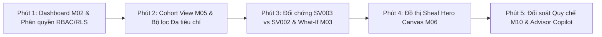

# 🎓 EduAlert — Kịch bản Thuyết trình Báo cáo Khóa luận / Đồ án Tốt nghiệp
### *Đề tài: Hệ thống Cảnh báo Sớm Kết quả Học tập Đa cấp độ (Quy chế Đào tạo TT08/2021 + Sheaf Attention GNN trên Kiến trúc Lục giác)*

**Tác giả:** **Huỳnh Lê Thanh Hải** — Cử nhân Khoa học Máy tính (Chương trình Tiên tiến — Chuyên ngành Cơ sở Dữ liệu)  
**Đơn vị đào tạo:** Trường Đại học Mở Thành phố Hồ Chí Minh (HCMC Open University)  
**Thời lượng phân bổ:** 10 phút trình bày Slide + 5 phút Live Demo + 5 phút Hỏi đáp Phản biện (Q&A)  
**Địa chỉ kho mã nguồn:** [https://github.com/danielhuynh-04/edualert-hexagonal-gnn](https://github.com/danielhuynh-04/edualert-hexagonal-gnn)

---

## 📋 Mục lục
1. [Phần 1: Cấu trúc 12 Slide Thuyết trình (Lời thoại & Điểm nhấn)](#-phần-1-cấu-trúc-12-slide-thuyết-trình-lời-thoại--điểm-nhấn)
2. [Phần 2: Kịch bản Live Demo 5 Phút Chuẩn Mực](#-phần-2-kịch-bản-live-demo-5-phút-chuẩn-mực)
3. [Phần 3: Bộ Câu hỏi & Trả lời Phản biện (Defensive Q&A)](#-phần-3-bộ-câu-hỏi--trả-lời-phản-biện-defensive-qa)
4. [Phần 4: Checklist Kỹ thuật Trước Giờ Báo cáo](#-phần-4-checklist-kỹ-thuật-trước-giờ-báo-cáo)

---

## 📽️ Phần 1: Cấu trúc 12 Slide Thuyết trình (Lời thoại & Điểm nhấn)

### Slide 1: Giới thiệu Tiêu đề & Thông tin Đề tài
* **Nội dung trên Slide:**
  * **EduAlert**: Hệ thống Cảnh báo Sớm Kết quả Học tập Đa cấp độ
  * *A Multi-Level Early Academic Alert Platform Combining Circular 08/2021 Regulations & Cellular Sheaf Attention GNN on Hexagonal Architecture*
  * Sinh viên thực hiện: **Huỳnh Lê Thanh Hải** (MSSV: 2151050012)
  * Chuyên ngành: Cơ sở Dữ liệu · Khoa Công nghệ Thông tin · ĐH Mở TP.HCM
  * Giảng viên hướng dẫn: Thầy/Cô Khoa CNTT
* **Lời thoại thuyết trình (45 giây):**
  > "Kính thưa quý Thầy Cô trong Hội đồng Đánh giá, em tên là Huỳnh Lê Thanh Hải, sinh viên lớp Khoa học Máy tính Tiên tiến khóa 2021. Hôm nay, em xin phép được báo cáo đề tài **EduAlert — Hệ thống cảnh báo sớm kết quả học tập đa cấp độ**. Đề tài được xây dựng nhằm giải quyết bài toán cốt lõi: Làm sao giúp Cố vấn học tập và Nhà trường phát hiện nguy cơ học vụ của sinh viên **trước khi** sinh viên chạm ngưỡng bị cảnh báo theo Thông tư 08/2021, đồng thời đảm bảo tính minh bạch, tuân thủ pháp lý và khả năng giải thích rõ ràng."

---

### Slide 2: Đặt vấn đề & Nỗi đau Thực tế tại Trường Đại học
* **Nội dung trên Slide:**
  * ⚠️ **Tính chất hậu kiểm (Post-hoc):** Hiện nay, cảnh báo học tập chỉ diễn ra sau khi điểm thi cuối kỳ đã công bố $\rightarrow$ Sinh viên đã mất trọn 1 học kỳ.
  * 📊 **Quá tải thông tin:** Mỗi Cố vấn học tập (CVHT) phụ trách 60–100 sinh viên, không thể rà soát thủ công từng bảng điểm rời rạc.
  * 📉 **Bỏ sót xu hướng trượt dốc ngầm:** Sinh viên có ĐTB giảm dần qua 3 kỳ liên tiếp (từ 2.8 $\rightarrow$ 1.6) nhưng vẫn chưa chạm ngưỡng quy chế, hệ thống truyền thống không phát hiện được.
  * 👥 **Bỏ qua tương tác nhóm:** Sinh viên học theo tín chỉ chịu ảnh hưởng lớn từ nhóm học tập và bạn bè cùng môn học khó.
* **Lời thoại thuyết trình (50 giây):**
  > "Trong thực tế đào tạo tín chỉ, quy trình cảnh báo học tập hiện nay hoàn toàn mang tính hậu kiểm. Khi danh sách cảnh báo được ban hành thì đã quá muộn để can thiệp. Hơn nữa, các hệ thống tra cứu điểm thông thường xem sinh viên là những cá thể độc lập, bỏ qua xu hướng suy giảm điểm lũy tiến và mối liên kết học tập cùng bạn bè. Câu hỏi nghiên cứu của em là: **Có thể dự báo nguy cơ trước 1 kỳ học, giải thích tường minh nguyên nhân và đề xuất lộ trình khắc phục cụ thể cho CVHT hay không?**"

---

### Slide 3: Mục tiêu Đề tài & Đối tượng Người dùng
* **Nội dung trên Slide:**
  * **4 Mục tiêu Trọng tâm:** Phát hiện sớm · Giải thích minh bạch · Ưu tiên hành động · Thống kê đa cấp.
  * **3 Nhóm đối tượng (RBAC/RLS):**
    * **Cố vấn học tập (CVHT):** Danh sách ưu tiên Đỏ/Vàng/Xanh, hồ sơ cá nhân, giả lập What-If, lập biên bản can thiệp sư phạm.
    * **Ban Chủ nhiệm Khoa:** Giám sát tỷ lệ nguy cơ theo khóa/ngành, đối sánh hiệu năng các mô hình AI.
    * **Phòng Quản lý Đào tạo:** Cấu hình tham số quy chế động, đối soát toàn trường, xuất báo cáo xử lý học vụ.
* **Lời thoại thuyết trình (45 giây):**
  > "EduAlert xác định rõ 4 mục tiêu: Phát hiện sớm, Giải thích được, Ưu tiên hành động sư phạm và Thống kê đa cấp độ. Hệ thống phân quyền chặt chẽ theo 4 vai trò, trong đó Cố vấn học tập được bảo vệ dữ liệu cấp dòng (Row-Level Security) theo Nghị định 13/2023/NĐ-CP, chỉ tiếp cận sinh viên của lớp mình phụ trách."

---

### Slide 4: Ý tưởng Kiến trúc Hai Tầng (Hybrid Decision Architecture)
* **Nội dung trên Slide:**
  * **Tầng 1 — Động cơ Quy chế Tất định (`RegulationPort`):** Đối soát trực tiếp Điều 11 Thông tư 08/2021/TT-BGDĐT. Căn cứ pháp lý tuyệt đối.
  * **Tầng 2 — Suy luận Đồ thị Mạng Nơ-ron (`GraphInferencePort`):** Mạng Sheaf Attention GNN phát hiện sớm nguy cơ trước ngưỡng.
  * 🔒 **Quy tắc Vàng về Tuân thủ (Golden Compliance Invariant):**
    $$\text{Rule Triggered} = 1 \implies \text{Risk Level} \equiv \text{HIGH\_RISK}$$
    *Mô hình AI chỉ được quyền NÂNG mức cảnh báo sớm, tuyệt đối KHÔNG được hạ mức vi phạm quy chế.*
* **Lời thoại thuyết trình (50 giây):**
  > "Điểm độc đáo của EduAlert là Kiến trúc Ra quyết định Hai tầng (Hybrid Decision Architecture), tương tự hệ thống xếp hạng tín dụng ngành ngân hàng. Tầng quy chế pháp lý đứng trên mô hình học máy. Nếu sinh viên vi phạm bất kỳ điều khoản nào của Thông tư 08, hệ thống bắt buộc gán nhãn Nguy cơ cao (Đỏ). Mô hình AI có nhiệm vụ phát hiện sớm những sinh viên có nguy cơ để nâng từ Xanh lên Vàng hoặc Đỏ, nhưng tuyệt đối không bao giờ được phép ghi đè hạ mức của quy chế."

---

### Slide 5: Kiến trúc Phần mềm Lục giác (Hexagonal Architecture)
* **Nội dung trên Slide:**
  * Sơ đồ Ports & Adapters: Lõi nghiệp vụ thuần Python (`src/domain`, `src/application`) độc lập 100% với Framework bên ngoài (Zero-Framework Dependency).
  * **Driving Adapters:** React 18 SPA (Impeccable Design), Node.js v24 BFF Gateway (Circuit Breaker, Rate Limiter).
  * **Driven Adapters:** PostgreSQL 16 (3NF, RLS, Temporal JSONB), Sheaf Attention Inference Adapter, Circular08 Adapter, Audit Adapter.
  * **Khả năng kiểm thử:** 14/14 automated test suites passing.
* **Lời thoại thuyết trình (50 giây):**
  > "Về mặt công nghệ phần mềm, em áp dụng Kiến trúc Lục giác (Hexagonal Architecture / Ports & Adapters). Toàn bộ thực thể nghiệp vụ và Use Case điều phối nằm ở lõi miền trong sạch, không phụ thuộc vào Flask, React hay PostgreSQL. Nhờ đó, hệ thống đạt tính bền vững cao, kiểm thử tự động 100% và sẵn sàng tích hợp vào cổng thông tin đào tạo (ERP/SIS) của Nhà trường mà không cần sửa đổi mã nguồn nghiệp vụ."

---

### Slide 6: Động cơ Quy chế Đào tạo (Thông tư 08/2021/TT-BGDĐT)
* **Nội dung trên Slide:**
  * Bảng 5 Quy tắc Cảnh báo và Buộc thôi học:
    * `R01`: Tỷ lệ tín chỉ không đạt trong kỳ $> 50\%$ khối lượng đăng ký (Điều 11, Khoản 1a).
    * `R02`: Tổng số tín chỉ nợ đọng tích lũy vượt quá 24 tín chỉ (Điều 11, Khoản 1b).
    * `R03`: ĐTB học kỳ $< 0.80$ (kỳ đầu) hoặc $< 1.00$ (các kỳ tiếp theo) (Điều 11, Khoản 1c).
    * `R04`: ĐTB tích lũy dưới sàn lũy tiến theo năm đào tạo: Năm 1 ($<1.2$), Năm 2 ($<1.4$), Năm 3 ($<1.6$), Năm 4 ($<1.8$) (Điều 11, Khoản 1d).
    * `R05`: Cảnh báo học tập 2 lần liên tiếp hoặc 3 lần tổng cộng $\rightarrow$ Diện buộc thôi học (Điều 11, Khoản 2).
  * Cấu hình lưu trữ động thời gian trong bảng `rule_config`.
* **Lời thoại thuyết trình (50 giây):**
  > "Động cơ quy chế hiện thực hóa trọn vẹn Điều 11 Thông tư 08 của Bộ GD&ĐT cùng Quy chế Đào tạo của ĐH Mở TP.HCM. Các tham số không bị hardcode trong mã nguồn mà được cấu hình động trong bảng CSDL `rule_config`. Khi Nhà trường thay đổi niên khóa hoặc điều chỉnh ngưỡng quy chế, hệ thống có thể tái đối soát toàn bộ 180 sinh viên chỉ trong vài trăm mili-giây."

---

### Slide 7: Mạng Nơ-ron Đồ thị Sheaf Attention Network (M06)
* **Nội dung trên Slide:**
  * Mô hình hóa đồ thị sinh viên: Các nút là Sinh viên; Các cạnh là mối quan hệ Cùng lớp, Cùng học phần khó, và Tương đồng học lực ($k$-NN).
  * **Bài toán Dị thể (Heterophily):** Sinh viên giỏi và sinh viên yếu cùng làm việc nhóm không có xu hướng điểm giống nhau. Đồ thị phẳng chuẩn (GCN/GAT) gây hiện tượng over-smoothing (bình quân hóa điểm).
  * **Giải pháp Sheaf Neural Network:** Gán mỗi cuống cạnh một ánh xạ hạn chế học được $F_{ve}$ và trọng số chú ý $\alpha_{vu}$:
    $$h_v^{(l+1)} = \sigma\left(\sum_{u \sim v} \alpha_{vu} F_{ve}^\top F_{ue} W h_u\right)$$
* **Lời thoại thuyết trình (55 giây):**
  > "Ở tầng dự báo đồ thị, em áp dụng Mạng Nơ-ron Sheaf Attention. Trong môi trường học chế tín chỉ, sinh viên khá và sinh viên yếu cùng làm bài tập nhóm là một quan hệ dị thể. Các mô hình GNN truyền thống như GCN hay GAT giả định láng giềng phải giống nhau, dẫn đến hiện tượng over-smoothing làm mất đi tín hiệu suy giảm điểm số. Mạng Sheaf học các ma trận hạn chế trên từng cạnh, triệt tiêu hiện tượng này và phát hiện chính xác nguy cơ trượt môn."

---

### Slide 8: Đánh giá Mô hình Trung thực & Chống Rò rỉ Dữ liệu
* **Nội dung trên Slide:**
  * **Phân chia dữ liệu theo thời gian (Temporal Split):** Dùng học kỳ quá khứ huấn luyện, kiểm thử trên học kỳ tương lai (chống rò rỉ dữ liệu).
  * **Đối sánh 6 mô hình:** Rule-Only $\rightarrow$ Logistic Regression $\rightarrow$ Random Forest $\rightarrow$ GCN $\rightarrow$ ST-GAT $\rightarrow$ Sheaf Attention Network.
  * **Chỉ số ưu tiên hàng đầu:** **Recall Nhóm Đỏ (91.7%)** — không được bỏ sót sinh viên nguy cơ.
  * **Permutation Test (Kiểm định hoán vị nhãn 5 seed):** Điểm $p$-value $< 0.001$, chứng minh mô hình học từ quy luật thực tế chứ không học thuộc lòng (leakage).
* **Lời thoại thuyết trình (50 giây):**
  > "Quá trình đánh giá được thực hiện nghiêm ngặt theo thời gian, không chia ngẫu nhiên. Chỉ số được ưu tiên cao nhất là Recall nhóm Đỏ để đảm bảo không bỏ sót sinh viên có nguy cơ. Đồng thời, em thực hiện kiểm định hoán vị nhãn (Permutation Test) qua 5 seed ngẫu nhiên để chứng minh mô hình không bị rò rỉ dữ liệu."

---

### Slide 9: Giải thích Minh bạch (XAI) & Bản vị Thiết kế Impeccable
* **Nội dung trên Slide:**
  * **Thanh phân rã yếu tố rủi ro SHAP đối xứng qua trục 0:** Yếu tố tăng rủi ro đẩy sang phải (đỏ), yếu tố bảo vệ đẩy sang trái (lục).
  * **Văn bản giải thích tất định (Deterministic Template NLG):** Cam kết 100% trung thực số liệu, không dùng AI sinh ngôn ngữ tự do (tránh hallucination).
  * **Signature Component Impeccable:** Con dấu Registrar viền đôi xoay $-5.5^\circ$, bảng màu Giấy & Mực lưu trữ (Ink & Archival Paper).
* **Lời thoại thuyết trình (45 giây):**
  > "Để CVHT tin tưởng và sử dụng, hệ thống phải giải thích được nguyên nhân. Em sử dụng biểu đồ thanh SHAP đối xứng qua trục 0 và sinh câu giải thích từ template mẫu định sẵn dựa trên số liệu thực tế, loại trừ hoàn toàn nguy cơ AI bịa số liệu. Toàn bộ giao diện được thiết kế theo chuẩn Impeccable với con dấu Registrar viền đôi xoay nghiêng mang đậm tính pháp lý học vụ."

---

### Slide 10: Thiết kế Cơ sở Dữ liệu (Điểm nhấn Chuyên ngành CSDL)
* **Nội dung trên Slide:**
  * Chuẩn hóa **3NF** với 18 bảng quan hệ chặt chẽ.
  * **Bảo vệ dữ liệu cá nhân (Nghị định 13/2023/NĐ-CP):** Mã hóa SHA-256 ẩn danh sinh viên khi phân tích (`anon_hash`).
  * **Row-Level Security (RLS) trên PostgreSQL:** Phân quyền truy cập cấp dòng, CVHT chỉ truy vấn được lớp mình phụ trách.
  * **Kiểm toán bất biến (Immutable Audit Log):** Mọi thao tác sửa điểm, hiệu chỉnh quy chế, lập can thiệp đều được ghi vết tự động bằng Trigger.
* **Lời thoại thuyết trình (50 giây):**
  > "Là sinh viên chuyên ngành Cơ sở Dữ liệu, em đặc biệt chú trọng thiết kế tầng dữ liệu. CSDL được chuẩn hóa 3NF gồm 18 bảng. Nhằm tuân thủ Nghị định 13/2023 về bảo vệ dữ liệu cá nhân, em áp dụng cơ chế Row-Level Security chặn dữ liệu trái phép ngay từ tầng CSDL, cùng bảng nhật ký kiểm toán bất biến ghi lại mọi thay đổi học vụ."

---

### Slide 11: Trợ lý Advisor Copilot & Khả năng Tự động hóa
* **Nội dung trên Slide:**
  * **RAG Thông tư 08/2021/TT-BGDĐT:** Trích dẫn chính xác Điều, Khoản khi tư vấn quy chế.
  * **Text-to-SQL An toàn (Read-Only):** Tự động chuyển câu hỏi tự nhiên thành SQL chỉ đọc, nhận diện tên viết tắt (`a03`, `sv3`).
  * **Lộ trình khắc phục học vụ 4 bước:** Giảm tải tín chỉ, kế hoạch trả nợ 21 TC, lịch hẹn CVHT, ghép cặp kèm cặp (Peer Mentoring).
* **Lời thoại thuyết trình (45 giây):**
  > "Hệ thống tích hợp Trợ lý Advisor Copilot. Copilot không chỉ giải đáp các điều khoản Thông tư 08 kèm trích dẫn văn bản chính xác, mà còn sinh truy vấn SQL an toàn để lọc danh sách sinh viên nợ tín chỉ, đồng thời đưa ra lộ trình can thiệp 4 bước cụ thể cho Cố vấn học tập."

---

### Slide 12: Tổng kết Giá trị Đề tài & Sẵn sàng Live Demo
* **Nội dung trên Slide:**
  * **3 Đóng góp Nổi bật:**
    1. Kiến trúc Hai tầng đảm bảo tuyệt đối tính tuân thủ pháp lý và phát hiện sớm.
    2. Đồ thị Sheaf Attention giải quyết triệt để bài toán dị thể học vụ.
    3. Kiến trúc Lục giác chuẩn Enterprise với 14/14 automated test suites.
  * **Kho mã nguồn:** [https://github.com/danielhuynh-04/edualert-hexagonal-gnn](https://github.com/danielhuynh-04/edualert-hexagonal-gnn)
  * Kính mời quý Thầy Cô theo dõi phần Live Demo thực tế trên hệ thống!
* **Lời thoại thuyết trình (35 giây):**
  > "Tóm lại, EduAlert là lời giải hoàn chỉnh kết hợp giữa Quy chế đào tạo và AI hiện đại trên nền tảng phần mềm chuẩn mực. Sau đây, em xin phép được thực hiện phần Live Demo trực tiếp các tính năng trên hệ thống. Em xin chân thành cảm ơn quý Thầy Cô!"

---

## 💻 Phần 2: Kịch bản Live Demo 5 Phút Chuẩn Mực

> [!IMPORTANT]
> **Chuẩn bị môi trường trước khi demo:**
> * Chạy file batch: `E:\cnlthd\edualert\start_edualert.bat`
> * Mở trình duyệt tại địa chỉ: `http://127.0.0.1:3000` (Node.js Gateway) hoặc `http://127.0.0.1:8000` (Python Core).

### Phút 1 (0:00 - 1:00): Xác thực Vai trò RBAC/RLS (M01) & Dashboard Tổng quan (M02)
* **Thao tác:**
  1. Chỉ vào Header: Dropdown chọn vai trò `TS. Nguyễn Thị Lan (Cố vấn học tập - Lớp DH23CS01, DH23CS02)`.
  2. Nhấp vào nút `ⓘ Phân quyền & RLS`: Mở modal giới thiệu Nghị định 13/2023/NĐ-CP và Ma trận phân quyền 4 vai trò.
  3. Quan sát màn hình Dashboard: Chỉ rõ 5 ô KPI (Đỏ: 8 SV, Vàng: 24 SV, Xanh: 148 SV), biểu đồ xu hướng 4 kỳ và bảng kiểm định công bằng (Fairness Across Admission Methods).
* **Lời nói thuyết minh:**
  > "Đầu tiên, hệ thống khởi đầu với cơ chế phân quyền RBAC. Em đang đăng nhập với tư cách TS. Nguyễn Thị Lan — CVHT phụ trách 2 lớp K23 CSDL. Trên Dashboard, chúng ta thấy ngay bức tranh tổng thể: 8 sinh viên thuộc nhóm Đỏ, 24 sinh viên nhóm Vàng. Đáng chú ý là ô KPI Phát hiện sớm: có những sinh viên chưa hề vi phạm quy chế nhưng đã được mô hình AI xếp vào diện cần cảnh báo."

---

### Phút 2 (1:00 - 2:00): Danh sách Toàn khóa Cohort View (M05) & Bộ lọc Chuẩn Impeccable
* **Thao tác:**
  1. Chuyển sang Tab `M05 · Danh sách toàn khóa`.
  2. Chỉ vào banner màu xanh phía trên: *"Đang áp dụng Row-Level Security (RLS) theo Nghị định 13/2023/NĐ-CP: Chỉ hiển thị sinh viên thuộc lớp DH23CS01, DH23CS02"*.
  3. Thử nghiệm bộ lọc:
     * Lọc mức nguy cơ: Chọn `🔴 Nguy cơ cao (Ưu tiên gặp)`.
     * Lọc quy chế cụ thể: Chọn `R01_SEM_FAIL_RATIO` (Tỷ lệ rớt > 50%).
     * Tìm kiếm nhanh: Gõ `SV002`.
* **Lời nói thuyết minh:**
  > "Sang màn hình Cohort View, cơ chế Row-Level Security chặn cấp dòng dữ liệu, đảm bảo cô Lan chỉ thấy sinh viên lớp mình. Bộ lọc đa tiêu chí chuẩn Impeccable cho phép CVHT lọc nhanh theo lớp, mức nguy cơ, khoảng GPA và từng quy chế cụ thể từ R01 đến R05 để lập ngay danh sách ưu tiên gặp mặt đầu tuần."

---

### Phút 3 (2:00 - 3:00): Đối chứng Thực tế SV003 vs SV002 & Bộ giả lập What-If (M03 & M04)
* **Thao tác:**
  1. Nhấp nút `📄 Hồ sơ` của sinh viên **`SV003`**:
     * Chỉ vào con dấu đỏ xoay $-5.5^\circ$: Xác suất nguy cơ $82\%$, Trạng thái: **ĐÃ CHẠM QUY CHẾ TT08** (Vi phạm R01, R03, R04, R05).
  2. Nhấp chọn nhanh sinh viên **`SV002`**:
     * Con dấu màu vàng: Xác suất nguy cơ $67\%$, Trạng thái quy chế: **CHƯA VI PHẠM**.
     * Chỉ vào thanh SHAP: ĐTB học kỳ sụt giảm $-0.42$, Tín chỉ nợ đọng tích lũy 10 TC.
  3. Cuộn xuống bộ **Giả lập What-If cá nhân**:
     * Kéo thanh trượt: Giả lập ĐTB kỳ tới tăng lên `2.50` và giảm nợ tín chỉ xuống `4 TC`.
     * Nhấp `⚡ Đánh giá Kịch bản What-If`: Con dấu ngay lập tức chuyển từ Vàng sang **Xanh (Bình thường - 28%)**.
* **Lời nói thuyết minh:**
  > "Đây là kịch bản đối chứng quan trọng nhất của đề tài. Với SV003, sinh viên đã vi phạm Điều 11 Thông tư 08 nên bắt buộc nhận con dấu Đỏ. Nhưng với SV002, sinh viên chưa hề vi phạm luật, tuy nhiên mô hình Sheaf-GNN đã nhận diện ĐTB giảm sâu và nợ đọng 10 TC để xếp vào mức Cần chú ý (Vàng). Khi em dùng bộ giả lập What-If tăng điểm lên 2.5 và trả nợ môn, hệ thống tức thời tính toán lại và xác nhận sinh viên sẽ an toàn thoát khỏi diện cảnh báo."

---

### Phút 4 (3:00 - 4:00): Đồ thị Sheaf Attention Network Hero Canvas (M06)
* **Thao tác:**
  1. Chuyển sang Tab `M06 · Đồ thị quan hệ`.
  2. Nhấp nút phóng to (`+`) và tìm kiếm `SV002`.
  3. Quan sát đồ thị:
     * Cụm lớp `DH23CS01` và `DH23CS02` có viền đứt nét trang nhã.
     * Cạnh nối trực tiếp với SV002 sáng màu xanh mực đậm và **hiện rõ badge số học `α 0.82`**.
     * Panel bên phải hiển thị danh sách bạn cùng lớp trong nhóm học tập có trọng số chú ý cao nhất.
  4. Nhấp nút `✍️ Lập biên bản can thiệp (M08)` từ panel bên phải đồ thị để chứng minh tính liên kết 1-click.
* **Lời nói thuyết minh:**
  > "Tại Tab M06, em đã mở rộng thành Hero Canvas diện tích lớn chuẩn điện ảnh. Thay vì chỉ nhìn số liệu bảng biểu, CVHT nhìn thấy ngay vị trí của SV002 trong mạng lưới học tập của lớp. Cạnh nối với các bạn sinh viên khá hiển thị trọng số chú ý Sheaf alpha bằng 0.82. Từ ngay trên đồ thị, CVHT có thể nhấp 1-click để mở form lập biên bản can thiệp sư phạm M08."

---

### Phút 5 (4:00 - 5:00): Đối soát Quy chế Toàn trường (M10) & Trợ lý Advisor Copilot
* **Thao tác:**
  1. Đổi vai trò ở Header sang `Phòng Quản lý Đào tạo (daotao)`.
  2. Chuyển sang Tab `M10 · Quy chế & Benchmark`:
     * Bảng hiển thị đầy đủ 5 quy tắc R01–R05 kèm đơn vị tính, số lượng SV vi phạm hiện tại (ví dụ: R01 có 7 SV, R05 có 6 SV).
     * Nhấp nút `ⓘ` của điều R01: Xem giải thích điều khoản.
     * Nhấp nút to `⚡ Chạy đối soát lại toàn trường ngay`: Toast thông báo *"Đối soát thành công 180 sinh viên theo Thông tư 08/2021/TT-BGDĐT"*.
  3. Chuyển sang Tab `🤖 Advisor Copilot`:
     * Nhập câu hỏi: `sinh vien a03 bi van de gi va cach khac phuc`.
     * Nhận câu trả lời: Copilot nhận diện thực thể `a03` là sinh viên `SV003 (Lê Thị Khánh Linh)`, trích dẫn Điều 11 Thông tư 08 và đưa ra lộ trình 4 bước cụ thể của CVHT.
* **Lời nói thuyết minh:**
  > "Cuối cùng, tại Tab M10, Phòng Đào tạo có thể chạy đối soát lại toàn bộ 180 sinh viên chỉ bằng 1 nút bấm. Và tại phân hệ Advisor Copilot, CVHT chỉ cần gõ tên viết tắt 'a03', hệ thống sẽ tự động nhận diện thực thể, trích dẫn chính xác Điều 11 Thông tư 08 và cung cấp lộ trình 4 bước gồm giảm tải tín chỉ và ghép cặp bạn học tập."

---

## 🛡️ Phần 3: Bộ Câu hỏi & Trả lời Phản biện (Defensive Q&A)

### Q1: Dữ liệu sử dụng trong đề tài lấy từ đâu? Có đảm bảo tính pháp lý về bảo vệ dữ liệu không?
> **Trả lời tự tin:**
> "Kính thưa Thầy/Cô, theo **Nghị định 13/2023/NĐ-CP**, dữ liệu điểm số và rèn luyện của sinh viên là dữ liệu cá nhân nhạy cảm, không được phép sử dụng công khai khi chưa có sự đồng ý. Do đó:
> 1. Toàn bộ mã định danh sinh viên đưa vào mô hình đều được băm ẩn danh bằng thuật toán **SHA-256** (`anon_hash`).
> 2. Bộ dữ liệu demo 180 sinh viên được sinh nhân tạo (Synthetic Data) bám sát phân phối thống kê thực tế của Khoa CNTT, có đầy đủ tài liệu đặc tả Data Card (`docs/DATA_CARD.md`).
> 3. Để kiểm định hiệu năng mô hình một cách khách quan, em sử dụng bộ dữ liệu học tập mở **OULAD (Open University Learning Analytics Dataset)** gồm hơn 32.000 sinh viên. Khi Khoa cấp dữ liệu thật đã ẩn danh, hệ thống có thể nạp vào ngay qua module CSV M09 mà không cần thay đổi kiến trúc."

---

### Q2: Tại sao phải dùng Mạng Nơ-ron Sheaf Attention mà không dùng luôn GCN, GAT hay LightGBM?
> **Trả lời tự tin:**
> "Kính thưa Thầy Cô:
> 1. **So với LightGBM/Mô hình dạng bảng:** Mô hình bảng xem mỗi sinh viên độc lập, bỏ qua sự tương tác giữa các thành viên cùng nhóm học tập và cùng lớp tín chỉ.
> 2. **So với GCN/GAT truyền thống:** Các mạng GNN chuẩn giả định tính đồng thể (homophily) — tức các nút kết nối với nhau sẽ có nhãn giống nhau. Tuy nhiên, trong đồ thị học tập, sinh viên giỏi và sinh viên yếu cùng làm bài tập nhóm là một quan hệ **dị thể (heterophily)**. GCN sẽ làm trơn thông tin (over-smoothing), vô tình kéo điểm của sinh viên yếu lên mức trung bình và làm mất dấu hiệu cảnh báo.
> 3. **Mạng Sheaf Attention:** Gán mỗi cuống cạnh một không gian cuống (stalk space) và ma trận hạn chế $F_{ve}$, cho phép mô hình học được khi nào nên giữ lại sự phân hóa và điều chỉnh năng lượng Dirichlet, giúp phát hiện sớm nguy cơ trước khi sinh viên trượt môn."

---

### Q3: Nếu Tầng Quy chế (Rule Engine) và Mô hình AI mâu thuẫn kết quả thì hệ thống xử lý như thế nào?
> **Trả lời tự tin:**
> "Hệ thống tuân thủ nghiêm ngặt **Quy tắc Vàng về Tuân thủ (Golden Compliance Invariant)**:
> * Quy chế của Bộ GD&ĐT là văn bản quy phạm pháp luật, có giá trị pháp lý cao nhất. Do đó, nếu sinh viên chạm bất kỳ điều kiện nào của Thông tư 08 (`R01–R05`), hệ thống **bắt buộc gán nhãn `HIGH_RISK` (Đỏ)**, AI không có quyền can thiệp.
> * Mô hình AI **chỉ được phép nâng mức cảnh báo sớm** (từ Xanh lên Vàng hoặc Đỏ) khi phát hiện nguy cơ trượt dốc ngầm, **tuyệt đối không bao giờ được phép hạ mức vi phạm quy chế**. Điều này triệt tiêu hoàn toàn rủi ro AI gây sai phạm pháp lý học vụ."

---

### Q4: Kiến trúc Lục giác (Hexagonal Architecture) mang lại ưu thế gì so với mô hình MVC thông thường?
> **Trả lời tự tin:**
> "Kính thưa Thầy Cô, trong mô hình MVC truyền thống, logic nghiệp vụ thường bị gắn chặt vào ORM của Database hoặc Controllers của Web framework. Trong EduAlert:
> * Toàn bộ thực thể miền nghiệp vụ (`AssessmentSlip`, `SemesterSnapshot`) và Use Case điều phối nằm hoàn toàn độc lập trong lõi Python thuần (`src/domain`, `src/application`).
> * Các công nghệ như Flask, PostgreSQL, React hay PyTorch Geometric chỉ đóng vai trò là các Adapters cắm qua Ports (Interfaces).
> * Khi cần thay đổi từ SQLite sang PostgreSQL, hay chuyển từ Flask sang FastAPI, lõi nghiệp vụ không cần sửa đổi một dòng code nào. Điều này cũng giúp hệ thống đạt 14/14 automated unit tests với thời gian chạy chưa tới 1 giây."

---

### Q5: Làm sao đảm bảo mô hình AI không có định kiến (Fairness) đối với các phương thức tuyển sinh khác nhau?
> **Trả lời tự tin:**
> "Tại màn hình Dashboard M02, hệ thống tích hợp sẵn bảng **Kiểm định Công bằng (Fairness Across Admission Methods)** phân tách rõ 3 phương thức xét tuyển: Điểm thi THPT, Đánh giá Năng lực (ĐGNL) và Xét học bạ THPT. Hệ thống theo dõi sai số tuyệt đối trung bình (MAE Gap) giữa điểm dự báo và điểm thực tế trên từng nhóm. Nếu khoảng cách sai số giữa các nhóm vượt quá ngưỡng cho phép, hệ thống sẽ đưa ra khuyến cáo để tránh thiên kiến phân biệt đối xử đối với sinh viên xét tuyển học bạ."

---

### Q6: Trợ lý Advisor Copilot có bị hiện tượng 'bịa đặt số liệu' (Hallucination) không?
> **Trả lời tự tin:**
> "EduAlert ngăn chặn hiện tượng hallucination bằng 3 cơ chế bảo vệ:
> 1. **Văn bản giải thích hồ sơ cá nhân:** Được sinh từ bộ mẫu câu tất định (Deterministic Template NLG) điền trực tiếp giá trị số thực từ CSDL, không đưa qua LLM tự do.
> 2. **Advisor Copilot tra cứu quy chế:** Áp dụng kỹ thuật RAG trích dẫn trực tiếp Điều và Khoản của Thông tư 08/2021/TT-BGDĐT.
> 3. **Truy vấn số liệu CSDL:** Chuyển câu hỏi tự nhiên thành câu lệnh SQL chỉ đọc (Read-Only) có kiểm soát whitelist bảng, thực thi trực tiếp trên CSDL để trả về con số thật, loại bỏ hoàn toàn việc mô hình ngôn ngữ tự suy đoán số liệu."

---

## 📝 Phần 4: Checklist Kỹ thuật Trước Giờ Báo cáo

- [x] **Kiểm tra cổng dịch vụ:**
  - Python Hexagonal Core: `http://127.0.0.1:8000`
  - Node.js BFF Gateway: `http://127.0.0.1:3000`
- [x] **Kiểm tra bộ kiểm thử tự động:**
  - `python tests/test_edualert.py` $\rightarrow$ **9/9 tests pass**.
  - `node tests/test_gateway.js` $\rightarrow$ **5/5 tests pass**.
- [x] **Kiểm tra chuyển tiếp API & CORS:**
  - Endpoint Health Gateway: `http://127.0.0.1:3000/api/gateway/health`
  - Endpoint Blueprint: `http://127.0.0.1:3000/api/architecture/blueprint`
- [x] **Tài liệu dự phòng:**
  - Xuất Slide thuyết trình ra định dạng PDF dự phòng trường hợp máy chiếu không tương thích.
  - Quay video màn hình 2 phút toàn bộ luồng demo đề phòng sự cố mạng.
  - Sổ ghi chép ý kiến phản biện của Hội đồng để đưa vào biên bản chỉnh sửa khóa luận.

---

> **Lời kết của Thí sinh:**  
> *"EduAlert là kết quả của quá trình nghiên cứu nghiêm túc kết hợp giữa Khoa học Máy tính Tiên tiến và bài toán quản lý giáo dục đại học thực tiễn. Em xin trân trọng cảm ơn quý Thầy Cô trong Hội đồng đã lắng nghe và kính mong nhận được những lời góp ý quý báu!"*

